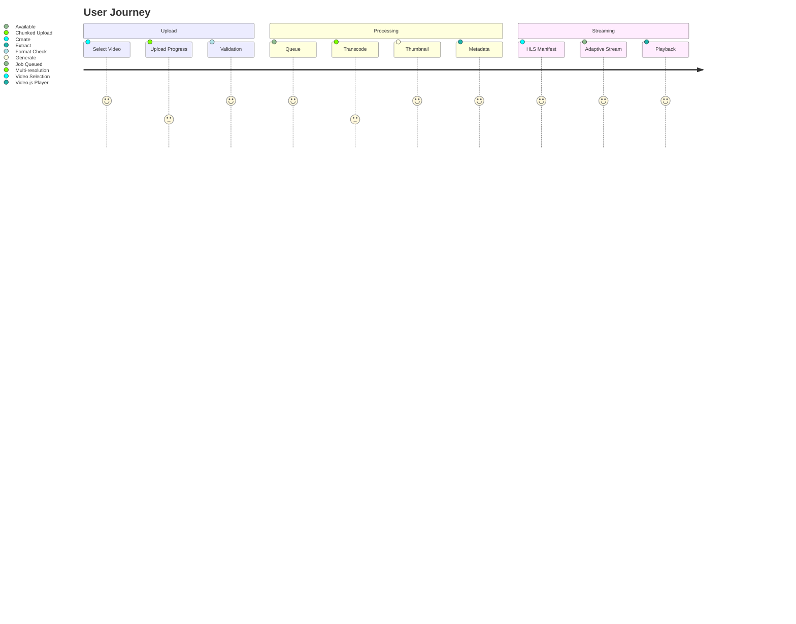
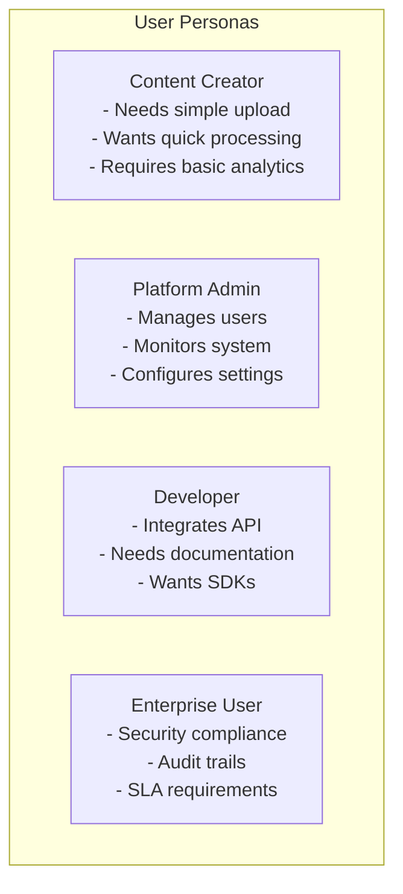

# Project Vision

## Purpose

This document articulates the long-term vision, mission, and strategic direction for the Automated Cloud-Native Video Transcoding and Streaming Platform.

## Scope

High-level product vision, target market, value proposition, and success metrics.

## Audience

- Product Managers
- Stakeholders
- Engineering Teams
- Business Leadership

## Dependencies

- [00_Project_Standards.md](./00_Project_Standards.md) - Development standards
- [05_Tech_Stack.md](./05_Tech_Stack.md) - Technology capabilities

## Related Documents

- [02_Requirements.md](./02_Requirements.md) - Detailed requirements
- [03_PRD.md](./03_PRD.md) - Product requirements
- [04_System_Architecture.md](./04_System_Architecture.md) - Technical architecture

## Table of Contents

1. [Vision Statement](#vision-statement)
2. [Mission Statement](#mission-statement)
3. [Problem Statement](#problem-statement)
4. [Solution Overview](#solution-overview)
5. [Target Market](#target-market)
6. [Value Proposition](#value-proposition)
7. [Success Metrics](#success-metrics)
8. [Strategic Goals](#strategic-goals)
9. [Competitive Analysis](#competitive-analysis)
10. [Product Strategy](#product-strategy)
11. [Design Decisions](#design-decisions)
12. [Notes](#notes)
13. [References](#references)
14. [Future Documents](#future-documents)
15. [Revision History](#revision-history)

## Vision Statement

> To become the leading cloud-native video processing platform that enables content creators, enterprises, and developers to seamlessly transcode, store, and stream video content at any scale with enterprise-grade reliability, security, and performance.

## Mission Statement

> We build a fully automated, scalable, and developer-friendly video transcoding and streaming platform that eliminates the complexity of video processing while providing broadcast-quality adaptive streaming capabilities through a modern cloud-native architecture.

## Problem Statement

### Current Challenges

| Challenge | Impact |
|-----------|--------|
| **Complex Video Processing** | Developers spend weeks implementing transcoding pipelines |
| **Scalability Issues** | Existing solutions fail under high concurrent load |
| **Cost Inefficiency** | Over-provisioning of resources for variable workloads |
| **Poor Developer Experience** | Fragmented APIs, inconsistent documentation |
| **Limited Format Support** | Missing support for modern codecs and adaptive streaming |
| **No Observability** | Lack of monitoring and debugging capabilities |
| **Security Gaps** | Inadequate authentication, authorization, and data protection |

### Market Pain Points

- Content creators need simple upload-to-stream workflows
- Enterprises require compliance and audit trails
- Developers demand API-first, well-documented solutions
- Operations teams need observability and alerting

## Solution Overview

### Core Capabilities

### Platform Features

| Feature | Description |
|---------|-------------|
| **Automated Transcoding** | Upload any format, get HLS adaptive streaming |
| **Multi-resolution Output** | 240p, 360p, 480p, 720p, 1080p, 4K |
| **Smart Queue System** | Priority-based job processing with retries |
| **Enterprise Security** | RBAC, JWT, audit logs, encryption |
| **Real-time Monitoring** | Prometheus metrics, Grafana dashboards |
| **Developer APIs** | RESTful API with Swagger documentation |
| **Scalable Storage** | S3-compatible with MinIO/R2 |

## Target Market

### Primary Segments

| Segment | Characteristics |
|---------|-----------------|
| **Content Creators** | YouTubers, streamers, educators uploading educational content |
| **Media Companies** | News, entertainment, corporate communications |
| **E-learning Platforms** | Online course providers, training organizations |
| **Developers** | Building video features into applications |

### User Personas

## Value Proposition

### For Content Creators

- **Zero Infrastructure**: No servers to manage
- **Instant Processing**: Automatic transcoding on upload
- **Global Streaming**: HLS adaptive streaming out of the box
- **Simple Pricing**: Pay for what you use

### For Enterprises

- **Security First**: Enterprise-grade authentication and authorization
- **Compliance Ready**: Audit logs, data encryption, RBAC
- **Scalable**: Handle any volume of video content
- **Observable**: Full metrics and monitoring

### For Developers

- **API First**: Well-documented REST API
- **Type Safe**: TypeScript SDK and type definitions
- **Extensible**: Plugin architecture for custom workflows
- **Modern Stack**: React, Next.js, NestJS, Prisma

## Success Metrics

### Business Metrics

| Metric | Target | Measurement |
|--------|--------|-------------|
| **Monthly Active Users** | 10,000 by Q4 2024 | User logins |
| **Videos Processed** | 1M by Q4 2024 | Successful transcoding jobs |
| **Uptime** | 99.9% | System availability |
| **Customer Satisfaction** | 4.5/5 NPS | Quarterly surveys |

### Technical Metrics

| Metric | Target | Measurement |
|--------|--------|-------------|
| **API Response Time** | < 100ms p95 | Prometheus metrics |
| **Transcoding Time** | < 2x video duration | Job completion time |
| **Error Rate** | < 0.1% | Failed jobs / total jobs |
| **Test Coverage** | > 80% | Jest coverage reports |

## Strategic Goals

### Phase 1: Foundation (Q1 2024)

- ✅ Core transcoding pipeline
- ✅ User authentication and RBAC
- ✅ Basic video library
- ✅ HLS streaming support

### Phase 2: Scale (Q2 2024)

- ✅ Chunked upload for large files
- ✅ Advanced analytics dashboard
- ✅ Webhook notifications
- ✅ Performance optimization

### Phase 3: Enterprise (Q3 2024)

- ✅ Audit logging
- ✅ Advanced security features
- ✅ Custom transcoding profiles
- ✅ API rate limiting

### Phase 4: Innovation (Q4 2024)

- ✅ AI subtitle generation
- ✅ Watermarking support
- ✅ DRM integration
- ✅ Kubernetes deployment

## Competitive Analysis

### Direct Competitors

| Platform | Strengths | Weaknesses |
|----------|-----------|------------|
| **AWS MediaConvert** | Enterprise scale, AWS integration | Complex, expensive, vendor lock-in |
| **Cloudinary** | Easy integration, good docs | Limited control, pricing |
| **Mux** | Great developer experience | Less customization, cost |
| **Vimeo** | Brand recognition | Not API-first, limited control |

### Our Advantages

| Advantage | Description |
|-----------|-------------|
| **Open Source Friendly** | No vendor lock-in, self-hostable |
| **Developer First** | API-first design, comprehensive docs |
| **Cost Effective** | Optimized resource usage, competitive pricing |
| **Cloud Native** | Container-first, Kubernetes ready |
| **Extensible** | Plugin architecture, custom workflows |

## Product Strategy

### Go-to-Market

1. **Developer Preview** - Early access for feedback
2. **Beta Launch** - Limited production access
3. **GA Release** - Full production availability
4. **Enterprise Tier** - Advanced features and support

### Pricing Model

| Tier | Features |
|------|----------|
| **Free** | 10GB storage, 100 hours/month transcoding |
| **Pro** | 1TB storage, 1000 hours/month transcoding |
| **Business** | 10TB storage, 10000 hours/month transcoding |
| **Enterprise** | Custom storage, SLA, dedicated support |

## Design Decisions

### Decision: Cloud-Native Architecture

**Status**: Accepted

**Context**: Need for scalability and future deployment flexibility.

**Decision**: Build as cloud-native, container-first platform.

**Consequences**:
- Docker-based deployment
- Stateless services
- Horizontal scaling capability

### Decision: API-First Design

**Status**: Accepted

**Context**: Target audience includes developers who need programmatic access.

**Decision**: All features accessible via REST API before UI.

**Consequences**:
- Consistent API design
- Better documentation
- Easier integration

### Decision: Modular Monolith

**Status**: Accepted

**Context**: Balance between development speed and future scalability.

**Decision**: Start with modular monolith, migrate to microservices.

**Consequences**:
- Faster initial development
- Clear service boundaries
- Gradual migration path

## Notes

- Vision is aspirational and guides long-term decisions
- Metrics are measured quarterly
- Competitive analysis is updated biannually

## References

- [Cloud-Native Computing Foundation](https://www.cncf.io)
- [State of Video Streaming 2024](https://example.com)

## Future Documents

- [03_PRD.md](./03_PRD.md) - Product requirements
- [25_Roadmap.md](./25_Roadmap.md) - Detailed timeline
- [24_UI_UX.md](./24_UI_UX.md) - User experience design

## Revision History

| Date | Version | Author | Changes |
|------|---------|--------|---------|
| 2024-01-15 | 1.0.0 | Product Team | Initial version |