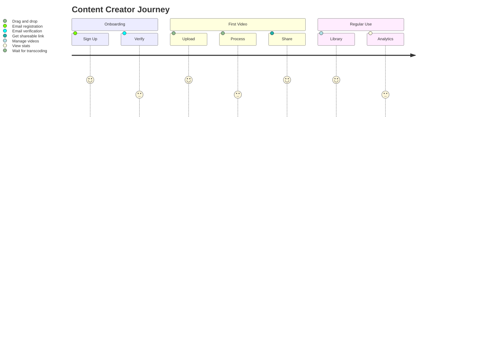
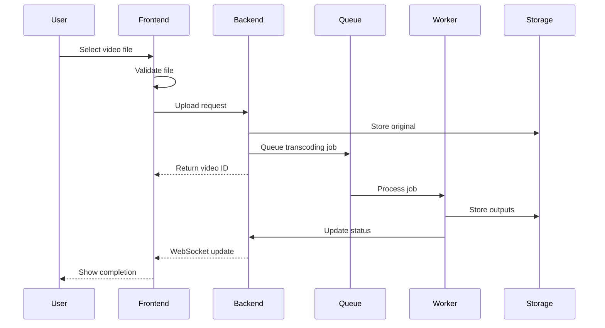
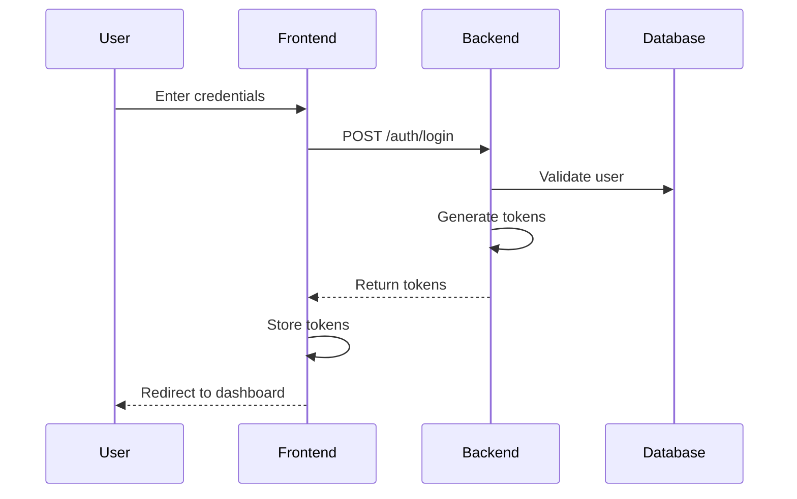
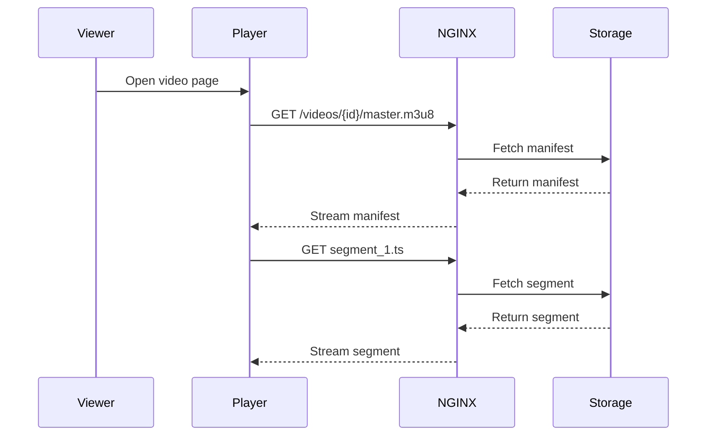
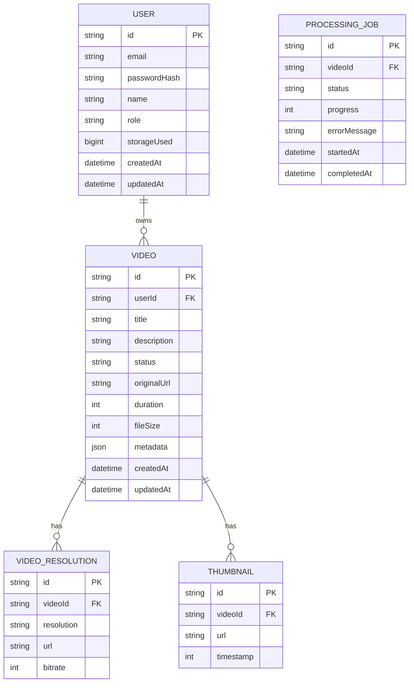

# Product Requirements Document (PRD)

## Purpose

This document defines the product requirements, user experience, and feature specifications for the Automated Cloud-Native Video Transcoding and Streaming Platform.

## Scope

Product features, user workflows, UI/UX specifications, and release planning.

## Audience

- Product Managers
- Engineering Teams
- Design Teams
- QA Engineers
- Stakeholders

## Dependencies

- [00_Project_Standards.md](./00_Project_Standards.md) - Development standards
- [01_Project_Vision.md](./01_Project_Vision.md) - Product vision
- [02_Requirements.md](./02_Requirements.md) - System requirements
- [05_Tech_Stack.md](./05_Tech_Stack.md) - Technology stack

## Related Documents

- [04_System_Architecture.md](./04_System_Architecture.md) - System architecture
- [24_UI_UX.md](./24_UI_UX.md) - UI/UX design
- [25_Roadmap.md](./25_Roadmap.md) - Release timeline

## Table of Contents

1. [Product Overview](#product-overview)
2. [User Personas](#user-personas)
3. [Feature Specifications](#feature-specifications)
4. [User Workflows](#user-workflows)
5. [UI/UX Requirements](#uiux-requirements)
6. [API Requirements](#api-requirements)
7. [Data Model](#data-model)
8. [Release Planning](#release-planning)
9. [Success Metrics](#success-metrics)
10. [Design Decisions](#design-decisions)
11. [Notes](#notes)
12. [References](#references)
13. [Future Documents](#future-documents)
14. [Revision History](#revision-history)

## Product Overview

### Product Description

The Automated Cloud-Native Video Transcoding and Streaming Platform is a comprehensive solution for video content management, providing:

- Automated video transcoding to multiple resolutions
- Adaptive HLS streaming
- Enterprise-grade security and RBAC
- Real-time monitoring and analytics
- Developer-friendly API

### Key Features

| Feature | Description | Priority |
|---------|-------------|----------|
| Video Upload | Drag-and-drop, chunked upload | P0 |
| Auto Transcoding | HLS output, multiple resolutions | P0 |
| Video Library | Search, filter, manage videos | P0 |
| User Management | Profiles, authentication, RBAC | P0 |
| Admin Dashboard | System monitoring, user management | P0 |
| Analytics | Usage tracking, performance metrics | P1 |
| Notifications | Email alerts, webhooks | P1 |

## User Personas

### Persona 1: Content Creator

**Characteristics**:
- Tech-savvy but not infrastructure expert
- Values simplicity and speed
- Needs reliable video processing
- Wants analytics on their content

### Persona 2: Platform Administrator

**Characteristics**:
- IT professional managing the platform
- Needs monitoring and control
- Requires audit capabilities
- Manages user accounts and quotas

### Persona 3: Developer

**Characteristics**:
- Integrates platform into applications
- Needs comprehensive API documentation
- Values SDKs and examples
- Requires webhook support

## Feature Specifications

### Authentication Module

#### User Registration

| Field | Type | Validation | Required |
|-------|------|------------|----------|
| email | string | Valid email, unique | Yes |
| password | string | Min 8 chars, mixed case, number, special | Yes |
| name | string | 2-100 chars | Yes |

**Flow**:
1. User submits registration form
2. System validates input
3. System creates user with hashed password
4. System sends verification email
5. User verifies email
6. User can login

#### User Login

| Field | Type | Validation | Required |
|-------|------|------------|----------|
| email | string | Valid email | Yes |
| password | string | Valid password | Yes |

**Flow**:
1. User submits credentials
2. System validates credentials
3. System generates JWT access token (15 min)
4. System generates refresh token (7 days)
5. Tokens returned in response

### Video Upload Module

#### Single File Upload

**Requirements**:
- Maximum file size: 5GB
- Supported formats: MP4, MOV, AVI, MKV, WebM, FLV
- Real-time progress indicator
- Client-side validation before upload

**Flow**:
1. User selects file
2. Client validates file type and size
3. File uploaded to MinIO
4. Video record created in database
5. Processing job queued

#### Chunked Upload

**Requirements**:
- Chunk size: 50MB
- Resume capability
- Parallel upload support
- Integrity verification

**Flow**:
1. User selects large file
2. File split into 50MB chunks
3. Chunks uploaded in parallel
4. Chunks assembled on server
5. Processing job queued

### Video Processing Module

#### Transcoding Pipeline

| Resolution | Video Bitrate | Audio Bitrate |
|------------|---------------|---------------|
| 240p | 400 kbps | 64 kbps |
| 360p | 800 kbps | 96 kbps |
| 480p | 1200 kbps | 128 kbps |
| 720p | 2400 kbps | 192 kbps |
| 1080p | 4800 kbps | 256 kbps |
| 4K | 12000 kbps | 384 kbps |

**Flow**:
1. Video file received
2. FFprobe extracts metadata
3. FFmpeg transcodes to HLS
4. Thumbnails generated at intervals
5. Preview GIF created
6. All outputs stored in MinIO
7. Database updated with URLs

#### Processing Status

| Status | Description |
|--------|-------------|
| PENDING | Waiting in queue |
| PROCESSING | Currently being transcoded |
| COMPLETED | All outputs generated |
| FAILED | Error during processing |
| CANCELLED | User cancelled processing |

### Video Library Module

#### Search and Filter

| Filter | Type | Options |
|--------|------|---------|
| query | string | Full-text search |
| status | enum | PENDING, PROCESSING, COMPLETED, FAILED |
| dateRange | object | start, end dates |
| sizeRange | object | min, max bytes |
| duration | object | min, max seconds |

#### Video Management

- Edit title and description
- Delete videos
- Privacy settings (public/private)
- Share links with expiration

### Admin Dashboard Module

#### System Monitoring

- CPU and memory usage
- Queue depth and processing rate
- Storage utilization
- API response times
- Error rates

#### User Management

- List all users
- View user storage usage
- Suspend/unsuspend users
- Assign roles and permissions

## User Workflows

### Video Upload Workflow

### Authentication Workflow

### Video Streaming Workflow

## UI/UX Requirements

### Design System

- **Framework**: Next.js 15 with App Router
- **Styling**: Tailwind CSS with shadcn/ui
- **Icons**: Lucide React
- **Charts**: Recharts
- **Animations**: Framer Motion

### Responsive Design

| Breakpoint | Width | Usage |
|------------|-------|-------|
| sm | 640px | Mobile |
| md | 768px | Tablet |
| lg | 1024px | Desktop |
| xl | 1280px | Large desktop |

### Accessibility

- WCAG 2.1 AA compliance
- Keyboard navigation
- Screen reader support
- Color contrast ratios > 4.5:1

### Internationalization

- English (default)
- Extensible for other languages
- RTL support for future languages

## API Requirements

### Authentication Endpoints

| Method | Endpoint | Description |
|--------|----------|-------------|
| POST | /api/v1/auth/register | Register new user |
| POST | /api/v1/auth/login | Login user |
| POST | /api/v1/auth/refresh | Refresh access token |
| POST | /api/v1/auth/logout | Logout user |
| POST | /api/v1/auth/forgot-password | Request password reset |
| POST | /api/v1/auth/reset-password | Reset password |

### Video Endpoints

| Method | Endpoint | Description |
|--------|----------|-------------|
| GET | /api/v1/videos | List user videos |
| POST | /api/v1/videos | Upload video |
| GET | /api/v1/videos/{id} | Get video details |
| PATCH | /api/v1/videos/{id} | Update video |
| DELETE | /api/v1/videos/{id} | Delete video |
| GET | /api/v1/videos/{id}/status | Get processing status |

### Admin Endpoints

| Method | Endpoint | Description |
|--------|----------|-------------|
| GET | /api/v1/admin/users | List all users |
| GET | /api/v1/admin/stats | Get system stats |
| GET | /api/v1/admin/jobs | List processing jobs |

## Data Model

### Core Entities

## Release Planning

### Phase 1: MVP (Q1 2024)

| Feature | Status |
|---------|--------|
| User authentication | ✅ |
| Video upload | ✅ |
| Basic transcoding | ✅ |
| Video library | ✅ |
| HLS streaming | ✅ |
| Admin dashboard | ✅ |

### Phase 2: Scale (Q2 2024)

| Feature | Status |
|---------|--------|
| Chunked upload | ✅ |
| Advanced analytics | ✅ |
| Webhook notifications | ⏳ |
| Performance optimization | ⏳ |

### Phase 3: Enterprise (Q3 2024)

| Feature | Status |
|---------|--------|
| Audit logging | ⏳ |
| Custom profiles | ⏳ |
| Rate limiting | ⏳ |
| Advanced security | ⏳ |

## Success Metrics

### User Metrics

| Metric | Target |
|--------|--------|
| Daily Active Users | 1,000 |
| Monthly Active Users | 10,000 |
| User Retention (30d) | 60% |
| NPS Score | 40+ |

### Technical Metrics

| Metric | Target |
|--------|--------|
| API Uptime | 99.9% |
| Transcoding Success Rate | 99.5% |
| Average Transcoding Time | < 2x video duration |
| API Response Time (p95) | < 100ms |

## Design Decisions

### Decision: API-First Development

**Status**: Accepted

**Context**: Developers are primary users alongside content creators.

**Decision**: All features must have API endpoints before UI implementation.

**Consequences**:
- Consistent API design
- Better documentation
- Easier integration

### Decision: Modular Monolith

**Status**: Accepted

**Context**: Need for fast initial development with future scalability.

**Decision**: Build as modular monolith with clear module boundaries.

**Consequences**:
- Single deployment initially
- Clear migration path to microservices
- Shared database with schema separation

### Decision: HLS as Primary Format

**Status**: Accepted

**Context**: Need for adaptive streaming with broad device support.

**Decision**: Use HLS as the only output format.

**Consequences**:
- Apple device compatibility
- Industry standard
- No MPEG-DASH support initially

## Notes

- PRD is the source of truth for product features
- All P0 features must be in Phase 1
- API endpoints are documented in [08_API_Design.md](./08_API_Design.md)

## References

- [Next.js Documentation](https://nextjs.org/docs)
- [shadcn/ui Documentation](https://ui.shadcn.com)

## Future Documents

- [08_API_Design.md](./08_API_Design.md) - Detailed API specification
- [24_UI_UX.md](./24_UI_UX.md) - UI/UX design system
- [25_Roadmap.md](./25_Roadmap.md) - Detailed release timeline

## Revision History

| Date | Version | Author | Changes |
|------|---------|--------|---------|
| 2024-01-15 | 1.0.0 | Product Team | Initial version |