# System Architecture

## Purpose

This document defines the complete system architecture for the Automated Cloud-Native Video Transcoding and Streaming Platform, including component design, data flow, and deployment architecture.

## Scope

All architectural decisions, patterns, and system design for the platform.

## Audience

- Solution Architects
- Engineering Teams
- DevOps Engineers
- Technical Leads

## Dependencies

- [00_Project_Standards.md](./00_Project_Standards.md) - Development standards
- [01_Project_Vision.md](./01_Project_Vision.md) - Product vision
- [02_Requirements.md](./02_Requirements.md) - System requirements
- [03_PRD.md](./03_PRD.md) - Product requirements
- [05_Tech_Stack.md](./05_Tech_Stack.md) - Technology stack

## Related Documents

- [06_Folder_Structure.md](./06_Folder_Structure.md) - Project structure
- [07_Database_Schema.md](./07_Database_Schema.md) - Database design
- [08_API_Design.md](./08_API_Design.md) - API specification
- [12_Queue_System.md](./12_Queue_System.md) - Queue implementation
- [13_Storage_Architecture.md](./13_Storage_Architecture.md) - Storage design
- [15_Transcoding_Pipeline.md](./15_Transcoding_Pipeline.md) - Video processing

## Table of Contents

1. [Architecture Overview](#architecture-overview)
2. [Architectural Patterns](#architectural-patterns)
3. [Component Architecture](#component-architecture)
4. [Data Flow](#data-flow)
5. [Deployment Architecture](#deployment-architecture)
6. [Security Architecture](#security-architecture)
7. [Scalability Architecture](#scalability-architecture)
8. [Resilience Architecture](#resilience-architecture)
9. [Technology Integration](#technology-integration)
10. [Design Decisions](#design-decisions)
11. [Notes](#notes)
12. [References](#references)
13. [Future Documents](#future-documents)
14. [Revision History](#revision-history)

## Architecture Overview

### High-Level Architecture

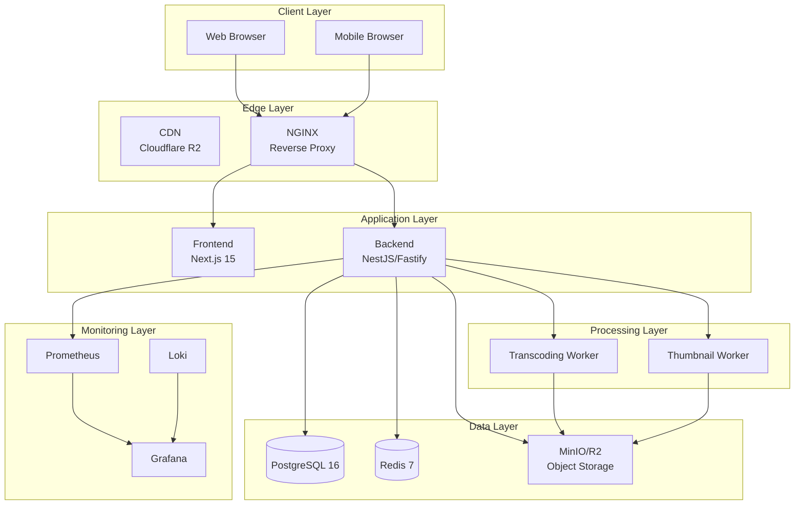

### Architecture Principles

| Principle | Implementation |
|-----------|----------------|
| **Cloud Native** | Container-first, 12-factor app |
| **API First** | All features accessible via REST API |
| **Security First** | Authentication, authorization, encryption |
| **Scalable** | Horizontal scaling, stateless services |
| **Maintainable** | Clean architecture, modular monolith |
| **Observable** | Metrics, logs, tracing |
| **Resilient** | Retry mechanisms, circuit breakers |

## Architectural Patterns

### Clean Architecture

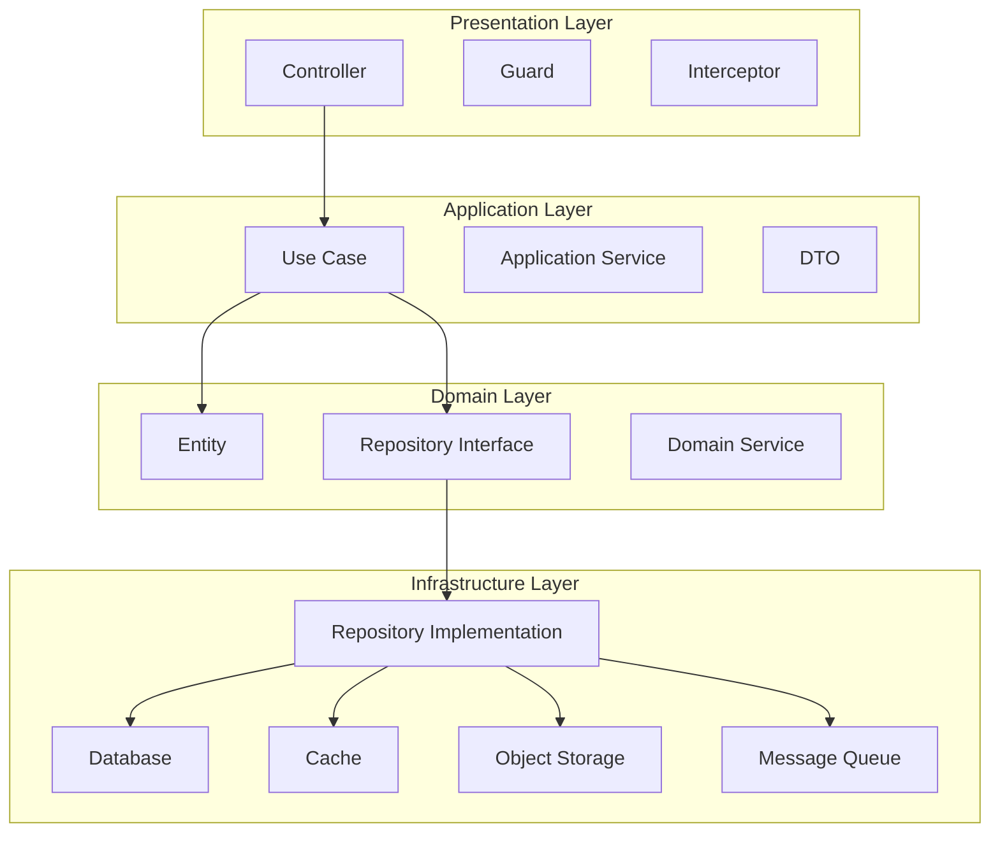

### Modular Monolith

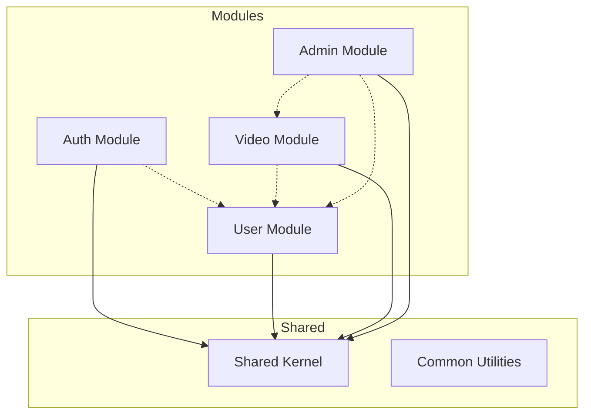

### Event-Driven Architecture

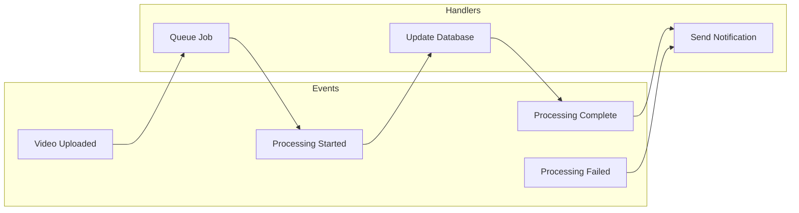

## Component Architecture

### Frontend Components

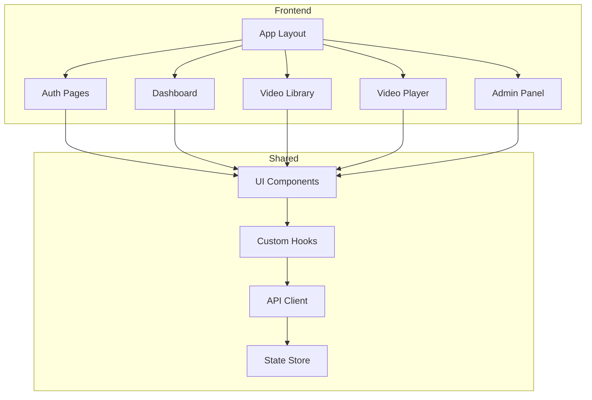

### Backend Components

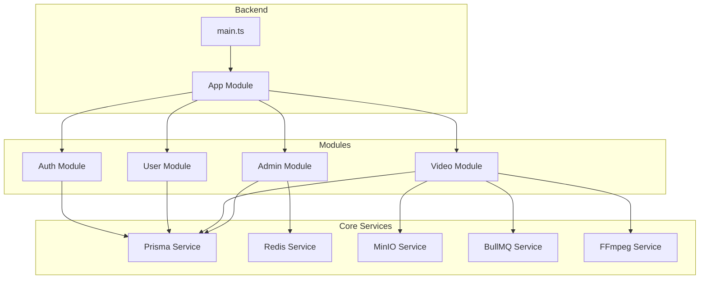

### Worker Components

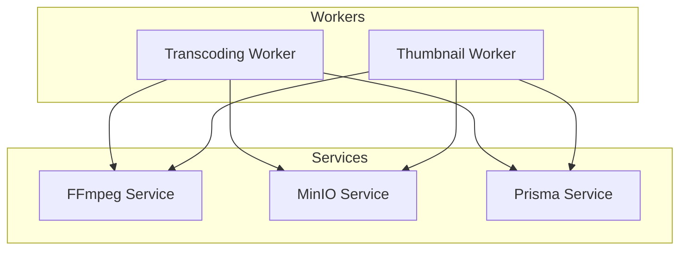

## Data Flow

### Video Upload Flow

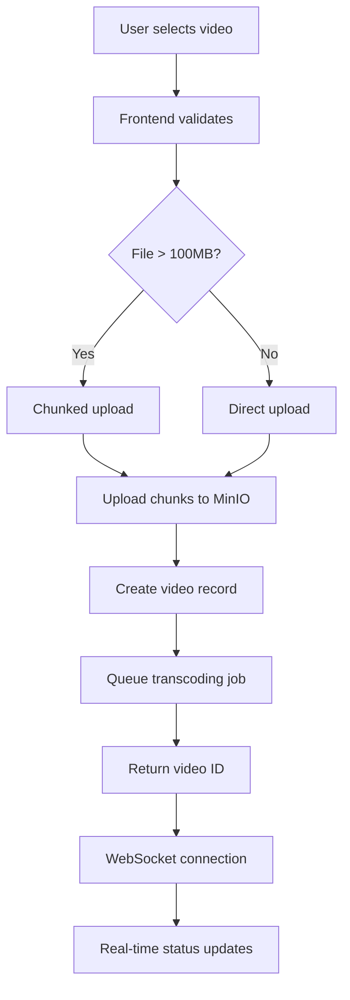

### Transcoding Flow

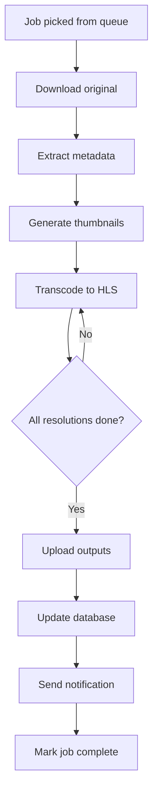

### Authentication Flow

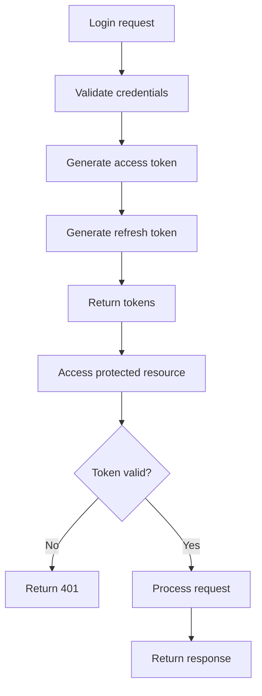

## Deployment Architecture

### Development Environment

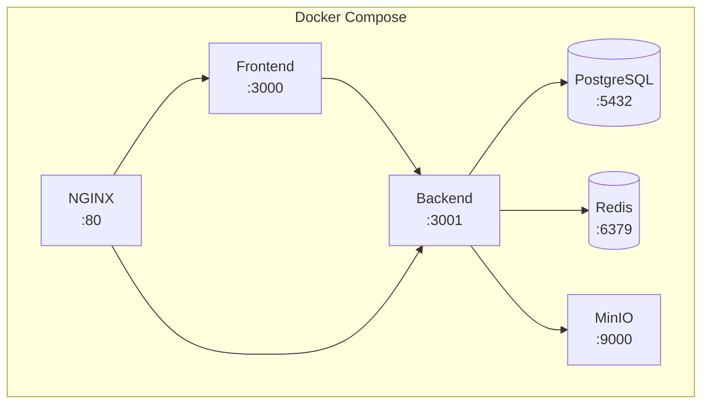

### Production Environment

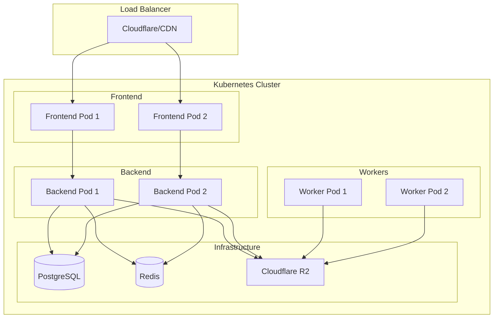

### Container Architecture

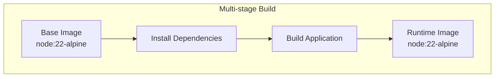

## Security Architecture

### Authentication Flow

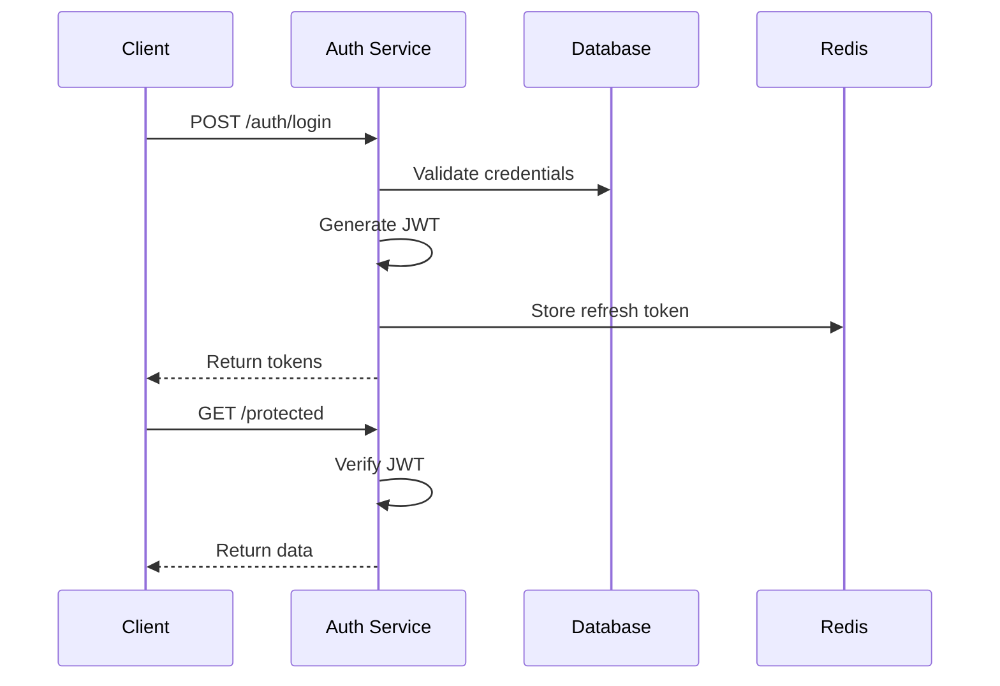

### Authorization Model

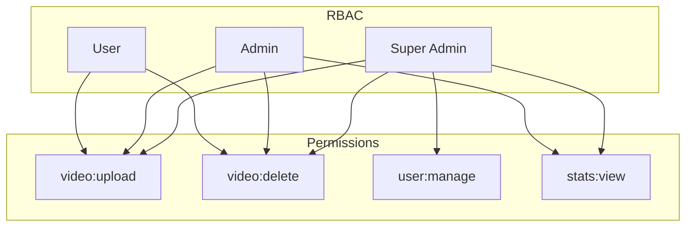

## Scalability Architecture

### Horizontal Scaling

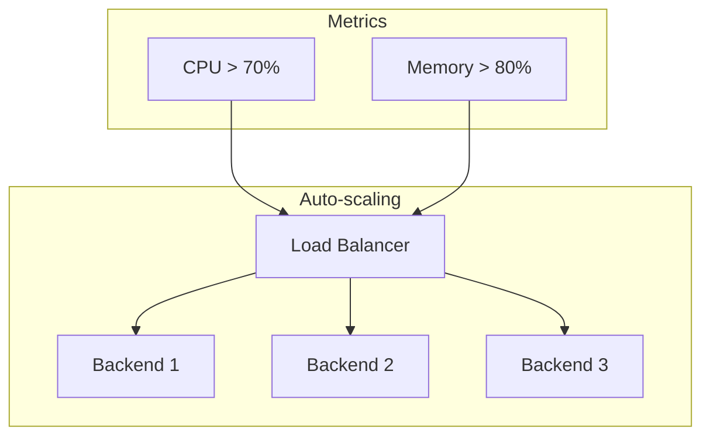

### Database Scaling

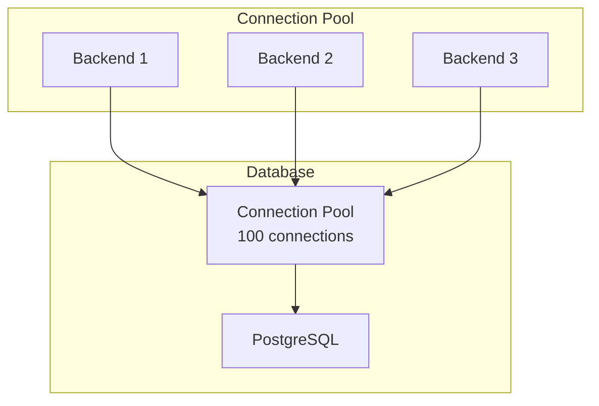

## Resilience Architecture

### Circuit Breaker Pattern

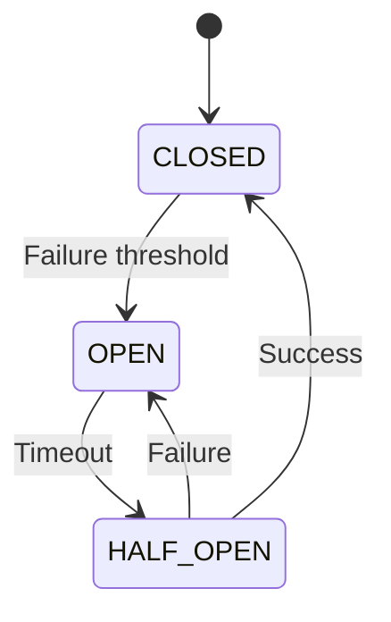

### Retry Mechanism

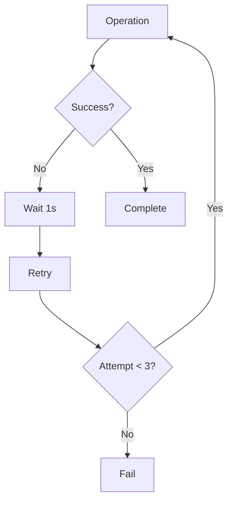

## Technology Integration

### Integration Matrix

| Component | Technology | Integration Type |
|-----------|------------|----------------|
| API | NestJS/Fastify | Internal |
| Database | PostgreSQL/Prisma | Internal |
| Cache | Redis | Internal |
| Storage | MinIO/S3 | Internal |
| Queue | BullMQ | Internal |
| Video Processing | FFmpeg | Internal |
| Frontend | Next.js | Internal |
| Monitoring | Prometheus | Internal |
| Logging | Loki | Internal |
| Visualization | Grafana | Internal |

### Data Flow Integration

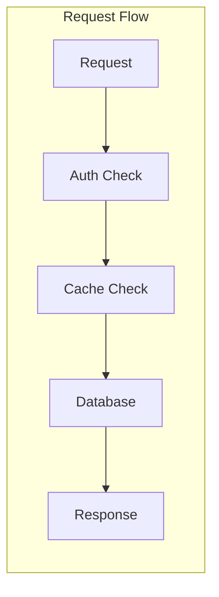

## Design Decisions

### Decision: Modular Monolith

**Status**: Accepted

**Context**: Need for fast initial development with clear service boundaries.

**Decision**: Implement as modular monolith with potential for microservice extraction.

**Consequences**:
- Faster initial development
- Shared database with clear module boundaries
- Clear path to microservices

### Decision: Event-Driven Processing

**Status**: Accepted

**Context**: Video processing is long-running and should not block API requests.

**Decision**: Use BullMQ for asynchronous job processing.

**Consequences**:
- Decoupled processing
- Retry mechanisms
- Progress tracking

### Decision: HLS Streaming

**Status**: Accepted

**Context**: Need for adaptive streaming with broad device support.

**Decision**: Use HLS as the primary streaming protocol.

**Consequences**:
- Apple device compatibility
- Requires segment generation
- Industry standard

### Decision: MinIO for Development

**Status**: Accepted

**Context**: Need for S3-compatible storage in development.

**Decision**: Use MinIO locally, Cloudflare R2 in production.

**Consequences**:
- Same API for both environments
- No vendor lock-in
- Easy local development

## Notes

- Architecture supports horizontal scaling
- All components are containerized
- Security is built into every layer
- Monitoring is comprehensive

## References

- [Clean Architecture - Robert Martin](https://www.amazon.com/Clean-Architecture-Robert-C-Martin/dp/0134494164)
- [Twelve-Factor App](https://12factor.net)

## Future Documents

- [06_Folder_Structure.md](./06_Folder_Structure.md) - Project structure
- [07_Database_Schema.md](./07_Database_Schema.md) - Database design
- [08_API_Design.md](./08_API_Design.md) - API specification
- [12_Queue_System.md](./12_Queue_System.md) - Queue implementation
- [13_Storage_Architecture.md](./13_Storage_Architecture.md) - Storage design
- [15_Transcoding_Pipeline.md](./15_Transcoding_Pipeline.md) - Video processing

## Revision History

| Date | Version | Author | Changes |
|------|---------|--------|---------|
| 2024-01-15 | 1.0.0 | Architecture Team | Initial version |