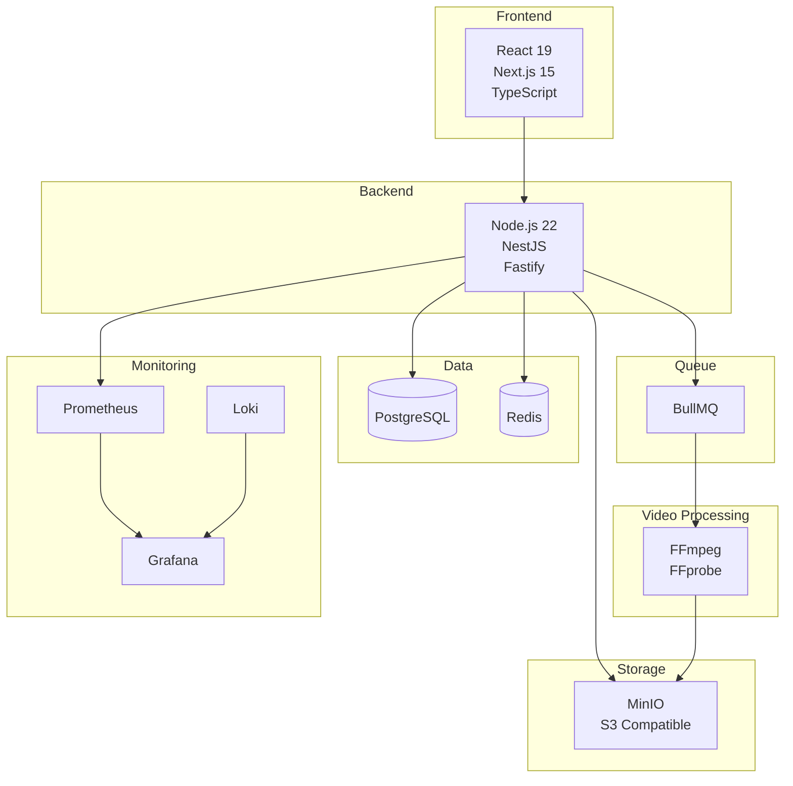
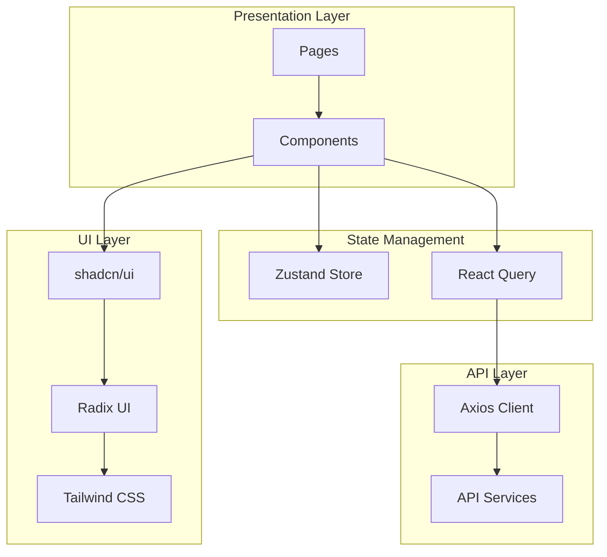
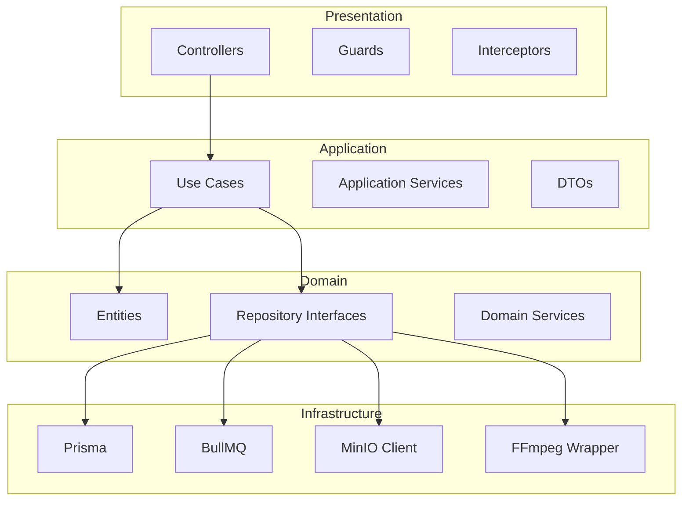
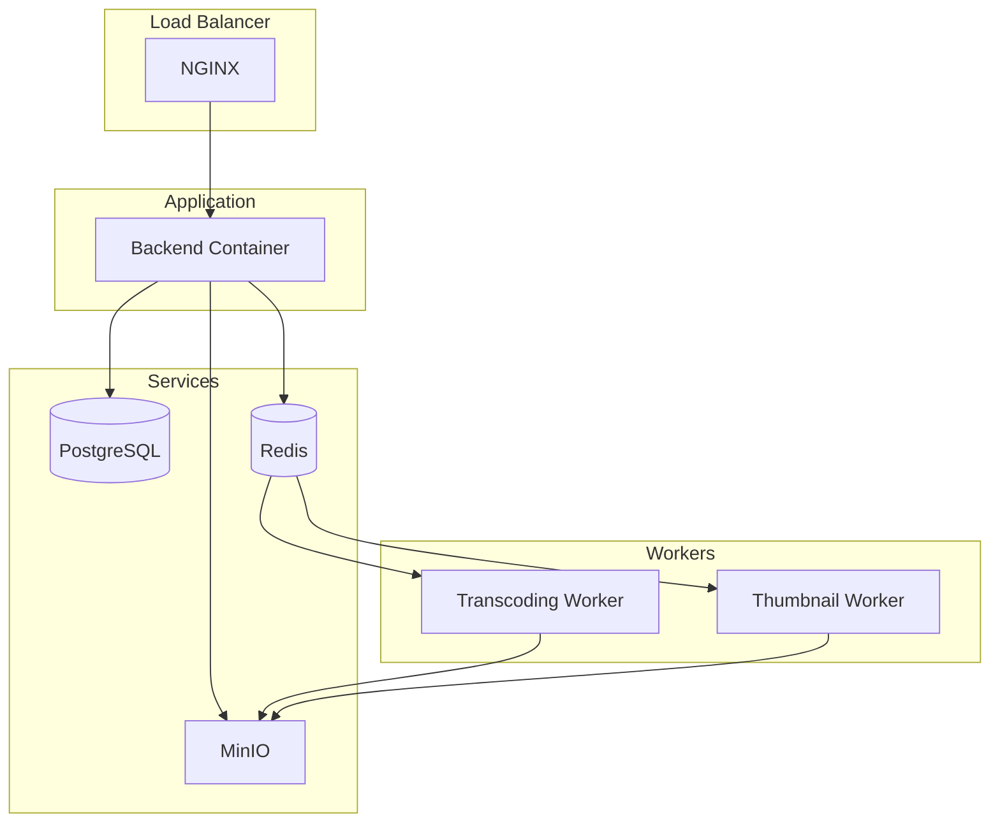
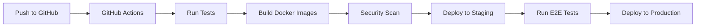
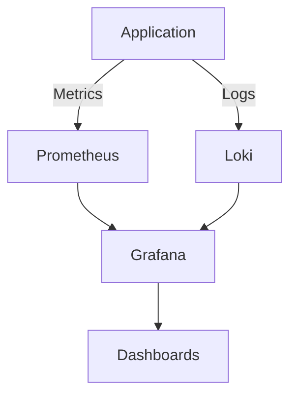
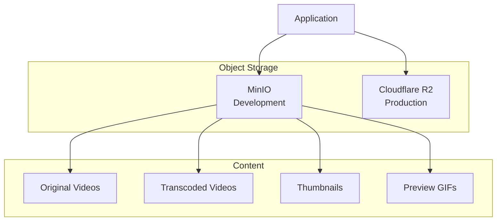
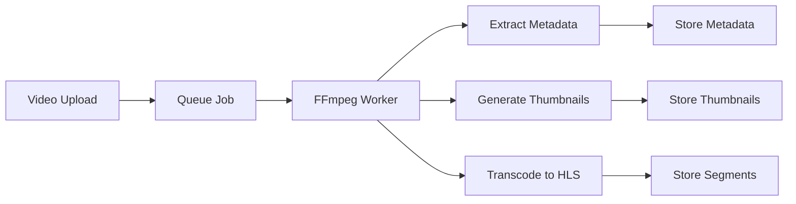

# Technology Stack

## Purpose

This document defines the complete technology stack for the Automated Cloud-Native Video Transcoding and Streaming Platform, including all frameworks, libraries, tools, and infrastructure components.

## Scope

All technology decisions, versions, and justifications for the platform.

## Audience

- Software Engineers
- Technical Leads
- DevOps Engineers
- Solution Architects

## Dependencies

- [00_Project_Standards.md](./00_Project_Standards.md) - Coding and architecture standards

## Related Documents

- [04_System_Architecture.md](./04_System_Architecture.md) - How these technologies integrate
- [16_Deployment.md](./16_Deployment.md) - Deployment configurations
- [22_Microservices.md](./22_Microservices.md) - Service boundaries

## Table of Contents

1. [Overview](#overview)
2. [Frontend Stack](#frontend-stack)
3. [Backend Stack](#backend-stack)
4. [Database Stack](#database-stack)
5. [Infrastructure Stack](#infrastructure-stack)
6. [DevOps Stack](#devops-stack)
7. [Monitoring Stack](#monitoring-stack)
8. [Storage Stack](#storage-stack)
9. [Video Processing Stack](#video-processing-stack)
10. [Justification](#justification)
11. [Version Matrix](#version-matrix)
12. [Design Decisions](#design-decisions)
13. [Notes](#notes)
14. [References](#references)
15. [Future Documents](#future-documents)
16. [Revision History](#revision-history)

## Overview

The technology stack is designed for enterprise-scale video processing with cloud-native principles, high performance, and future microservices migration.

## Frontend Stack

| Technology | Version | Purpose |
|------------|---------|---------|
| React | 19.x | UI library |
| Next.js | 15.x | React framework with SSR/SSG |
| TypeScript | 5.x | Type safety |
| Tailwind CSS | 3.x | Utility-first CSS framework |
| shadcn/ui | latest | Component library |
| Radix UI | latest | Accessible UI primitives |
| Framer Motion | latest | Animation library |
| TanStack Query | latest | Server state management |
| Zustand | latest | Client state management |
| React Hook Form | latest | Form state management |
| Zod | latest | Schema validation |
| Axios | latest | HTTP client |
| Video.js | 8.x | Video player |
| React Dropzone | latest | File upload component |
| Recharts | latest | Data visualization |
| Lucide React | latest | Icon library |

### Frontend Architecture

## Backend Stack

| Technology | Version | Purpose |
|------------|---------|---------|
| Node.js | 22.x LTS | Runtime environment |
| NestJS | 10.x | Backend framework |
| Fastify | 5.x | Web server (faster than Express) |
| TypeScript | 5.x | Type safety |
| Prisma ORM | 5.x | Database ORM |
| Swagger | latest | API documentation |
| JWT | latest | Token-based authentication |
| Passport.js | latest | Authentication middleware |
| bcrypt | latest | Password hashing |
| class-validator | latest | DTO validation |
| Multer | latest | File upload handling |
| Sharp | latest | Image processing |

### Backend Architecture

## Database Stack

| Technology | Version | Purpose |
|------------|---------|---------|
| PostgreSQL | 16.x | Primary database |
| Redis | 7.x | Cache and session store |
| Prisma | 5.x | ORM and query builder |

### Database Features

- **PostgreSQL 16**: Advanced indexing, JSON support, full-text search
- **Redis 7**: Pub/Sub, streams, Lua scripting
- **Prisma**: Type-safe queries, migrations, connection pooling

## Infrastructure Stack

| Technology | Version | Purpose |
|------------|---------|---------|
| Docker | latest | Containerization |
| Docker Compose | latest | Local orchestration |
| NGINX | latest | Reverse proxy, HLS streaming |
| MinIO | latest | Object storage (S3 compatible) |

### Infrastructure Architecture

## DevOps Stack

| Technology | Version | Purpose |
|------------|---------|---------|
| pnpm | 9.x | Package manager |
| GitHub Actions | latest | CI/CD pipeline |
| Docker | latest | Container building |
| Docker Compose | latest | Multi-container orchestration |

### CI/CD Pipeline

## Monitoring Stack

| Technology | Version | Purpose |
|------------|---------|---------|
| Prometheus | latest | Metrics collection |
| Grafana | latest | Metrics visualization |
| Loki | latest | Log aggregation |
| Pino | latest | Structured logging |

### Monitoring Architecture

## Storage Stack

| Technology | Version | Purpose |
|------------|---------|---------|
| MinIO | latest | Development object storage |
| Cloudflare R2 | latest | Production object storage |

### Storage Architecture

## Video Processing Stack

| Technology | Version | Purpose |
|------------|---------|---------|
| FFmpeg | 7.x | Video transcoding |
| FFprobe | 7.x | Metadata extraction |

### Video Processing Pipeline

## Justification

### Why Node.js 22 + NestJS?

- **Performance**: V8 engine improvements, native fetch API
- **Ecosystem**: Rich npm ecosystem for video processing
- **Type Safety**: TypeScript provides compile-time guarantees
- **Architecture**: NestJS supports Clean Architecture out of the box
- **Scalability**: Built-in support for microservices

### Why Fastify over Express?

- **Performance**: 2x faster request handling
- **Schema Validation**: Built-in JSON schema validation
- **Plugin System**: Modular and extensible
- **Logging**: Native structured logging support

### Why PostgreSQL?

- **JSONB**: Native JSON support for flexible metadata
- **Full-text Search**: Built-in search capabilities
- **Extensions**: PostGIS, pg_stat_statements
- **Reliability**: ACID compliance, proven at scale

### Why Redis + BullMQ?

- **Performance**: In-memory operations
- **Persistence**: RDB and AOF for durability
- **Pub/Sub**: Real-time event processing
- **BullMQ**: Robust job queue with retries, scheduling

### Why MinIO?

- **S3 Compatibility**: Drop-in replacement for AWS S3
- **Local Development**: No external dependencies
- **Performance**: Optimized for high throughput
- **Kubernetes Native**: Easy production deployment

## Version Matrix

| Component | Development | Staging | Production |
|-----------|-------------|---------|------------|
| Node.js | 22.x | 22.x | 22.x |
| PostgreSQL | 16.x | 16.x | 16.x |
| Redis | 7.x | 7.x | 7.x |
| MinIO | latest | latest | N/A |
| Cloudflare R2 | N/A | N/A | latest |
| FFmpeg | 7.x | 7.x | 7.x |

## Design Decisions

### Decision: pnpm over npm/yarn

**Status**: Accepted

**Context**: Monorepo with multiple packages, need for fast installs.

**Decision**: Use pnpm for its disk efficiency and fast installation.

**Consequences**:
- Faster CI/CD builds
- Reduced disk usage
- Workspace protocol support

### Decision: Fastify over Express

**Status**: Accepted

**Context**: High-performance API required for video metadata operations.

**Decision**: Use Fastify for its superior performance and built-in validation.

**Consequences**:
- 2x faster request handling
- Built-in JSON schema validation
- Different middleware API

### Decision: Modular Monolith

**Status**: Accepted

**Context**: Need for fast initial development with future microservices path.

**Decision**: Build as modular monolith with clear module boundaries.

**Consequences**:
- Single deployment unit initially
- Clear migration path to microservices
- Shared database with schema separation

## Notes

- All versions are locked and should not be changed without architecture review
- Production services (R2) are separate from development (MinIO)
- FFmpeg version must match between development and production

## References

- [Node.js 22 Release Notes](https://nodejs.org/en/blog/release/v22.0.0)
- [NestJS Documentation](https://docs.nestjs.com)
- [Fastify Documentation](https://www.fastify.io/docs/latest)

## Future Documents

- [06_Folder_Structure.md](./06_Folder_Structure.md) - Project structure
- [13_Storage_Architecture.md](./13_Storage_Architecture.md) - Storage details
- [15_Transcoding_Pipeline.md](./15_Transcoding_Pipeline.md) - Video processing details

## Revision History

| Date | Version | Author | Changes |
|------|---------|--------|---------|
| 2024-01-15 | 1.0.0 | Architecture Team | Initial version |