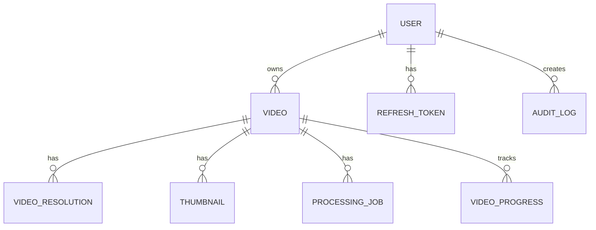

# Database Schema

## Purpose

This document defines the complete database schema for the Automated Cloud-Native Video Transcoding and Streaming Platform using PostgreSQL and Prisma.

## Scope

All database tables, relationships, indexes, and constraints.

## Audience

- Database Architects
- Backend Engineers
- DevOps Engineers

## Dependencies

- [00_Project_Standards.md](./00_Project_Standards.md) - Development standards
- [04_System_Architecture.md](./04_System_Architecture.md) - System architecture
- [05_Tech_Stack.md](./05_Tech_Stack.md) - Technology stack

## Related Documents

- [08_API_Design.md](./08_API_Design.md) - API design
- [09_Authentication.md](./09_Authentication.md) - Authentication
- [10_User_Roles.md](./10_User_Roles.md) - User roles

## Table of Contents

1. [Schema Overview](#schema-overview)
2. [User Schema](#user-schema)
3. [Video Schema](#video-schema)
4. [Processing Schema](#processing-schema)
5. [Storage Schema](#storage-schema)
6. [Audit Schema](#audit-schema)
7. [Indexes](#indexes)
8. [Constraints](#constraints)
9. [Design Decisions](#design-decisions)
10. [Notes](#notes)
11. [References](#references)
12. [Future Documents](#future-documents)
13. [Revision History](#revision-history)

## Schema Overview



## User Schema

### User Entity

```prisma
model User {
  id            String    @id @default(cuid())
  email         String    @unique
  passwordHash  String
  name          String
  role          Role      @default(USER)
  avatarUrl     String?
  storageUsed   BigInt    @default(0)
  storageQuota  BigInt    @default(10737418240) // 10GB default
  isActive      Boolean   @default(true)
  emailVerified Boolean   @default(false)
  createdAt     DateTime  @default(now())
  updatedAt     DateTime  @updatedAt
  deletedAt     DateTime?

  videos        Video[]
  refreshTokens RefreshToken[]
  auditLogs     AuditLog[]

  @@index([email])
  @@index([role])
  @@map("users")
}

enum Role {
  USER
  ADMIN
  SUPER_ADMIN
}
```

### Refresh Token Entity

```prisma
model RefreshToken {
  id        String   @id @default(cuid())
  userId    String
  token     String   @unique
  expiresAt DateTime
  createdAt DateTime @default(now())
  revokedAt DateTime?

  user User @relation(fields: [userId], references: [id])

  @@index([userId])
  @@index([expiresAt])
  @@map("refresh_tokens")
}
```

## Video Schema

### Video Entity

```prisma
model Video {
  id          String         @id @default(cuid())
  userId      String
  title       String
  description String?
  status      VideoStatus    @default(PENDING)
  originalUrl String
  duration    Int?
  fileSize    BigInt
  mimeType    String
  metadata    Json?
  isPublic    Boolean        @default(false)
  createdAt   DateTime       @default(now())
  updatedAt   DateTime       @updatedAt
  deletedAt   DateTime?

  user           User              @relation(fields: [userId], references: [id])
  resolutions    VideoResolution[]
  thumbnails     Thumbnail[]
  processingJobs ProcessingJob[]
  progress       VideoProgress?

  @@index([userId])
  @@index([status])
  @@index([createdAt])
  @@map("videos")
}

enum VideoStatus {
  PENDING
  PROCESSING
  COMPLETED
  FAILED
  CANCELLED
}
```

### Video Resolution Entity

```prisma
model VideoResolution {
  id        String @id @default(cuid())
  videoId   String
  resolution String // 240p, 360p, 480p, 720p, 1080p, 4k
  url       String
  bitrate   Int
  width     Int
  height    Int

  video Video @relation(fields: [videoId], references: [id])

  @@index([videoId])
  @@index([resolution])
  @@map("video_resolutions")
}
```

### Thumbnail Entity

```prisma
model Thumbnail {
  id        String @id @default(cuid())
  videoId   String
  url       String
  timestamp Int // seconds from start
  width     Int
  height    Int

  video Video @relation(fields: [videoId], references: [id])

  @@index([videoId])
  @@map("thumbnails")
}
```

## Processing Schema

### Processing Job Entity

```prisma
model ProcessingJob {
  id          String        @id @default(cuid())
  videoId     String
  status      JobStatus     @default(PENDING)
  progress    Int           @default(0)
  priority    Int           @default(0)
  attempts    Int           @default(0)
  maxAttempts Int           @default(3)
  errorMessage String?
  startedAt   DateTime?
  completedAt DateTime?
  createdAt   DateTime      @default(now())
  updatedAt   DateTime      @updatedAt

  video Video @relation(fields: [videoId], references: [id])

  @@index([videoId])
  @@index([status])
  @@index([priority])
  @@map("processing_jobs")
}

enum JobStatus {
  PENDING
  PROCESSING
  COMPLETED
  FAILED
  CANCELLED
}
```

### Video Progress Entity

```prisma
model VideoProgress {
  id        String   @id @default(cuid())
  videoId   String   @unique
  userId    String
  position  Int      // seconds watched
  duration  Int      // total duration
  completed Boolean  @default(false)
  updatedAt DateTime @updatedAt

  @@index([videoId, userId])
  @@map("video_progress")
}
```

## Storage Schema

### Storage Quota Entity

```prisma
model StorageQuota {
  id          String   @id @default(cuid())
  userId      String   @unique
  used        BigInt   @default(0)
  quota       BigInt
  warningSent Boolean  @default(false)
  updatedAt   DateTime @updatedAt

  @@index([userId])
  @@map("storage_quotas")
}
```

## Audit Schema

### Audit Log Entity

```prisma
model AuditLog {
  id          String   @id @default(cuid())
  userId      String?
  action      String
  resource    String
  resourceId  String?
  ipAddress   String?
  userAgent   String?
  metadata    Json?
  createdAt   DateTime @default(now())

  user User? @relation(fields: [userId], references: [id])

  @@index([userId])
  @@index([action])
  @@index([createdAt])
  @@map("audit_logs")
}
```

## Indexes

### Performance Indexes

| Table | Column | Type | Purpose |
|-------|--------|------|---------|
| users | email | unique | Fast user lookup |
| users | role | btree | Role-based queries |
| videos | userId | btree | User video listing |
| videos | status | btree | Processing status |
| videos | createdAt | btree | Date filtering |
| processing_jobs | status | btree | Job queue queries |
| processing_jobs | priority | btree | Priority ordering |
| audit_logs | createdAt | btree | Time-based queries |

### Full-Text Search

```prisma
model Video {
  // ... other fields
  @@fulltext([title, description])
}
```

## Constraints

### Check Constraints

```sql
-- Video file size limit
ALTER TABLE videos ADD CONSTRAINT video_file_size_max 
CHECK (file_size <= 5368709120); -- 5GB

-- Storage quota limit
ALTER TABLE storage_quotas ADD CONSTRAINT storage_quota_positive 
CHECK (quota > 0);
```

### Foreign Key Constraints

All foreign keys use CASCADE delete for referential integrity.

## Design Decisions

### Decision: Soft Delete

**Status**: Accepted

**Context**: Need to maintain data for audit and recovery.

**Decision**: Use soft delete with deletedAt timestamp.

**Consequences**:
- Data recovery possible
- Audit trail maintained
- Queries must filter deleted records

### Decision: JSONB for Metadata

**Status**: Accepted

**Context**: Video metadata is variable and extensible.

**Decision**: Use PostgreSQL JSONB for video metadata.

**Consequences**:
- Flexible schema
- Queryable JSON
- No joins required

## Notes

- All tables use cuid() for primary keys
- Timestamps are in UTC
- Soft delete is implemented for all entities

## References

- [PostgreSQL Documentation](https://www.postgresql.org/docs/)
- [Prisma Documentation](https://www.prisma.io/docs)

## Future Documents

- [08_API_Design.md](./08_API_Design.md) - API endpoints
- [19_Error_Handling.md](./19_Error_Handling.md) - Error handling

## Revision History

| Date | Version | Author | Changes |
|------|---------|--------|---------|
| 2024-01-15 | 1.0.0 | Database Team | Initial version |