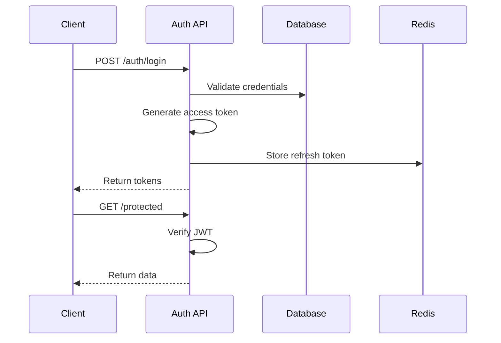
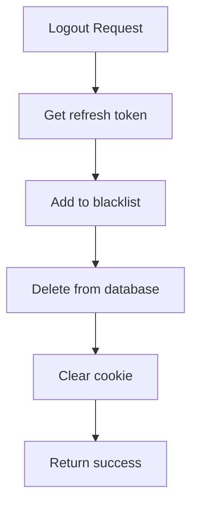
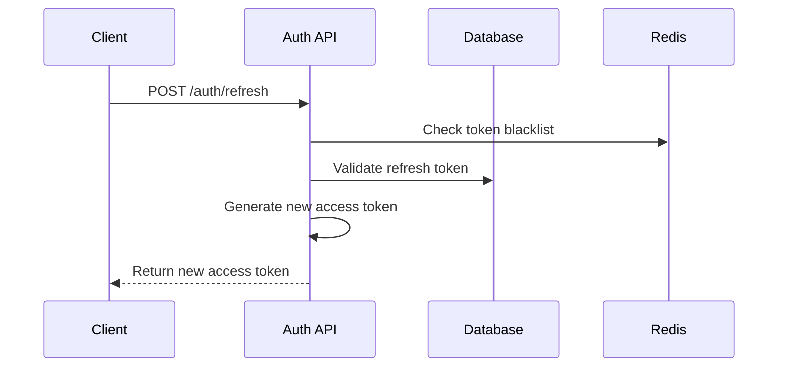

# Authentication

## Purpose

This document defines the authentication and authorization architecture for the Automated Cloud-Native Video Transcoding and Streaming Platform.

## Scope

JWT implementation, session management, password security, and RBAC.

## Audience

- Security Engineers
- Backend Engineers
- DevOps Engineers

## Dependencies

- [00_Project_Standards.md](./00_Project_Standards.md) - Development standards
- [05_Tech_Stack.md](./05_Tech_Stack.md) - Technology stack
- [07_Database_Schema.md](./07_Database_Schema.md) - Database schema

## Related Documents

- [08_API_Design.md](./08_API_Design.md) - API design
- [10_User_Roles.md](./10_User_Roles.md) - User roles
- [17_Security.md](./17_Security.md) - Security architecture

## Table of Contents

1. [Authentication Overview](#authentication-overview)
2. [JWT Implementation](#jwt-implementation)
3. [Password Security](#password-security)
4. [Session Management](#session-management)
5. [Token Refresh](#token-refresh)
6. [Authorization Model](#authorization-model)
7. [Security Headers](#security-headers)
8. [Rate Limiting](#rate-limiting)
9. [Design Decisions](#design-decisions)
10. [Notes](#notes)
11. [References](#references)
12. [Future Documents](#future-documents)
13. [Revision History](#revision-history)

## Authentication Overview



## JWT Implementation

### Token Structure

**Access Token Payload**:
```json
{
  "sub": "user_abc123",
  "email": "user@example.com",
  "role": "USER",
  "iat": 1705312200,
  "exp": 1705312200 + 900,
  "jti": "jwt_abc123"
}
```

**Refresh Token Payload**:
```json
{
  "sub": "user_abc123",
  "tokenId": "rt_abc123",
  "iat": 1705312200,
  "exp": 1705312200 + 604800
}
```

### Token Configuration

| Parameter | Value |
|-----------|-------|
| Algorithm | HS256 |
| Access Token Expiry | 15 minutes |
| Refresh Token Expiry | 7 days |
| Issuer | video-streaming-platform |
| Audience | api.videostreaming.com |

## Password Security

### Hashing Algorithm

- **Algorithm**: bcrypt
- **Cost Factor**: 12
- **Salt**: Auto-generated per password

### Password Requirements

| Rule | Requirement |
|------|-------------|
| Minimum Length | 8 characters |
| Maximum Length | 128 characters |
| Uppercase | At least 1 |
| Lowercase | At least 1 |
| Number | At least 1 |
| Special Character | At least 1 |

### Password Validation

```typescript
const passwordSchema = z.string()
  .min(8, 'Password must be at least 8 characters')
  .max(128, 'Password must be at most 128 characters')
  .regex(/[A-Z]/, 'Password must contain uppercase letter')
  .regex(/[a-z]/, 'Password must contain lowercase letter')
  .regex(/[0-9]/, 'Password must contain a number')
  .regex(/[^A-Za-z0-9]/, 'Password must contain a special character');
```

## Session Management

### Token Storage

- **Access Token**: In-memory (frontend state)
- **Refresh Token**: HttpOnly, Secure, SameSite=Strict cookie
- **Token Blacklist**: Redis with TTL

### Logout Flow



## Token Refresh

### Refresh Flow



### Refresh Token Rotation

- New refresh token generated on each refresh
- Old refresh token invalidated
- Prevents token reuse attacks

## Authorization Model

### RBAC Implementation

| Role | Permissions |
|------|-------------|
| USER | video:upload, video:delete, video:view |
| ADMIN | USER permissions + user:view, stats:view |
| SUPER_ADMIN | All permissions |

### Permission Check

```typescript
@Injectable()
export class PermissionGuard implements CanActivate {
  constructor(private reflector: Reflector) {}

  canActivate(context: ExecutionContext): boolean {
    const required = this.reflector.get<Permission[]>(
      'permissions',
      context.getHandler()
    );
    
    const request = context.switchToHttp().getRequest();
    const user = request.user;
    
    return hasPermission(user.role, required);
  }
}
```

## Security Headers

### HTTP Headers

| Header | Value | Purpose |
|--------|-------|---------|
| Strict-Transport-Security | max-age=31536000; includeSubDomains | Force HTTPS |
| X-Content-Type-Options | nosniff | Prevent MIME sniffing |
| X-Frame-Options | DENY | Prevent clickjacking |
| X-XSS-Protection | 1; mode=block | XSS protection |
| Content-Security-Policy | default-src 'self' | CSP |
| Referrer-Policy | strict-origin-when-cross-origin | Referrer control |

## Rate Limiting

### Authentication Endpoints

| Endpoint | Limit | Window |
|----------|-------|--------|
| /auth/login | 10 | 1 minute |
| /auth/register | 5 | 1 hour |
| /auth/refresh | 100 | 1 minute |
| /auth/forgot-password | 3 | 1 hour |

### Rate Limit Headers

```
X-RateLimit-Limit: 100
X-RateLimit-Remaining: 99
X-RateLimit-Reset: 1705312260
```

## Design Decisions

### Decision: JWT over Session

**Status**: Accepted

**Context**: Need for stateless, scalable authentication.

**Decision**: Use JWT tokens with refresh token rotation.

**Consequences**:
- Stateless authentication
- Horizontal scaling
- Token revocation complexity

### Decision: bcrypt Cost 12

**Status**: Accepted

**Context**: Balance between security and performance.

**Decision**: Use bcrypt with cost factor 12.

**Consequences**:
- ~250ms per hash
- Resistant to brute force
- May increase in future

## Notes

- All tokens are signed with strong secret
- Refresh tokens are stored in database
- Access tokens are short-lived

## References

- [JWT.io](https://jwt.io)
- [OWASP Authentication Cheat Sheet](https://cheatsheetseries.owasp.org/cheatsheets/Authentication_Cheat_Sheet.html)

## Future Documents

- [17_Security.md](./17_Security.md) - Security architecture
- [10_User_Roles.md](./10_User_Roles.md) - User roles

## Revision History

| Date | Version | Author | Changes |
|------|---------|--------|---------|
| 2024-01-15 | 1.0.0 | Security Team | Initial version |