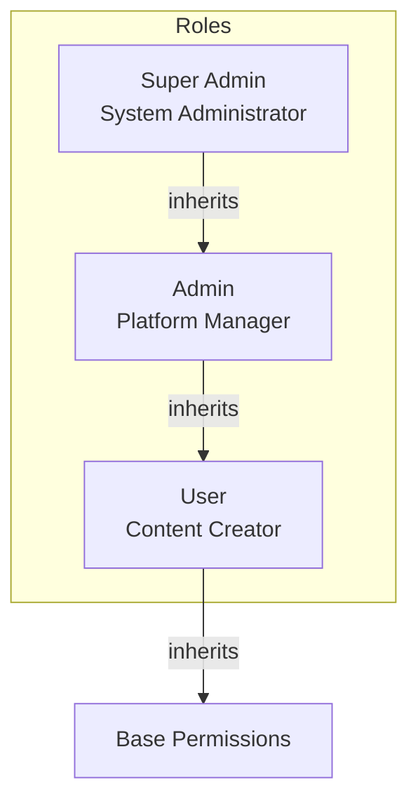
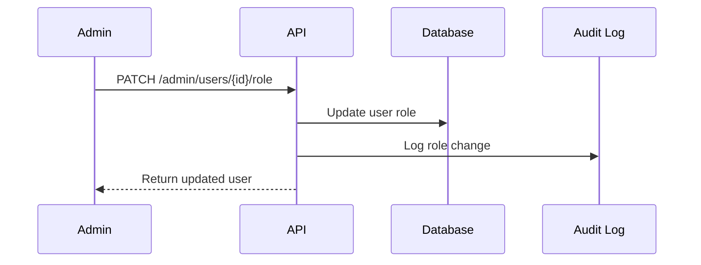
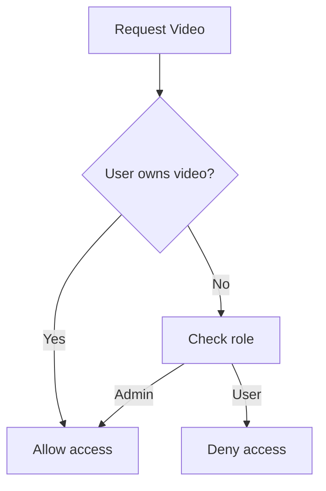

# User Roles

## Purpose

This document defines the role-based access control (RBAC) model for the Automated Cloud-Native Video Transcoding and Streaming Platform.

## Scope

User roles, permissions, and access control implementation.

## Audience

- Security Engineers
- Backend Engineers
- Product Managers

## Dependencies

- [00_Project_Standards.md](./00_Project_Standards.md) - Development standards
- [09_Authentication.md](./09_Authentication.md) - Authentication
- [07_Database_Schema.md](./07_Database_Schema.md) - Database schema

## Related Documents

- [08_API_Design.md](./08_API_Design.md) - API design
- [17_Security.md](./17_Security.md) - Security architecture

## Table of Contents

1. [Role Overview](#role-overview)
2. [Roles and Permissions](#roles-and-permissions)
3. [Permission Matrix](#permission-matrix)
4. [Role Assignment](#role-assignment)
5. [Access Control Implementation](#access-control-implementation)
6. [Resource-Level Permissions](#resource-level-permissions)
7. [Design Decisions](#design-decisions)
8. [Notes](#notes)
9. [References](#references)
10. [Future Documents](#future-documents)
11. [Revision History](#revision-history)

## Role Overview



## Roles and Permissions

### USER Role

| Permission | Description |
|------------|-------------|
| video:upload | Upload videos to library |
| video:view | View own videos |
| video:update | Update own video metadata |
| video:delete | Delete own videos |
| profile:view | View own profile |
| profile:update | Update own profile |

### ADMIN Role

| Permission | Description |
|------------|-------------|
| user:view | View all users |
| user:update | Update user roles |
| stats:view | View system statistics |
| job:view | View processing jobs |
| job:cancel | Cancel processing jobs |

### SUPER_ADMIN Role

| Permission | Description |
|------------|-------------|
| user:manage | Full user management |
| system:config | System configuration |
| audit:view | View audit logs |
| all | All permissions |

## Permission Matrix

| Endpoint | USER | ADMIN | SUPER_ADMIN |
|----------|------|-------|-------------|
| GET /videos | ✅ | ✅ | ✅ |
| POST /videos | ✅ | ✅ | ✅ |
| GET /videos/{id} | Own | All | All |
| PATCH /videos/{id} | Own | All | All |
| DELETE /videos/{id} | Own | All | All |
| GET /admin/users | ❌ | ✅ | ✅ |
| GET /admin/stats | ❌ | ✅ | ✅ |
| GET /admin/jobs | ❌ | ✅ | ✅ |

## Role Assignment

### Default Assignment

- New users are assigned USER role by default
- Role changes require admin privileges
- Role changes are logged in audit trail

### Role Change Flow



## Access Control Implementation

### Guard Implementation

```typescript
@Injectable()
export class RolesGuard implements CanActivate {
  constructor(private reflector: Reflector) {}

  canActivate(context: ExecutionContext): boolean {
    const requiredRoles = this.reflector.get<Role[]>(
      'roles',
      context.getHandler()
    );
    
    if (!requiredRoles) {
      return true;
    }
    
    const request = context.switchToHttp().getRequest();
    const user = request.user;
    
    return requiredRoles.some(role => user.roles.includes(role));
  }
}
```

### Decorator Usage

```typescript
@Get('users')
@Roles(Role.ADMIN, Role.SUPER_ADMIN)
async getUsers() {
  return this.userService.findAll();
}
```

## Resource-Level Permissions

### Video Ownership



### Permission Check

```typescript
async canAccessVideo(userId: string, videoId: string): Promise<boolean> {
  const video = await this.videoRepository.findById(videoId);
  
  if (video.userId === userId) {
    return true;
  }
  
  const user = await this.userRepository.findById(userId);
  return user.role === Role.ADMIN || user.role === Role.SUPER_ADMIN;
}
```

## Design Decisions

### Decision: Role Hierarchy

**Status**: Accepted

**Context**: Need for simple, maintainable permission model.

**Decision**: Use hierarchical roles (SUPER_ADMIN > ADMIN > USER).

**Consequences**:
- Simple permission checks
- Easy to understand
- Limited flexibility

### Decision: Database Role Storage

**Status**: Accepted

**Context**: Roles need to be queryable and auditable.

**Decision**: Store role in user table as enum.

**Consequences**:
- Simple queries
- No joins required
- Role changes require migration

## Notes

- Roles are enforced at the API level
- Resource ownership is checked for USER role
- All role changes are audited

## References

- [OWASP RBAC](https://cheatsheetseries.owasp.org/cheatsheets/Role-Based_Access_Control_Cheat_Sheet.html)

## Future Documents

- [17_Security.md](./17_Security.md) - Security architecture

## Revision History

| Date | Version | Author | Changes |
|------|---------|--------|---------|
| 2024-01-15 | 1.0.0 | Security Team | Initial version |