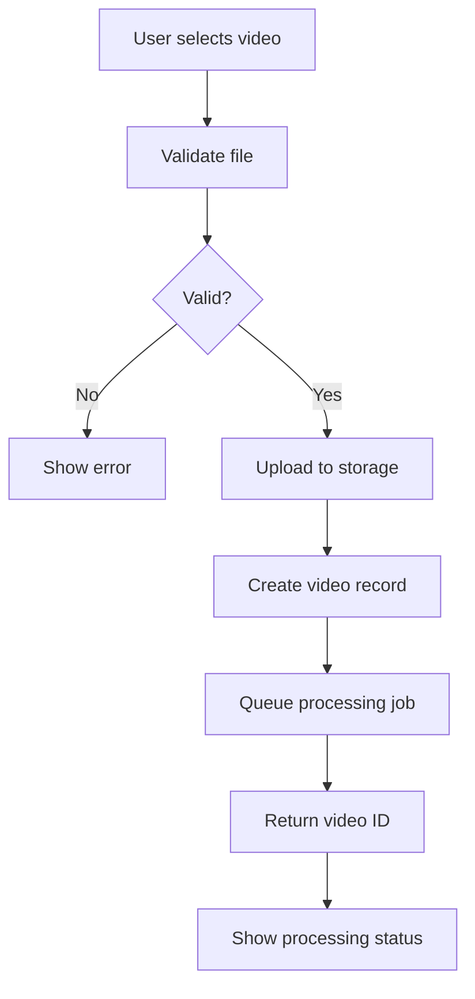
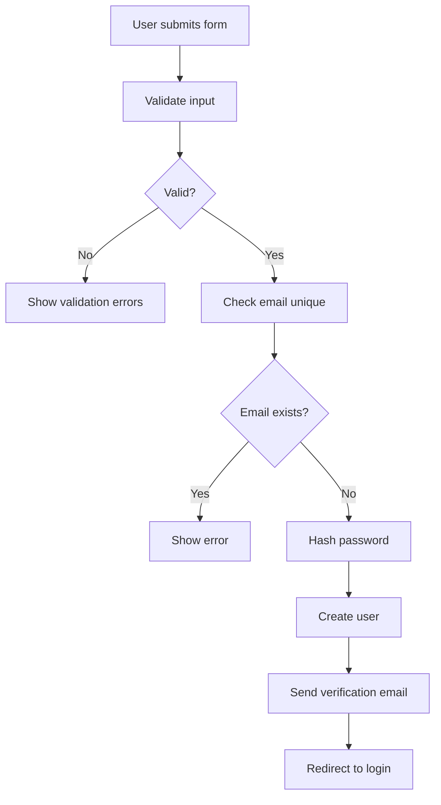
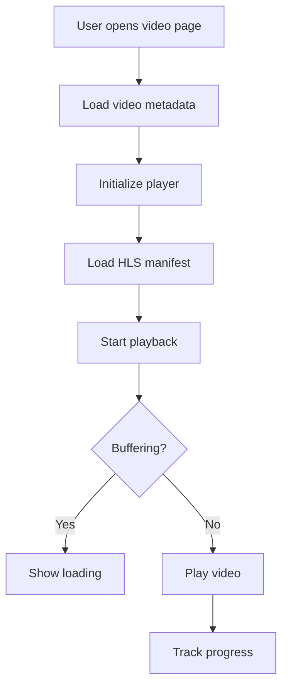
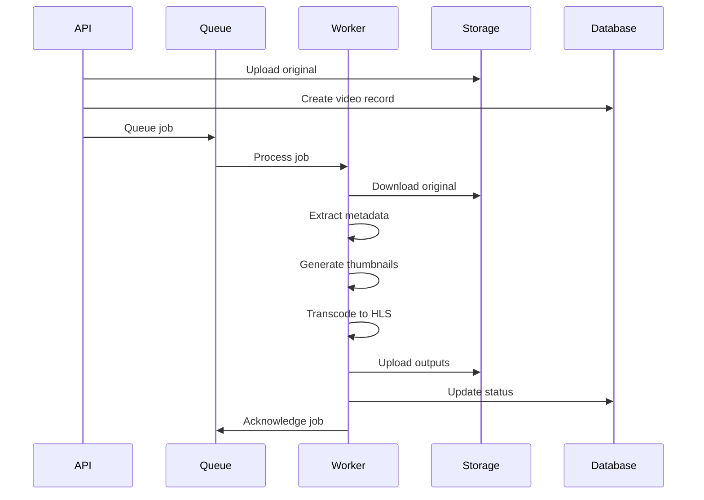
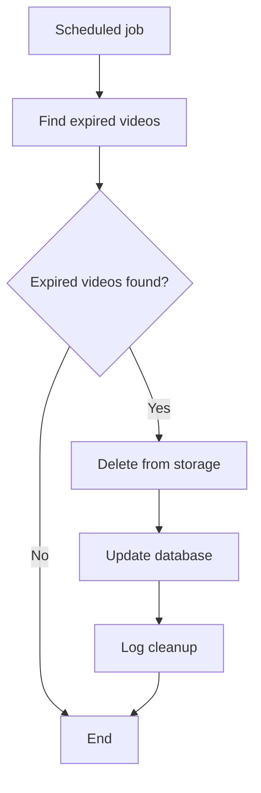
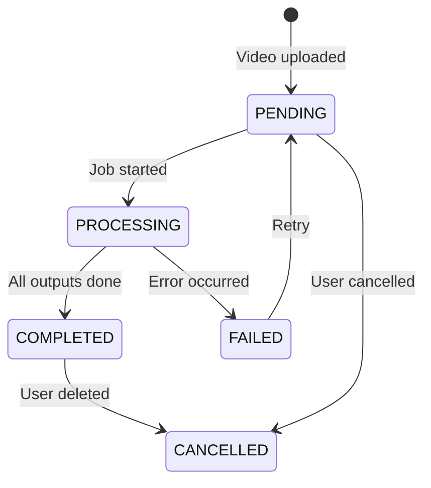
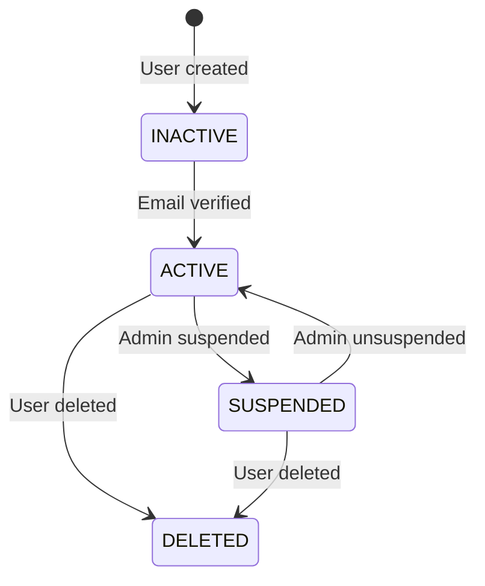
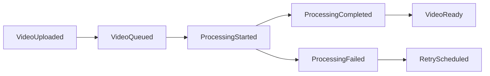
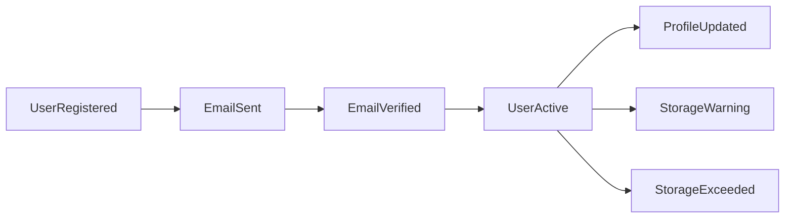

# Workflow

## Purpose

This document defines the business workflows and processes for the Automated Cloud-Native Video Transcoding and Streaming Platform.

## Scope

User workflows, system processes, and business logic flows.

## Audience

- Product Managers
- Engineering Teams
- QA Engineers

## Dependencies

- [00_Project_Standards.md](./00_Project_Standards.md) - Development standards
- [02_Requirements.md](./02_Requirements.md) - System requirements
- [03_PRD.md](./03_PRD.md) - Product requirements

## Related Documents

- [12_Queue_System.md](./12_Queue_System.md) - Queue implementation
- [15_Transcoding_Pipeline.md](./15_Transcoding_Pipeline.md) - Video processing
- [21_Background_Jobs.md](./21_Background_Jobs.md) - Background jobs

## Table of Contents

1. [User Workflows](#user-workflows)
2. [System Workflows](#system-workflows)
3. [Business Rules](#business-rules)
4. [State Machines](#state-machines)
5. [Event Flows](#event-flows)
6. [Design Decisions](#design-decisions)
7. [Notes](#notes)
8. [References](#references)
9. [Future Documents](#future-documents)
10. [Revision History](#revision-history)

## User Workflows

### Video Upload Workflow

### User Registration Workflow

### Video Playback Workflow

## System Workflows

### Transcoding Workflow

### Storage Cleanup Workflow

## Business Rules

### Storage Quota Rules

| Rule | Description |
|------|-------------|
| R001 | Users cannot upload if storage quota exceeded |
| R002 | Storage used is updated after each upload |
| R003 | Warning email sent at 80% quota |
| R004 | Upload blocked at 100% quota |

### Video Processing Rules

| Rule | Description |
|------|-------------|
| R010 | Videos are processed in order of upload |
| R011 | Failed jobs are retried 3 times |
| R012 | Jobs are cancelled after max retries |
| R013 | Processing priority based on user tier |

### User Management Rules

| Rule | Description |
|------|-------------|
| R020 | Users are created with USER role |
| R021 | Only admins can change roles |
| R022 | Deleted users are soft-deleted |
| R023 | Email verification required for login |

## State Machines

### Video Status State Machine

### User Status State Machine

## Event Flows

### Video Events

### User Events

## Design Decisions

### Decision: Event-Driven Processing

**Status**: Accepted

**Context**: Video processing is long-running and asynchronous.

**Decision**: Use event-driven architecture with BullMQ.

**Consequences**:
- Decoupled components
- Better scalability
- Complex error handling

### Decision: Soft Delete

**Status**: Accepted

**Context**: Need to maintain data for audit and recovery.

**Decision**: Use soft delete with status field.

**Consequences**:
- Data recovery possible
- Audit trail maintained
- Query complexity

## Notes

- All workflows are idempotent
- State changes are logged
- Business rules are enforced at application level

## References

- [State Machine Pattern](https://refactoring.guru/design-patterns/state)

## Future Documents

- [12_Queue_System.md](./12_Queue_System.md) - Queue implementation
- [15_Transcoding_Pipeline.md](./15_Transcoding_Pipeline.md) - Video processing

## Revision History

| Date | Version | Author | Changes |
|------|---------|--------|---------|
| 2024-01-15 | 1.0.0 | Product Team | Initial version |