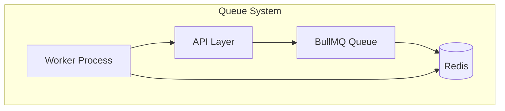
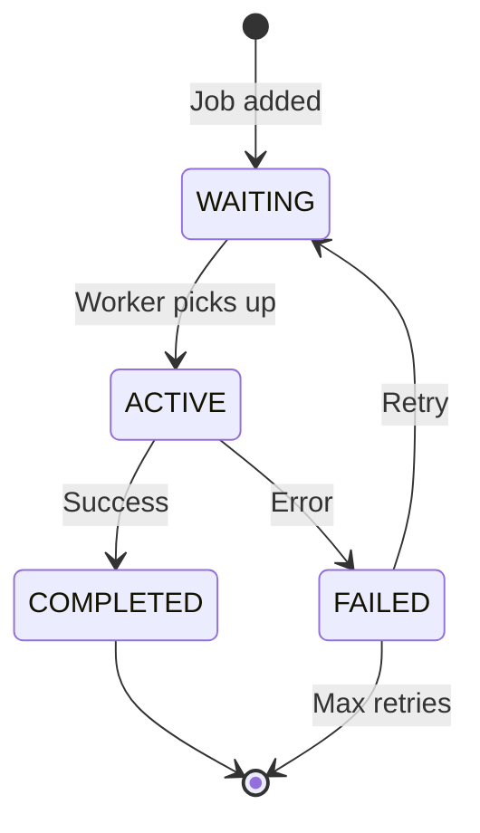

# Queue System

## Purpose

This document defines the queue system architecture for the Automated Cloud-Native Video Transcoding and Streaming Platform using BullMQ.

## Scope

Job queue design, worker implementation, and processing strategies.

## Audience

- Backend Engineers
- DevOps Engineers
- System Architects

## Dependencies

- [00_Project_Standards.md](./00_Project_Standards.md) - Development standards
- [05_Tech_Stack.md](./05_Tech_Stack.md) - Technology stack
- [11_Workflow.md](./11_Workflow.md) - Business workflows

## Related Documents

- [15_Transcoding_Pipeline.md](./15_Transcoding_Pipeline.md) - Video processing
- [21_Background_Jobs.md](./21_Background_Jobs.md) - Background jobs
- [20_Logging_Monitoring.md](./20_Logging_Monitoring.md) - Monitoring

## Table of Contents

1. [Queue Overview](#queue-overview)
2. [Queue Architecture](#queue-architecture)
3. [Job Types](#job-types)
4 [Job Lifecycle](#job-lifecycle)
5. [Worker Implementation](#worker-implementation)
6. [Priority System](#priority-system)
7. [Retry Strategy](#retry-strategy)
8. [Monitoring](#monitoring)
9. [Design Decisions](#design-decisions)
10. [Notes](#notes)
11. [References](#references)
12. [Future Documents](#future-documents)
13. [Revision History](#revision-history)

## Queue Overview



## Queue Architecture

### Components

| Component | Description |
|-----------|-------------|
| Queue | BullMQ queue for job management |
| Redis | Job storage and pub/sub |
| Worker | Processes jobs from queue |
| Scheduler | Delayed and recurring jobs |

### Queue Configuration

```typescript
const queueConfig = {
  connection: {
    host: process.env.REDIS_HOST,
    port: parseInt(process.env.REDIS_PORT),
    password: process.env.REDIS_PASSWORD,
  },
  defaultJobOptions: {
    attempts: 3,
    backoff: {
      type: 'exponential',
      delay: 1000,
    },
    removeOnComplete: true,
    removeOnFail: false,
  },
};
```

## Job Types

### Video Transcoding Job

```typescript
interface TranscodeJob {
  videoId: string;
  userId: string;
  resolutions: Resolution[];
  priority: number;
}

interface Resolution {
  name: '240p' | '360p' | '480p' | '720p' | '1080p' | '4k';
  width: number;
  height: number;
  bitrate: number;
}
```

### Thumbnail Generation Job

```typescript
interface ThumbnailJob {
  videoId: string;
  timestamps: number[]; // seconds
  width: number;
  height: number;
}
```

### Metadata Extraction Job

```typescript
interface MetadataJob {
  videoId: string;
  filePath: string;
}
```

## Job Lifecycle



## Worker Implementation

### Worker Setup

```typescript
import { Worker, Queue } from 'bullmq';

const transcodeWorker = new Worker(
  'transcode',
  async (job) => {
    const { videoId, resolutions } = job.data;
    
    // Download original
    const video = await downloadVideo(videoId);
    
    // Extract metadata
    const metadata = await extractMetadata(video.path);
    
    // Transcode to each resolution
    for (const resolution of resolutions) {
      await transcode(video.path, resolution);
    }
    
    // Update database
    await updateVideoStatus(videoId, 'COMPLETED');
  },
  {
    concurrency: 4,
    removeOnFail: false,
  }
);
```

### Worker Events

```typescript
transcodeWorker.on('completed', (job) => {
  logger.info('Job completed', { jobId: job.id });
});

transcodeWorker.on('failed', (job, err) => {
  logger.error('Job failed', { jobId: job?.id, error: err.message });
});

transcodeWorker.on('progress', (job, progress) => {
  logger.info('Job progress', { jobId: job.id, progress });
});
```

## Priority System

### Priority Levels

| Priority | Use Case |
|----------|----------|
| 1 | Critical system jobs |
| 5 | Admin user videos |
| 10 | Paid tier users |
| 20 | Free tier users |
| 50 | Default |

### Priority Configuration

```typescript
const getPriority = (userRole: Role, isPaid: boolean): number => {
  if (userRole === Role.SUPER_ADMIN) return 1;
  if (userRole === Role.ADMIN) return 5;
  if (isPaid) return 10;
  return 20;
};
```

## Retry Strategy

### Exponential Backoff

| Attempt | Delay |
|---------|-------|
| 1 | 1 second |
| 2 | 2 seconds |
| 3 | 4 seconds |

### Retry Configuration

```typescript
const retryConfig = {
  attempts: 3,
  backoff: {
    type: 'exponential',
    delay: 1000,
  },
  removeOnFail: false,
};
```

## Monitoring

### Queue Metrics

| Metric | Description |
|--------|-------------|
| waiting | Jobs waiting to be processed |
| active | Jobs currently processing |
| completed | Successfully completed jobs |
| failed | Failed jobs |
| delayed | Delayed jobs |

### Prometheus Metrics

```typescript
import { Queue } from 'bullmq';
import client from 'prom-client';

const queueGauge = new client.Gauge({
  name: 'queue_jobs_total',
  help: 'Total jobs in queue',
  labelNames: ['status', 'queue'],
});

const updateQueueMetrics = async () => {
  const counts = await Queue.getJobCounts('transcode');
  queueGauge.labels({ status: 'waiting', queue: 'transcode' }).set(counts.waiting);
  queueGauge.labels({ status: 'active', queue: 'transcode' }).set(counts.active);
  queueGauge.labels({ status: 'failed', queue: 'transcode' }).set(counts.failed);
};
```

## Design Decisions

### Decision: BullMQ over RabbitMQ

**Status**: Accepted

**Context**: Need for Redis-based queue with good Node.js support.

**Decision**: Use BullMQ for job queue management.

**Consequences**:
- Redis dependency
- Good Node.js integration
- Built-in retry and scheduling

### Decision: Separate Queues

**Status**: Accepted

**Context**: Different job types have different requirements.

**Decision**: Use separate queues for transcoding, thumbnails, and metadata.

**Consequences**:
- Independent scaling
- Different priorities
- Isolated failures

## Notes

- Workers are stateless
- Jobs are idempotent
- Queue metrics are exposed for monitoring

## References

- [BullMQ Documentation](https://docs.bullmq.io)

## Future Documents

- [15_Transcoding_Pipeline.md](./15_Transcoding_Pipeline.md) - Video processing
- [20_Logging_Monitoring.md](./20_Logging_Monitoring.md) - Monitoring

## Revision History

| Date | Version | Author | Changes |
|------|---------|--------|---------|
| 2024-01-15 | 1.0.0 | Backend Team | Initial version |