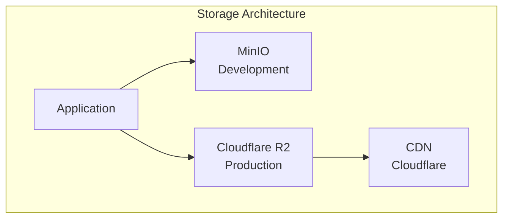

# Storage Architecture

## Purpose

This document defines the storage architecture for the Automated Cloud-Native Video Transcoding and Streaming Platform using MinIO and Cloudflare R2.

## Scope

Object storage design, file organization, and CDN integration.

## Audience

- DevOps Engineers
- Backend Engineers
- System Architects

## Dependencies

- [00_Project_Standards.md](./00_Project_Standards.md) - Development standards
- [05_Tech_Stack.md](./05_Tech_Stack.md) - Technology stack
- [04_System_Architecture.md](./04_System_Architecture.md) - System architecture

## Related Documents

- [14_Streaming_Architecture.md](./14_Streaming_Architecture.md) - Streaming
- [15_Transcoding_Pipeline.md](./15_Transcoding_Pipeline.md) - Video processing
- [18_Caching.md](./18_Caching.md) - Caching

## Table of Contents

1. [Storage Overview](#storage-overview)
2. [Object Storage](#object-storage)
3. [File Organization](#file-organization)
4. [Storage Tiers](#storage-tiers)
5. [CDN Integration](#cdn-integration)
6. [Backup Strategy](#backup-strategy)
7. [Security](#security)
8. [Performance](#performance)
9. [Design Decisions](#design-decisions)
10. [Notes](#notes)
11. [References](#references)
12. [Future Documents](#future-documents)
13. [Revision History](#revision-history)

## Storage Overview



## Object Storage

### MinIO Configuration

```yaml
minio:
  endpoint: localhost
  port: 9000
  accessKey: minioadmin
  secretKey: minioadmin
  bucket: video-streaming
  useSSL: false
```

### Cloudflare R2 Configuration

```yaml
r2:
  accountId: ${R2_ACCOUNT_ID}
  accessKey: ${R2_ACCESS_KEY}
  secretKey: ${R2_SECRET_KEY}
  bucket: video-streaming-production
```

### S3 Client

```typescript
import { S3Client } from '@aws-sdk/client-s3';

const s3Client = new S3Client({
  endpoint: process.env.MINIO_ENDPOINT,
  region: 'us-east-1',
  credentials: {
    accessKeyId: process.env.MINIO_ACCESS_KEY,
    secretAccessKey: process.env.MINIO_SECRET_KEY,
  },
  forcePathStyle: true,
});
```

## File Organization

### Directory Structure

```
{video-id}/
├── original.mp4
├── metadata.json
├── thumbnails/
│   ├── 10s.jpg
│   ├── 30s.jpg
│   └── 60s.jpg
├── preview.gif
├── hls/
│   ├── 240p/
│   │   ├── master.m3u8
│   │   ├── segment_0.ts
│   │   └── segment_1.ts
│   ├── 360p/
│   ├── 480p/
│   ├── 720p/
│   ├── 1080p/
│   └── 4k/
└── dash/
    └── (future)
```

### File Naming Convention

| Type | Pattern |
|------|---------|
| Video ID | video_{cuid} |
| Thumbnail | {timestamp}s.jpg |
| HLS Manifest | master.m3u8 |
| HLS Segment | segment_{index}.ts |
| Preview GIF | preview.gif |

## Storage Tiers

### Development Tier

| Component | Storage |
|-----------|---------|
| Original videos | MinIO |
| Transcoded videos | MinIO |
| Thumbnails | MinIO |
| Metadata | MinIO |

### Production Tier

| Component | Storage |
|-----------|---------|
| Original videos | Cloudflare R2 |
| Transcoded videos | Cloudflare R2 |
| Thumbnails | Cloudflare R2 |
| Metadata | Cloudflare R2 |
| CDN | Cloudflare CDN |

## CDN Integration

### CDN Configuration

```nginx
location ~* \.(m3u8|ts|mp4|jpg|gif)$ {
    proxy_pass http://minio;
    proxy_cache video_cache;
    proxy_cache_valid 200 1h;
    proxy_cache_valid 404 1m;
    add_header Cache-Control "public, max-age=3600";
}
```

### Cache Headers

| File Type | Cache Duration |
|-----------|----------------|
| HLS Manifest | 1 hour |
| HLS Segments | 24 hours |
| Thumbnails | 7 days |
| Preview GIF | 7 days |
| Original Video | No cache |

## Backup Strategy

### Backup Schedule

| Data | Frequency | Retention |
|------|-----------|-----------|
| Database | Daily | 30 days |
| Original Videos | Never | Permanent |
| Transcoded Videos | Never | Permanent |
| Thumbnails | Never | Permanent |

### Backup Implementation

```bash
# Daily database backup
pg_dump -h $DB_HOST -U $DB_USER $DB_NAME > backup_$(date +%Y%m%d).sql

# Upload to R2
aws s3 cp backup_$(date +%Y%m%d).sql s3://backups/
```

## Security

### Bucket Policy

```json
{
  "Version": "2012-10-17",
  "Statement": [
    {
      "Effect": "Allow",
      "Principal": "*",
      "Action": "s3:GetObject",
      "Resource": "arn:aws:s3:::video-streaming-production/hls/*",
      "Condition": {
        "StringEquals": {
          "s3:ExistingObjectTag/public": "true"
        }
      }
    }
  ]
}
```

### Signed URLs

```typescript
const signedUrl = await s3Client.getSignedUrl('getObject', {
  Bucket: process.env.MINIO_BUCKET,
  Key: `${videoId}/hls/720p/master.m3u8`,
  Expires: 3600, // 1 hour
});
```

## Performance

### Upload Optimization

| Strategy | Implementation |
|----------|----------------|
| Multipart Upload | 50MB chunks |
| Parallel Upload | 4 concurrent chunks |
| Resume Support | Upload ID tracking |

### Download Optimization

| Strategy | Implementation |
|----------|----------------|
| Range Requests | HTTP Range header |
| CDN Caching | 24-hour TTL |
| Compression | gzip for manifests |

## Design Decisions

### Decision: MinIO for Development

**Status**: Accepted

**Context**: Need for S3-compatible storage in development.

**Decision**: Use MinIO locally, Cloudflare R2 in production.

**Consequences**:
- Same API for both environments
- No vendor lock-in
- Easy local development

### Decision: HLS Directory Structure

**Status**: Accepted

**Context**: Need for organized, cacheable video files.

**Decision**: Separate directories per resolution.

**Consequences**:
- Easy to manage
- CDN-friendly
- Clear organization

## Notes

- All files are stored with UUID-based names
- Storage is isolated per environment
- CDN is optional for production

## References

- [MinIO Documentation](https://min.io/docs)
- [Cloudflare R2 Documentation](https://developers.cloudflare.com/r2)

## Future Documents

- [14_Streaming_Architecture.md](./14_Streaming_Architecture.md) - Streaming
- [18_Caching.md](./18_Caching.md) - Caching

## Revision History

| Date | Version | Author | Changes |
|------|---------|--------|---------|
| 2024-01-15 | 1.0.0 | Infrastructure Team | Initial version |