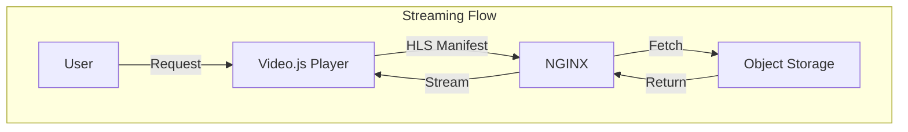
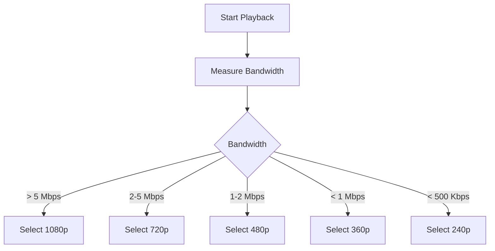

# Streaming Architecture

## Purpose

This document defines the streaming architecture for the Automated Cloud-Native Video Transcoding and Streaming Platform using HLS and Video.js.

## Scope

Video streaming protocols, player integration, and adaptive streaming.

## Audience

- Backend Engineers
- Frontend Engineers
- DevOps Engineers

## Dependencies

- [00_Project_Standards.md](./00_Project_Standards.md) - Development standards
- [05_Tech_Stack.md](./05_Tech_Stack.md) - Technology stack
- [13_Storage_Architecture.md](./13_Storage_Architecture.md) - Storage

## Related Documents

- [13_Storage_Architecture.md](./13_Storage_Architecture.md) - Storage
- [15_Transcoding_Pipeline.md](./15_Transcoding_Pipeline.md) - Transcoding
- [24_UI_UX.md](./24_UI_UX.md) - UI/UX

## Table of Contents

1. [Streaming Overview](#streaming-overview)
2. [HLS Protocol](#hls-protocol)
3. [Video Player](#video-player)
4. [Adaptive Streaming](#adaptive-streaming)
5. [Stream Security](#stream-security)
6. [Performance Optimization](#performance-optimization)
7. [Bandwidth Management](#bandwidth-management)
8. [Design Decisions](#design-decisions)
9. [Notes](#notes)
10. [References](#references)
11. [Future Documents](#future-documents)
12. [Revision History](#revision-history)

## Streaming Overview



## HLS Protocol

### HLS Manifest Structure

```m3u8
#EXTM3U
#EXT-X-VERSION:3
#EXT-X-INDEPENDENT-SEGMENTS

#EXT-X-STREAM-INF:BANDWIDTH=2400000,RESOLUTION=1280x720,CODECS="avc1.42001e,mp4a.40.2"
720p/master.m3u8

#EXT-X-STREAM-INF:BANDWIDTH=1200000,RESOLUTION=854x480,CODECS="avc1.42001e,mp4a.40.2"
480p/master.m3u8

#EXT-X-STREAM-INF:BANDWIDTH=800000,RESOLUTION=640x360,CODECS="avc1.42001e,mp4a.40.2"
360p/master.m3u8
```

### Segment Format

```m3u8
#EXTM3U
#EXT-X-VERSION:3
#EXT-X-TARGETDURATION:10
#EXT-X-MEDIA-SEQUENCE:0

#EXTINF:10.0,
segment_0.ts
#EXTINF:10.0,
segment_1.ts
#EXT-X-ENDLIST
```

## Video Player

### Video.js Configuration

```typescript
import videojs from 'video.js';

const player = videojs('my-video', {
  autoplay: false,
  controls: true,
  preload: 'auto',
  fluid: true,
  html5: {
    hls: {
      enableWorker: true,
      smoothQualityChange: true,
    },
  },
});
```

### Player Features

| Feature | Description |
|---------|-------------|
| Quality Selector | Manual resolution selection |
| Auto Quality | Adaptive based on bandwidth |
| Fullscreen | Fullscreen mode support |
| Captions | Subtitle support (future) |
| Picture-in-Picture | PiP support |

## Adaptive Streaming

### Quality Selection Algorithm



### Buffer Management

| Buffer Size | Behavior |
|-------------|----------|
| 0-10s | Low quality |
| 10-30s | Medium quality |
| 30s+ | High quality |

## Stream Security

### Signed URLs

```typescript
// Generate signed URL for private videos
const url = await s3Client.getSignedUrl('getObject', {
  Bucket: process.env.MINIO_BUCKET,
  Key: `${videoId}/hls/720p/master.m3u8`,
  Expires: 3600,
});
```

### Token Validation

```typescript
// Validate token before streaming
app.get('/stream/:videoId/:resolution/master.m3u8', 
  authMiddleware, 
  async (req, res) => {
    const video = await videoService.getVideo(req.params.videoId);
    
    if (!video.isPublic && video.userId !== req.user.id) {
      return res.status(403).send('Forbidden');
    }
    
    // Stream manifest
  }
);
```

## Performance Optimization

### NGINX Configuration

```nginx
location ~* \.(m3u8|ts)$ {
    proxy_pass http://minio;
    proxy_cache video_cache;
    proxy_cache_valid 200 1h;
    proxy_cache_key $uri;
    
    # Enable range requests
    proxy_force_ranges on;
    
    # Add cache headers
    add_header Cache-Control "public, max-age=3600";
    add_header Access-Control-Allow-Origin "*";
}
```

### Cache Strategy

| Content | Cache TTL |
|---------|-----------|
| HLS Manifest | 1 hour |
| Video Segments | 24 hours |
| Thumbnails | 7 days |

## Bandwidth Management

### Bitrate Ladder

| Resolution | Video Bitrate | Audio Bitrate | Total |
|------------|---------------|---------------|-------|
| 240p | 400 kbps | 64 kbps | 464 kbps |
| 360p | 800 kbps | 96 kbps | 896 kbps |
| 480p | 1200 kbps | 128 kbps | 1328 kbps |
| 720p | 2400 kbps | 192 kbps | 2592 kbps |
| 1080p | 4800 kbps | 256 kbps | 5056 kbps |
| 4K | 12000 kbps | 384 kbps | 12384 kbps |

### Bandwidth Detection

```typescript
// Client-side bandwidth detection
const bandwidth = await player.tech_.getBandwidth();
const quality = selectQuality(bandwidth);
player.qualityLevel(quality);
```

## Design Decisions

### Decision: HLS over MPEG-DASH

**Status**: Accepted

**Context**: Need for broad device compatibility.

**Decision**: Use HLS as primary streaming protocol.

**Consequences**:
- Apple device support
- Industry standard
- Requires segment generation

### Decision: Video.js Player

**Status**: Accepted

**Context**: Need for customizable, open-source player.

**Decision**: Use Video.js with HLS support.

**Consequences**:
- Open source
- Customizable
- Good documentation

## Notes

- HLS is the only supported format
- Player is responsive
- Quality selection is automatic

## References

- [HLS Specification](https://tools.ietf.org/html/draft-pantos-http-live-streaming)
- [Video.js Documentation](https://videojs.com/docs)

## Future Documents

- [15_Transcoding_Pipeline.md](./15_Transcoding_Pipeline.md) - Transcoding
- [24_UI_UX.md](./24_UI_UX.md) - UI/UX

## Revision History

| Date | Version | Author | Changes |
|------|---------|--------|---------|
| 2024-01-15 | 1.0.0 | Streaming Team | Initial version |