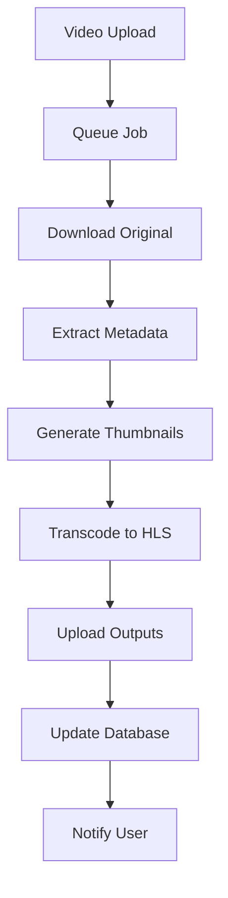
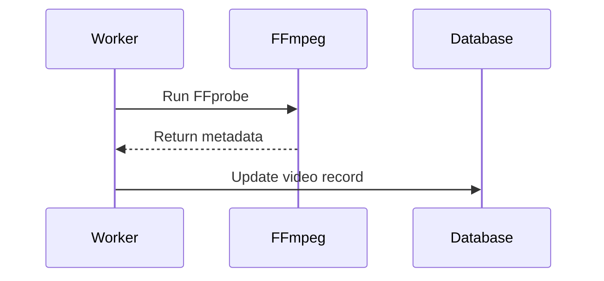
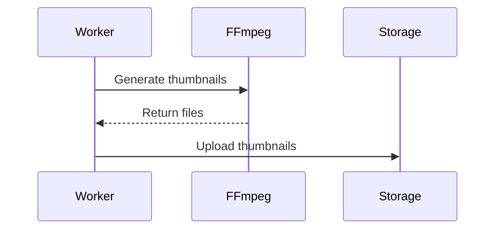
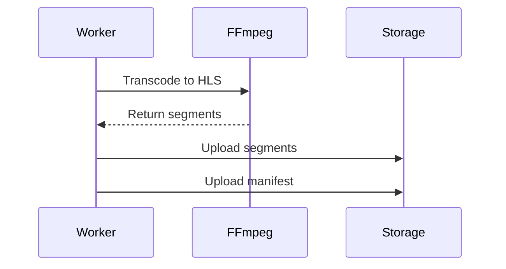

# Transcoding Pipeline

## Purpose

This document defines the video transcoding pipeline for the Automated Cloud-Native Video Transcoding and Streaming Platform using FFmpeg.

## Scope

Video processing workflows, FFmpeg configuration, and output generation.

## Audience

- Backend Engineers
- DevOps Engineers
- System Architects

## Dependencies

- [00_Project_Standards.md](./00_Project_Standards.md) - Development standards
- [05_Tech_Stack.md](./05_Tech_Stack.md) - Technology stack
- [12_Queue_System.md](./12_Queue_System.md) - Queue system
- [13_Storage_Architecture.md](./13_Storage_Architecture.md) - Storage

## Related Documents

- [14_Streaming_Architecture.md](./14_Streaming_Architecture.md) - Streaming
- [21_Background_Jobs.md](./21_Background_Jobs.md) - Background jobs

## Table of Contents

1. [Pipeline Overview](#pipeline-overview)
2. [FFmpeg Configuration](#ffmpeg-configuration)
3. [Processing Steps](#processing-steps)
4. [Output Formats](#output-formats)
5. [Performance Optimization](#performance-optimization)
6. [Error Handling](#error-handling)
7. [Monitoring](#monitoring)
8. [Design Decisions](#design-decisions)
9. [Notes](#notes)
10. [References](#references)
11. [Future Documents](#future-documents)
12. [Revision History](#revision-history)

## Pipeline Overview



## FFmpeg Configuration

### FFmpeg Command

```bash
ffmpeg -i input.mp4 \
  -c:v libx264 \
  -preset fast \
  -crf 23 \
  -c:a aac \
  -b:a 128k \
  -hls_time 10 \
  -hls_playlist_type event \
  -hls_segment_filename output_%03d.ts \
  output.m3u8
```

### FFprobe for Metadata

```bash
ffprobe -v quiet \
  -print_format json \
  -show_format \
  -show_streams \
  input.mp4
```

### FFmpeg Service

```typescript
@Injectable()
export class FFmpegService {
  async extractMetadata(filePath: string): Promise<VideoMetadata> {
    const command = `ffprobe -v quiet -print_format json -show_format -show_streams ${filePath}`;
    const output = await exec(command);
    return JSON.parse(output);
  }

  async transcodeToHLS(
    inputPath: string,
    outputPath: string,
    resolution: Resolution
  ): Promise<void> {
    const command = `ffmpeg -i ${inputPath} -vf scale=${resolution.width}:${resolution.height} -c:v libx264 -preset fast -crf 23 -c:a aac -b:a 128k -hls_time 10 -hls_playlist_type event ${outputPath}`;
    await exec(command);
  }

  async generateThumbnail(
    inputPath: string,
    outputPath: string,
    timestamp: number
  ): Promise<void> {
    const command = `ffmpeg -ss ${timestamp} -i ${inputPath} -vframes 1 -q:v 2 ${outputPath}`;
    await exec(command);
  }
}
```

## Processing Steps

### Step 1: Metadata Extraction



### Step 2: Thumbnail Generation



### Step 3: HLS Transcoding



## Output Formats

### HLS Output

| Resolution | Dimensions | Video Bitrate | Audio Bitrate |
|------------|------------|---------------|---------------|
| 240p | 426x240 | 400 kbps | 64 kbps |
| 360p | 640x360 | 800 kbps | 96 kbps |
| 480p | 854x480 | 1200 kbps | 128 kbps |
| 720p | 1280x720 | 2400 kbps | 192 kbps |
| 1080p | 1920x1080 | 4800 kbps | 256 kbps |
| 4K | 3840x2160 | 12000 kbps | 384 kbps |

### Thumbnail Output

| Type | Dimensions | Format |
|------|------------|--------|
| Preview | 1280x720 | JPEG |
| Grid | 160x90 | JPEG |

### Preview GIF

| Parameter | Value |
|-----------|-------|
| Duration | 3 seconds |
| FPS | 10 |
| Dimensions | 640x360 |
| Format | GIF |

## Performance Optimization

### Parallel Processing

```typescript
async processVideo(videoId: string): Promise<void> {
  const resolutions = ['240p', '360p', '480p', '720p', '1080p', '4k'];
  
  // Process all resolutions in parallel
  await Promise.all(
    resolutions.map(res => this.transcodeResolution(videoId, res))
  );
}
```

### Hardware Acceleration

```bash
# NVIDIA GPU
ffmpeg -hwaccel cuda -i input.mp4 -c:v h264_nvenc output.mp4

# Intel Quick Sync
ffmpeg -hwaccel qsv -i input.mp4 -c:v h264_qsv output.mp4
```

## Error Handling

### Retry Logic

```typescript
const retryConfig = {
  attempts: 3,
  backoff: {
    type: 'exponential',
    delay: 1000,
  },
};
```

### Error Types

| Error | Action |
|-------|--------|
| Invalid format | Fail immediately |
| Corrupted file | Fail after 1 retry |
| Storage error | Retry 3 times |
| FFmpeg crash | Retry 3 times |

## Monitoring

### Processing Metrics

| Metric | Description |
|--------|-------------|
| processing_time | Time to process video |
| output_size | Size of transcoded video |
| error_rate | Failed processing rate |
| queue_depth | Jobs waiting |

### Progress Tracking

```typescript
// Update progress during processing
await job.updateProgress(25); // Metadata extracted
await job.updateProgress(50); // Thumbnails done
await job.updateProgress(75); // Transcoding done
await job.updateProgress(100); // All done
```

## Design Decisions

### Decision: HLS Output

**Status**: Accepted

**Context**: Need for adaptive streaming with broad compatibility.

**Decision**: Use HLS as the only output format.

**Consequences**:
- Apple device support
- Industry standard
- Requires segment generation

### Decision: Multiple Resolutions

**Status**: Accepted

**Context**: Need for adaptive quality streaming.

**Decision**: Generate 6 resolutions (240p-4K).

**Consequences**:
- Better user experience
- Higher storage costs
- Longer processing time

## Notes

- FFmpeg runs in Docker container
- Processing is CPU-intensive
- Output is stored in object storage

## References

- [FFmpeg Documentation](https://ffmpeg.org/documentation.html)
- [HLS Specification](https://tools.ietf.org/html/draft-pantos-http-live-streaming)

## Future Documents

- [14_Streaming_Architecture.md](./14_Streaming_Architecture.md) - Streaming
- [21_Background_Jobs.md](./21_Background_Jobs.md) - Background jobs

## Revision History

| Date | Version | Author | Changes |
|------|---------|--------|---------|
| 2024-01-15 | 1.0.0 | Video Team | Initial version |