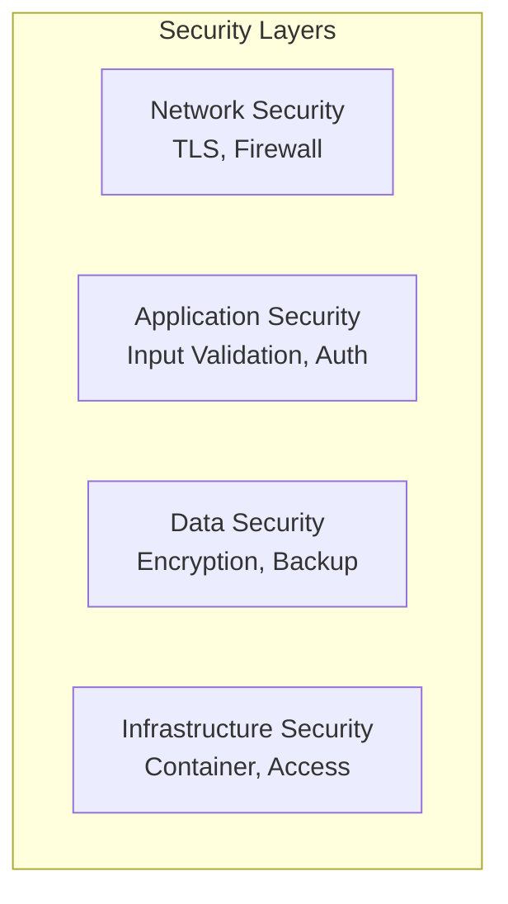

# Security

## Purpose

This document defines the security architecture for the Automated Cloud-Native Video Transcoding and Streaming Platform.

## Scope

Security controls, threat model, and compliance requirements.

## Audience

- Security Engineers
- DevOps Engineers
- Engineering Teams

## Dependencies

- [00_Project_Standards.md](./00_Project_Standards.md) - Development standards
- [05_Tech_Stack.md](./05_Tech_Stack.md) - Technology stack
- [09_Authentication.md](./09_Authentication.md) - Authentication

## Related Documents

- [08_API_Design.md](./08_API_Design.md) - API design
- [18_Caching.md](./18_Caching.md) - Caching
- [19_Error_Handling.md](./19_Error_Handling.md) - Error handling

## Table of Contents

1. [Security Overview](#security-overview)
2. [Threat Model](#threat-model)
3. [Authentication Security](#authentication-security)
4. [Authorization Security](#authorization-security)
5. [Data Security](#data-security)
6. [Network Security](#network-security)
7. [Application Security](#application-security)
8. [Infrastructure Security](#infrastructure-security)
9. [Compliance](#compliance)
10. [Security Testing](#security-testing)
11. [Design Decisions](#design-decisions)
12. [Notes](#notes)
13. [References](#references)
14. [Future Documents](#future-documents)
15. [Revision History](#revision-history)

## Security Overview



## Threat Model

### STRIDE Analysis

| Threat | Mitigation |
|--------|------------|
| **Spoofing** | JWT tokens, email verification |
| **Tampering** | Input validation, checksums |
| **Repudiation** | Audit logs, signed URLs |
| **Information Disclosure** | Encryption, RBAC |
| **Denial of Service** | Rate limiting, resource limits |
| **Elevation of Privilege** | Role-based access, least privilege |

## Authentication Security

### Password Security

- **Hashing**: bcrypt with cost factor 12
- **Storage**: Hashed passwords only
- **Validation**: Zod schema validation
- **Reset**: Time-limited tokens

### Token Security

- **Access Token**: 15 minutes expiry
- **Refresh Token**: 7 days expiry, stored in database
- **Signing**: Strong secret key (256-bit)
- **Revocation**: Token blacklist in Redis

## Authorization Security

### RBAC Implementation

| Role | Permissions |
|------|-------------|
| USER | Own videos only |
| ADMIN | All videos, user management |
| SUPER_ADMIN | Full system access |

### Resource Access

```typescript
// Check resource ownership
async canAccessVideo(userId: string, videoId: string): Promise<boolean> {
  const video = await this.videoRepository.findById(videoId);
  return video.userId === userId || this.hasAdminRole(userId);
}
```

## Data Security

### Encryption at Rest

- **Database**: PostgreSQL TDE (future)
- **Storage**: S3 SSE-S3
- **Backups**: Encrypted at rest

### Encryption in Transit

- **TLS 1.3**: All external communication
- **HTTPS**: Enforced for all endpoints
- **HSTS**: Strict-Transport-Security header

### Data Retention

| Data | Retention |
|------|-----------|
| User data | Until account deletion |
| Videos | Until user deletion |
| Audit logs | 90 days |
| System logs | 30 days |

## Network Security

### Firewall Rules

| Port | Service | Access |
|------|---------|--------|
| 443 | HTTPS | Public |
| 80 | HTTP | Redirect to 443 |
| 5432 | PostgreSQL | Private |
| 6379 | Redis | Private |
| 9000 | MinIO | Private |

### CORS Policy

```typescript
app.enableCors({
  origin: process.env.ALLOWED_ORIGINS?.split(','),
  methods: ['GET', 'POST', 'PATCH', 'DELETE'],
  credentials: true,
});
```

## Application Security

### Input Validation

```typescript
const videoUploadSchema = z.object({
  title: z.string().min(1).max(200),
  description: z.string().max(2000).optional(),
  file: z.instanceof(File).refine(
    (file) => file.size <= 5368709120, // 5GB
    'File too large'
  ),
});
```

### File Validation

- **Magic bytes**: Check file type
- **Extension**: Validate extension
- **Size**: Enforce size limits
- **Virus scan**: ClamAV integration (future)

### Rate Limiting

```typescript
app.use(rateLimit({
  windowMs: 60000, // 1 minute
  max: 100, // limit each IP to 100 requests per windowMs
  message: 'Too many requests',
}));
```

## Infrastructure Security

### Container Security

- **Base image**: Distroless or Alpine
- **User**: Non-root user
- **Secrets**: Environment variables, not files
- **Scanning**: Trivy security scan

### Kubernetes Security

```yaml
securityContext:
  runAsNonRoot: true
  runAsUser: 1000
  allowPrivilegeEscalation: false
  readOnlyRootFilesystem: true
```

## Compliance

### GDPR Compliance

- **Data portability**: Export user data
- **Right to deletion**: Delete user account
- **Consent**: Cookie consent banner
- **Privacy**: Privacy policy

### SOC 2 Compliance

- **Audit logs**: All actions logged
- **Access control**: RBAC implemented
- **Encryption**: Data encrypted
- **Monitoring**: Security events monitored

## Security Testing

### Automated Testing

| Test Type | Tool |
|-----------|------|
| SAST | SonarQube |
| DAST | OWASP ZAP |
| Dependency | Snyk |
| Container | Trivy |

### Penetration Testing

- **Frequency**: Annual
- **Scope**: All endpoints
- **Report**: Remediation plan

## Design Decisions

### Decision: bcrypt over Argon2

**Status**: Accepted

**Context**: Need for widely supported, secure hashing.

**Decision**: Use bcrypt with cost factor 12.

**Consequences**:
- Widely supported
- ~250ms per hash
- May upgrade in future

### Decision: JWT over Session

**Status**: Accepted

**Context**: Need for stateless, scalable authentication.

**Decision**: Use JWT with refresh token rotation.

**Consequences**:
- Stateless
- Horizontal scaling
- Token revocation complexity

## Notes

- Security is built into every layer
- Regular security audits required
- All vulnerabilities are patched within 72 hours

## References

- [OWASP Top 10](https://owasp.org/www-project-top-ten/)
- [NIST Cybersecurity Framework](https://www.nist.gov/cyberframework)

## Future Documents

- [18_Caching.md](./18_Caching.md) - Caching
- [19_Error_Handling.md](./19_Error_Handling.md) - Error handling

## Revision History

| Date | Version | Author | Changes |
|------|---------|--------|---------|
| 2024-01-15 | 1.0.0 | Security Team | Initial version |