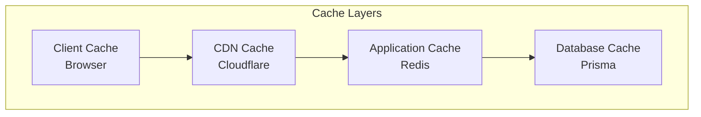

# Caching

## Purpose

This document defines the caching strategy for the Automated Cloud-Native Video Transcoding and Streaming Platform.

## Scope

Cache layers, strategies, and implementation details.

## Audience

- DevOps Engineers
- Backend Engineers
- System Architects

## Dependencies

- [00_Project_Standards.md](./00_Project_Standards.md) - Development standards
- [05_Tech_Stack.md](./05_Tech_5.0.0.md) - Technology stack
- [07_Database_Schema.md](./07_Database_Schema.md) - Database schema

## Related Documents

- [13_Storage_Architecture.md](./13_Storage_Architecture.md) - Storage
- [17_Security.md](./17_Security.md) - Security
- [20_Logging_Monitoring.md](./20_Logging_Monitoring.md) - Monitoring

## Table of Contents

1. [Cache Overview](#cache-overview)
2. [Cache Layers](#cache-layers)
3. [Redis Configuration](#redis-configuration)
4. [Cache Strategies](#cache-strategies)
5. [Cache Keys](#cache-keys)
6. [TTL Configuration](#ttl-configuration)
7. [Cache Invalidation](#cache-invalidation)
8. [Performance Metrics](#performance-metrics)
9. [Design Decisions](#design-decisions)
10. [Notes](#notes)
11. [References](#references)
12. [Future Documents](#future-documents)
13. [Revision History](#revision-history)

## Cache Overview



## Cache Layers

### Client-Side Cache

| Data | TTL | Storage |
|------|-----|---------|
| User profile | 5 minutes | LocalStorage |
| Video list | 1 minute | Memory |
| API responses | 30 seconds | React Query |

### CDN Cache

| Data | TTL |
|------|-----|
| HLS segments | 24 hours |
| Thumbnails | 7 days |
| Preview GIFs | 7 days |

### Application Cache (Redis)

| Data | TTL |
|------|-----|
| Session data | 7 days |
| Rate limit counters | 1 minute |
| Processing status | 1 hour |
| Video metadata | 1 hour |

### Database Cache

| Data | TTL |
|------|-----|
| Query results | 5 minutes |
| Connection pool | N/A |

## Redis Configuration

```yaml
redis:
  host: ${REDIS_HOST}
  port: ${REDIS_PORT}
  password: ${REDIS_PASSWORD}
  tls: true
  maxRetries: 3
  retryDelay: 1000
```

### Redis Client

```typescript
import { createClient } from 'redis';

const redis = createClient({
  url: process.env.REDIS_URL,
  socket: {
    tls: true,
  },
});

await redis.connect();
```

## Cache Strategies

### Cache-Aside Pattern

```typescript
async getVideo(id: string): Promise<Video> {
  const cached = await redis.get(`video:${id}`);
  if (cached) return JSON.parse(cached);
  
  const video = await this.prisma.video.findUnique({ where: { id } });
  await redis.setEx(`video:${id}`, 3600, JSON.stringify(video));
  
  return video;
}
```

### Write-Through Pattern

```typescript
async updateVideo(id: string, data: UpdateVideoDto): Promise<Video> {
  const video = await this.prisma.video.update({
    where: { id },
    data,
  });
  
  await redis.setEx(`video:${id}`, 3600, JSON.stringify(video));
  
  return video;
}
```

## Cache Keys

### Key Naming Convention

| Pattern | Example |
|---------|---------|
| User | user:{id} |
| Video | video:{id} |
| Video list | user:{id}:videos |
| Processing status | video:{id}:status |
| Rate limit | rate:{userId}:{endpoint} |

### Key Structure

```typescript
const cacheKeys = {
  user: (id: string) => `user:${id}`,
  video: (id: string) => `video:${id}`,
  videoList: (userId: string, page: number) => `user:${userId}:videos:${page}`,
  processingStatus: (videoId: string) => `video:${videoId}:status`,
  rateLimit: (userId: string, endpoint: string) => `rate:${userId}:${endpoint}`,
};
```

## TTL Configuration

### Time-to-Live Settings

| Data Type | TTL | Reason |
|-----------|-----|--------|
| User session | 7 days | Refresh token expiry |
| Video metadata | 1 hour | Infrequent changes |
| Processing status | 1 hour | Real-time updates |
| Rate limit | 1 minute | Sliding window |
| API response | 30 seconds | Fresh data |

## Cache Invalidation

### Event-Based Invalidation

```typescript
// Invalidate cache on update
@EventsHandler(VideoUpdatedEvent)
export class VideoCacheHandler {
  async handle(event: VideoUpdatedEvent) {
    await redis.del(`video:${event.videoId}`);
  }
}
```

### Time-Based Invalidation

- Redis TTL handles automatic expiration
- No manual cleanup required

## Performance Metrics

### Cache Hit Ratio

| Layer | Target |
|-------|--------|
| Redis | > 80% |
| CDN | > 90% |
| Client | > 70% |

### Metrics Collection

```typescript
const cacheHitCounter = new client.Counter({
  name: 'cache_hits_total',
  help: 'Total cache hits',
  labelNames: ['layer', 'key_type'],
});

const cacheMissCounter = new client.Counter({
  name: 'cache_misses_total',
  help: 'Total cache misses',
  labelNames: ['layer', 'key_type'],
});
```

## Design Decisions

### Decision: Redis for Session Storage

**Status**: Accepted

**Context**: Need for distributed, fast session storage.

**Decision**: Use Redis for session and cache storage.

**Consequences**:
- Fast access
- Distributed sessions
- Additional infrastructure

### Decision: Cache-Aside Pattern

**Status**: Accepted

**Context**: Need for simple, reliable caching.

**Decision**: Use cache-aside pattern for most data.

**Consequences**:
- Simple implementation
- Cache miss penalty
- Eventual consistency

## Notes

- All cache keys use consistent naming
- TTL is set appropriately for data type
- Cache metrics are monitored

## References

- [Redis Documentation](https://redis.io/documentation)
- [Caching Best Practices](https://aws.amazon.com/caching)

## Future Documents

- [20_Logging_Monitoring.md](./20_Logging_Monitoring.md) - Monitoring

## Revision History

| Date | Version | Author | Changes |
|------|---------|--------|---------|
| 2024-01-15 | 1.0.0 | Infrastructure Team | Initial version |