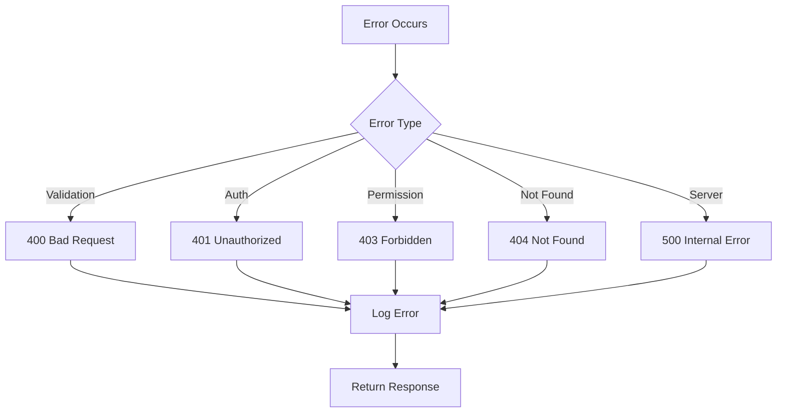

# Error Handling

## Purpose

This document defines the error handling strategy for the Automated Cloud-Native Video Transcoding and Streaming Platform.

## Scope

Error types, handling patterns, and logging integration.

## Audience

- Backend Engineers
- Frontend Engineers
- QA Engineers

## Dependencies

- [00_Project_Standards.md](./00_Project_Standards.md) - Development standards
- [05_Tech_Stack.md](./05_Tech_Stack.md) - Technology stack
- [08_API_Design.md](./08_API_Design.md) - API design

## Related Documents

- [20_Logging_Monitoring.md](./20_Logging_Monitoring.md) - Monitoring
- [17_Security.md](./17_Security.md) - Security

## Table of Contents

1. [Error Handling Overview](#error-handling-overview)
2. [Error Types](#error-types)
3. [Error Codes](#error-codes)
4. [Exception Handling](#exception-handling)
5. [API Error Responses](#api-error-responses)
6. [Frontend Error Handling](#frontend-error-handling)
7. [Logging Integration](#logging-integration)
8. [Monitoring](#monitoring)
9. [Design Decisions](#design-decisions)
10. [Notes](#notes)
11. [References](#references)
12. [Future Documents](#future-documents)
13. [Revision History](#revision-history)

## Error Handling Overview



## Error Types

### Application Errors

| Type | Description |
|------|-------------|
| ValidationError | Input validation failed |
| AuthenticationError | Invalid or missing credentials |
| AuthorizationError | Insufficient permissions |
| NotFoundError | Resource not found |
| ConflictError | Resource already exists |
| RateLimitError | Too many requests |
| ProcessingError | Video processing failed |

### System Errors

| Type | Description |
|------|-------------|
| DatabaseError | Database connection/query failed |
| StorageError | Object storage operation failed |
| QueueError | Job queue operation failed |
| ExternalError | Third-party service failed |

## Error Codes

### Error Code Enum

```typescript
enum ErrorCode {
  VALIDATION_ERROR = 'VALIDATION_ERROR',
  AUTHENTICATION_ERROR = 'AUTHENTICATION_ERROR',
  AUTHORIZATION_ERROR = 'AUTHORIZATION_ERROR',
  NOT_FOUND = 'NOT_FOUND',
  CONFLICT = 'CONFLICT',
  RATE_LIMIT = 'RATE_LIMIT',
  INTERNAL_ERROR = 'INTERNAL_ERROR',
  PROCESSING_ERROR = 'PROCESSING_ERROR',
}
```

### HTTP Status Mapping

| Error Code | HTTP Status |
|------------|-------------|
| VALIDATION_ERROR | 400 |
| AUTHENTICATION_ERROR | 401 |
| AUTHORIZATION_ERROR | 403 |
| NOT_FOUND | 404 |
| CONFLICT | 409 |
| RATE_LIMIT | 429 |
| INTERNAL_ERROR | 500 |
| PROCESSING_ERROR | 500 |

## Exception Handling

### Global Exception Filter

```typescript
@Catch()
export class GlobalExceptionFilter implements ExceptionFilter {
  catch(exception: unknown, host: ArgumentsHost) {
    const ctx = host.switchToHttp();
    const response = ctx.getResponse<Response>();
    
    let status = 500;
    let code = ErrorCode.INTERNAL_ERROR;
    let message = 'Internal server error';
    
    if (exception instanceof BadRequestException) {
      status = 400;
      code = ErrorCode.VALIDATION_ERROR;
      message = exception.message;
    } else if (exception instanceof UnauthorizedException) {
      status = 401;
      code = ErrorCode.AUTHENTICATION_ERROR;
    }
    
    response.status(status).json({
      error: {
        code,
        message,
      },
      meta: {
        timestamp: new Date().toISOString(),
        requestId: ctx.getRequest().headers['x-request-id'],
      },
    });
  }
}
```

### Custom Exceptions

```typescript
export class VideoProcessingError extends InternalServerErrorException {
  constructor(message: string, public readonly videoId: string) {
    super(message);
  }
}

export class StorageQuotaExceededError extends ForbiddenException {
  constructor(public readonly quota: number) {
    super('Storage quota exceeded');
  }
}
```

## API Error Responses

### Error Response Format

```json
{
  "error": {
    "code": "VALIDATION_ERROR",
    "message": "Invalid input data",
    "details": [
      {
        "field": "email",
        "message": "Invalid email format"
      }
    ]
  },
  "meta": {
    "timestamp": "2024-01-15T10:30:00Z",
    "requestId": "req_123456"
  }
}
```

### Validation Error

```json
{
  "error": {
    "code": "VALIDATION_ERROR",
    "message": "Invalid input data",
    "details": [
      {
        "field": "title",
        "value": "",
        "message": "Title is required"
      }
    ]
  },
  "meta": {
    "timestamp": "2024-01-15T10:30:00Z",
    "requestId": "req_123456"
  }
}
```

## Frontend Error Handling

### React Query Error Handling

```typescript
const { data, error, isLoading } = useQuery({
  queryKey: ['video', videoId],
  queryFn: () => api.getVideo(videoId),
  onError: (error) => {
    if (error.code === 'NOT_FOUND') {
      router.push('/404');
    } else if (error.code === 'AUTHENTICATION_ERROR') {
      router.push('/login');
    }
  },
});
```

### Error Boundary

```typescript
class ErrorBoundary extends Component {
  state = { hasError: false };

  static getDerivedStateFromError(error) {
    return { hasError: true };
  }

  componentDidCatch(error, errorInfo) {
    logger.error('Frontend error', { error, errorInfo });
  }

  render() {
    if (this.state.hasError) {
      return <ErrorPage />;
    }
    return this.props.children;
  }
}
```

## Logging Integration

### Error Logging

```typescript
import pino from 'pino';

const logger = pino({
  level: 'error',
  redact: ['password', 'token', 'secret'],
});

// Log error with context
logger.error({
  err: error,
  requestId: req.id,
  userId: req.user?.id,
  endpoint: req.path,
}, 'Request failed');
```

## Monitoring

### Error Metrics

| Metric | Description |
|--------|-------------|
| error_count | Total errors |
| error_rate | Errors per second |
| error_by_type | Errors by type |
| error_by_endpoint | Errors by endpoint |

### Prometheus Metrics

```typescript
const errorCounter = new client.Counter({
  name: 'errors_total',
  help: 'Total errors',
  labelNames: ['type', 'endpoint', 'status'],
});

// Increment on error
errorCounter.inc({ type: 'VALIDATION_ERROR', endpoint: '/videos', status: 400 });
```

## Design Decisions

### Decision: Structured Error Responses

**Status**: Accepted

**Context**: Need for consistent, machine-readable errors.

**Decision**: Use structured error response format.

**Consequences**:
- Consistent API
- Easy error handling
- More verbose responses

### Decision: Error Code Enum

**Status**: Accepted

**Context**: Need for stable, documented error codes.

**Decision**: Use enum for error codes.

**Consequences**:
- Type-safe error codes
- Easy to document
- Breaking changes on modification

## Notes

- All errors are logged
- Error codes are stable
- Stack traces are not exposed to clients

## References

- [RFC 7807 - Problem Details](https://tools.ietf.org/html/rfc7807)

## Future Documents

- [20_Logging_Monitoring.md](./20_Logging_Monitoring.md) - Monitoring

## Revision History

| Date | Version | Author | Changes |
|------|---------|--------|---------|
| 2024-01-15 | 1.0.0 | Backend Team | Initial version |