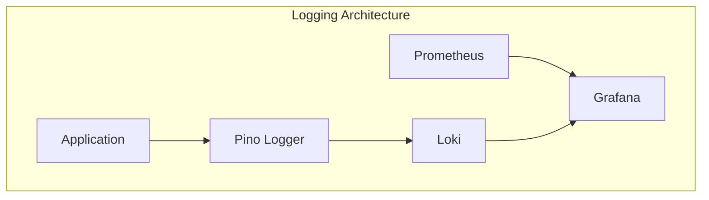

# Logging & Monitoring

## Purpose

This document defines the logging and monitoring architecture for the Automated Cloud-Native Video Transcoding and Streaming Platform.

## Scope

Log structure, monitoring stack, and observability.

## Audience

- DevOps Engineers
- Backend Engineers
- System Administrators

## Dependencies

- [00_Project_Standards.md](./00_Project_Standards.md) - Development standards
- [05_Tech_Stack.md](./05_Tech_Stack.md) - Technology stack
- [19_Error_Handling.md](./19_Error_Handling.md) - Error handling

## Related Documents

- [12_Queue_System.md](./12_Queue_System.md) - Queue system
- [16_Deployment.md](./16_Deployment.md) - Deployment

## Table of Contents

1. [Logging Overview](#logging-overview)
2. [Log Structure](#log-structure)
3. [Log Levels](#log-levels)
4. [Monitoring Stack](#monitoring-stack)
5. [Metrics](#metrics)
6. [Alerting](#alerting)
7. [Dashboards](#dashboards)
8. [Log Aggregation](#log-aggregation)
9. [Tracing](#tracing)
10. [Design Decisions](#design-decisions)
11. [Notes](#notes)
12. [References](#references)
13. [Future Documents](#future-documents)
14. [Revision History](#revision-history)

## Logging Overview



## Log Structure

### Log Format

```json
{
  "level": "info",
  "time": "2024-01-15T10:30:00.000Z",
  "msg": "Video transcoding started",
  "reqId": "req_123456",
  "userId": "user_abc123",
  "videoId": "video_xyz789",
  "metadata": {
    "resolution": "720p",
    "format": "mp4"
  }
}
```

### Log Fields

| Field | Type | Description |
|-------|------|-------------|
| level | string | Log level |
| time | string | ISO timestamp |
| msg | string | Log message |
| reqId | string | Request ID |
| userId | string | User ID (if authenticated) |
| videoId | string | Video ID (if applicable) |
| metadata | object | Additional context |

## Log Levels

| Level | Usage |
|-------|-------|
| fatal | System unusable |
| error | Error events |
| warn | Warning events |
| info | Informational events |
| debug | Debug events |
| trace | Detailed tracing |

### Level Configuration

```typescript
const logger = pino({
  level: process.env.LOG_LEVEL || 'info',
  redact: {
    paths: ['password', 'token', 'secret', 'authorization'],
    censor: '[REDACTED]',
  },
});
```

## Monitoring Stack

### Prometheus Configuration

```yaml
global:
  scrape_interval: 15s

scrape_configs:
  - job_name: 'backend'
    static_configs:
      - targets: ['backend:3001']
  - job_name: 'workers'
    static_configs:
      - targets: ['worker:3002']
```

### Grafana Configuration

```yaml
datasources:
  - name: Prometheus
    type: prometheus
    url: http://prometheus:9090
  - name: Loki
    type: loki
    url: http://loki:3100
```

## Metrics

### Application Metrics

| Metric | Type | Description |
|--------|------|-------------|
| http_requests_total | Counter | Total HTTP requests |
| http_request_duration_seconds | Histogram | Request duration |
| video_processing_duration_seconds | Histogram | Processing time |
| queue_jobs_total | Gauge | Jobs in queue |
| cache_hit_ratio | Gauge | Cache hit ratio |

### Business Metrics

| Metric | Type | Description |
|--------|------|-------------|
| videos_uploaded_total | Counter | Total videos uploaded |
| videos_processed_total | Counter | Total videos processed |
| storage_used_bytes | Gauge | Total storage used |
| active_users | Gauge | Active users |

### Prometheus Metrics

```typescript
const httpRequestCounter = new client.Counter({
  name: 'http_requests_total',
  help: 'Total HTTP requests',
  labelNames: ['method', 'path', 'status'],
});

const httpRequestDuration = new client.Histogram({
  name: 'http_request_duration_seconds',
  help: 'HTTP request duration',
  labelNames: ['method', 'path'],
});
```

## Alerting

### Alert Rules

| Alert | Condition | Severity |
|-------|-----------|----------|
| HighErrorRate | > 5% errors | Critical |
| HighQueueDepth | > 100 jobs | Warning |
| LowDiskSpace | < 10% free | Critical |
| HighCPU | > 80% for 5m | Warning |

### Alert Configuration

```yaml
groups:
  - name: backend
    rules:
      - alert: HighErrorRate
        expr: rate(errors_total[5m]) > 0.05
        for: 1m
        labels:
          severity: critical
        annotations:
          summary: "High error rate detected"
```

## Dashboards

### System Dashboard

- CPU usage
- Memory usage
- Disk usage
- Network traffic

### Application Dashboard

- Request rate
- Error rate
- Response time
- Queue depth

### Business Dashboard

- Videos uploaded
- Videos processed
- Storage used
- Active users

## Log Aggregation

### Loki Configuration

```yaml
auth_enabled: false
server:
  http_listen_port: 3100
  grpc_listen_port: 9095
```

### LogQL Queries

```
# Error count
count_over_time({app="backend"} |= "error" [1h])

# Request rate
rate({app="backend"}[5m])

# Video processing logs
{job="worker"} |= "transcoding"
```

## Tracing

### OpenTelemetry Integration

```typescript
import { trace } from '@opentelemetry/api';

const tracer = trace.getTracer('video-streaming');

const span = tracer.startSpan('video-transcode');
try {
  await transcodeVideo(videoId);
} finally {
  span.end();
}
```

## Design Decisions

### Decision: Pino over Winston

**Status**: Accepted

**Context**: Need for fast, structured logging.

**Decision**: Use Pino for logging.

**Consequences**:
- Fast JSON logging
- Low overhead
- Good ecosystem

### Decision: Loki over ELK

**Status**: Accepted

**Context**: Need for lightweight, Kubernetes-native logging.

**Decision**: Use Loki for log aggregation.

**Consequences**:
- Lightweight
- Grafana integration
- Less resource usage

## Notes

- All logs are structured JSON
- Sensitive data is redacted
- Metrics are exposed on /metrics endpoint

## References

- [Pino Documentation](https://github.com/pinojs/pino)
- [Prometheus Documentation](https://prometheus.io/docs)

## Future Documents

- [16_Deployment.md](./16_Deployment.md) - Deployment

## Revision History

| Date | Version | Author | Changes |
|------|---------|--------|---------|
| 2024-01-15 | 1.0.0 | DevOps Team | Initial version |