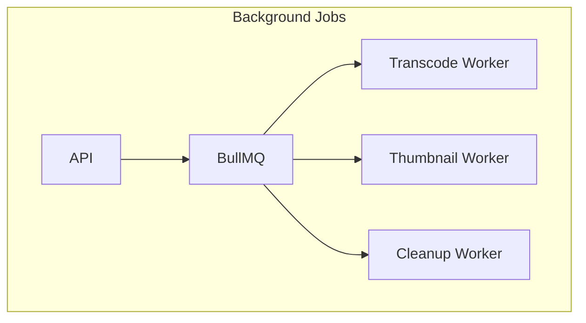
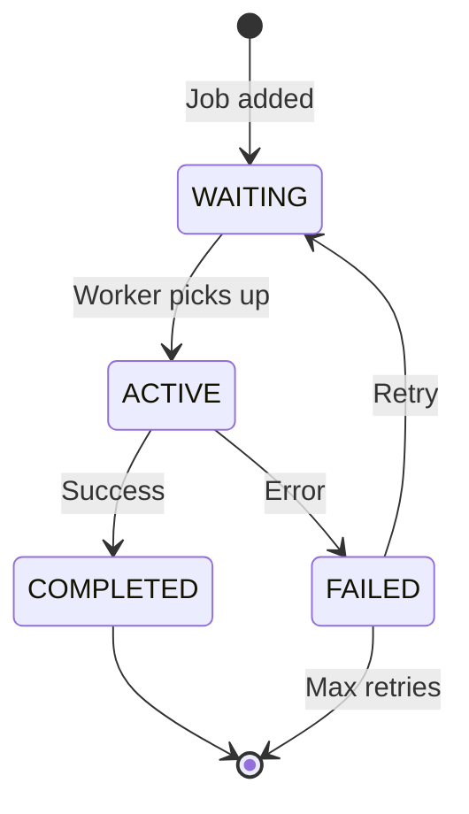

# Background Jobs

## Purpose

This document defines the background job architecture for the Automated Cloud-Native Video Transcoding and Streaming Platform.

## Scope

Job processing, worker management, and job lifecycle.

## Audience

- Backend Engineers
- DevOps Engineers
- System Architects

## Dependencies

- [00_Project_Standards.md](./00_Project_Standards.md) - Development standards
- [05_Tech_Stack.md](./05_Tech_Stack.md) - Technology stack
- [12_Queue_System.md](./12_Queue_System.md) - Queue system

## Related Documents

- [15_Transcoding_Pipeline.md](./15_Transcoding_Pipeline.md) - Transcoding
- [20_Logging_Monitoring.md](./20_Logging_Monitoring.md) - Monitoring

## Table of Contents

1. [Background Jobs Overview](#background-jobs-overview)
2. [Job Types](#job-types)
3. [Worker Architecture](#worker-architecture)
4. [Job Scheduling](#job-scheduling)
5. [Job Lifecycle](#job-lifecycle)
6. [Error Handling](#error-handling)
7. [Monitoring](#monitoring)
8. [Scaling](#scaling)
9. [Design Decisions](#design-decisions)
10. [Notes](#notes)
11. [References](#references)
12. [Future Documents](#future-documents)
13. [Revision History](#revision-history)

## Background Jobs Overview



## Job Types

### Video Transcoding Job

```typescript
interface TranscodeJob {
  id: string;
  videoId: string;
  userId: string;
  resolutions: Resolution[];
  priority: number;
}
```

### Thumbnail Generation Job

```typescript
interface ThumbnailJob {
  id: string;
  videoId: string;
  timestamps: number[];
  width: number;
  height: number;
}
```

### Cleanup Job

```typescript
interface CleanupJob {
  id: string;
  type: 'expired_videos' | 'failed_jobs' | 'temp_files';
}
```

## Worker Architecture

### Worker Process

```typescript
// worker.ts
import { Worker } from 'bullmq';
import { transcodeVideo } from './transcode';

const worker = new Worker('transcode', async (job) => {
  const { videoId, resolutions } = job.data;
  
  // Update progress
  await job.updateProgress(10);
  
  // Download original
  const video = await downloadVideo(videoId);
  await job.updateProgress(25);
  
  // Extract metadata
  const metadata = await extractMetadata(video.path);
  await job.updateProgress(50);
  
  // Transcode
  for (const resolution of resolutions) {
    await transcodeToHLS(video.path, resolution);
  }
  await job.updateProgress(90);
  
  // Upload outputs
  await uploadOutputs(videoId);
  await job.updateProgress(100);
  
  return { success: true };
});
```

### Worker Configuration

```typescript
const workerConfig = {
  concurrency: 2,
  removeOnFail: false,
  removeOnComplete: true,
};
```

## Job Scheduling

### Delayed Jobs

```typescript
// Schedule cleanup for 24 hours later
await queue.add('cleanup', { type: 'temp_files' }, {
  delay: 24 * 60 * 60 * 1000,
});
```

### Recurring Jobs

```typescript
// Schedule daily cleanup
await queue.add('cleanup', { type: 'expired_videos' }, {
  repeat: {
    cron: '0 0 * * *', // Daily at midnight
  },
});
```

## Job Lifecycle



## Error Handling

### Retry Strategy

```typescript
const retryConfig = {
  attempts: 3,
  backoff: {
    type: 'exponential',
    delay: 1000,
  },
};
```

### Dead Letter Queue

```typescript
// Move failed jobs to DLQ after max retries
worker.on('failed', async (job, err) => {
  if (job.attemptsMade >= job.opts.maxAttempts) {
    await deadLetterQueue.add(job.name, job.data);
  }
});
```

## Monitoring

### Job Metrics

| Metric | Description |
|--------|-------------|
| jobs_processed_total | Total jobs processed |
| jobs_failed_total | Total jobs failed |
| job_duration_seconds | Job processing time |
| queue_depth | Jobs waiting |

### Worker Metrics

| Metric | Description |
|--------|-------------|
| worker_count | Active workers |
| worker_memory_bytes | Worker memory usage |
| worker_cpu_percent | Worker CPU usage |

## Scaling

### Horizontal Scaling

```yaml
# Kubernetes deployment
apiVersion: apps/v1
kind: Deployment
metadata:
  name: transcode-worker
spec:
  replicas: 3
  selector:
    matchLabels:
      app: transcode-worker
  template:
    spec:
      containers:
      - name: worker
        image: video-streaming/worker:latest
        resources:
          limits:
            cpu: '2'
            memory: '4G'
```

### Auto-scaling

| Metric | Threshold | Action |
|--------|-----------|--------|
| Queue depth > 100 | Scale up | Add worker |
| Queue depth < 10 | Scale down | Remove worker |

## Design Decisions

### Decision: BullMQ for Jobs

**Status**: Accepted

**Context**: Need for Redis-based job queue with good Node.js support.

**Decision**: Use BullMQ for background job processing.

**Consequences**:
- Redis dependency
- Good Node.js integration
- Built-in retry and scheduling

### Decision: Separate Workers

**Status**: Accepted

**Context**: Different job types have different resource requirements.

**Decision**: Use separate worker processes for each job type.

**Consequences**:
- Independent scaling
- Isolated failures
- More complex deployment

## Notes

- Workers are stateless
- Jobs are idempotent
- All jobs are monitored

## References

- [BullMQ Documentation](https://docs.bullmq.io)

## Future Documents

- [15_Transcoding_Pipeline.md](./15_Transcoding_Pipeline.md) - Transcoding

## Revision History

| Date | Version | Author | Changes |
|------|---------|--------|---------|
| 2024-01-15 | 1.0.0 | Backend Team | Initial version |