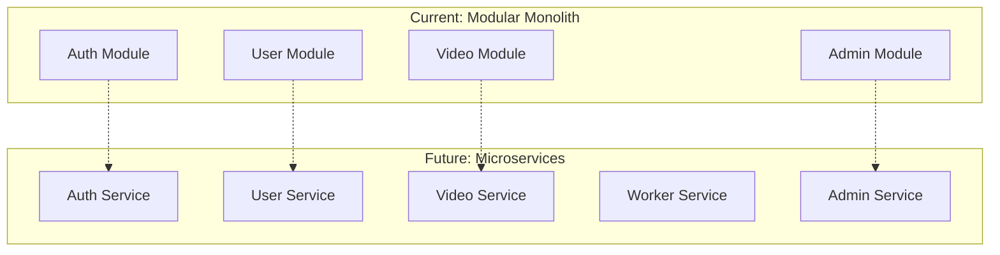
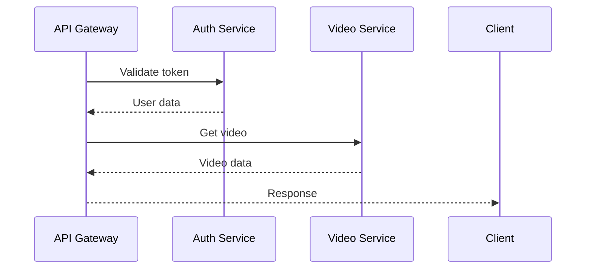
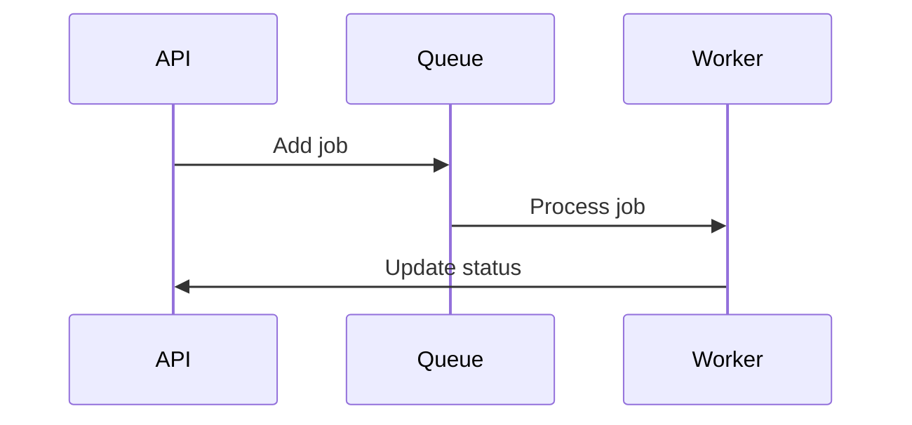
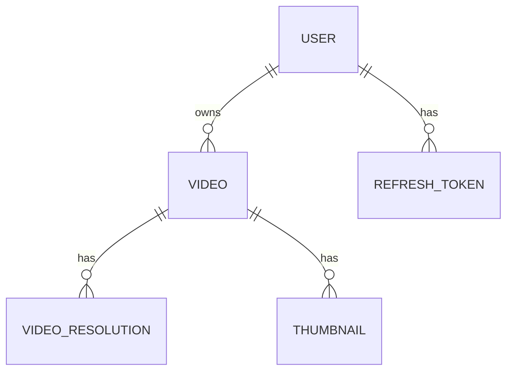

# Microservices

## Purpose

This document defines the microservice architecture for the Automated Cloud-Native Video Transcoding and Streaming Platform.

## Scope

Service boundaries, communication patterns, and future migration path.

## Audience

- Solution Architects
- Engineering Teams
- DevOps Engineers

## Dependencies

- [00_Project_Standards.md](./00_Project_Standards.md) - Development standards
- [04_System_Architecture.md](./04_System_Architecture.md) - System architecture
- [06_Folder_Structure.md](./06_Folder_Structure.md) - Folder structure

## Related Documents

- [04_System_Architecture.md](./04_System_Architecture.md) - System architecture
- [12_Queue_System.md](./12_Queue_System.md) - Queue system
- [16_Deployment.md](./16_Deployment.md) - Deployment

## Table of Contents

1. [Microservices Overview](#microservices-overview)
2. [Service Boundaries](#service-boundaries)
3. [Communication Patterns](#communication-patterns)
4. [Data Isolation](#data-isolation)
5. [API Gateway](#api-gateway)
6. [Service Discovery](#service-discovery)
7. [Migration Path](#migration-path)
8. [Design Decisions](#design-decisions)
9. [Notes](#notes)
10. [References](#references)
11. [Future Documents](#future-documents)
12. [Revision History](#revision-history)

## Microservices Overview



## Service Boundaries

### Auth Service

| Responsibility | Domain |
|----------------|--------|
| User registration | Auth |
| User login | Auth |
| Token management | Auth |
| Password reset | Auth |

### User Service

| Responsibility | Domain |
|----------------|--------|
| User profile | User |
| Storage quota | User |
| User settings | User |

### Video Service

| Responsibility | Domain |
|----------------|--------|
| Video upload | Video |
| Video metadata | Video |
| Video library | Video |
| Video search | Video |

### Worker Service

| Responsibility | Domain |
|----------------|--------|
| Video transcoding | Processing |
| Thumbnail generation | Processing |
| Metadata extraction | Processing |

### Admin Service

| Responsibility | Domain |
|----------------|--------|
| User management | Admin |
| System stats | Admin |
| Job management | Admin |

## Communication Patterns

### Synchronous Communication



### Asynchronous Communication



## Data Isolation

### Database per Service

| Service | Database |
|---------|----------|
| Auth | auth_db |
| User | user_db |
| Video | video_db |
| Admin | admin_db |

### Shared Database (Current)



## API Gateway

### Gateway Configuration

```yaml
api_gateway:
  routes:
    - path: /api/v1/auth/*
      service: auth-service
    - path: /api/v1/users/*
      service: user-service
    - path: /api/v1/videos/*
      service: video-service
    - path: /api/v1/admin/*
      service: admin-service
```

### Gateway Features

- Rate limiting
- Authentication
- Request routing
- Response aggregation

## Service Discovery

### Kubernetes Service Discovery

```yaml
apiVersion: v1
kind: Service
metadata:
  name: video-service
spec:
  selector:
    app: video-service
  ports:
    - protocol: TCP
      port: 80
      targetPort: 3001
```

## Migration Path

### Phase 1: Modular Monolith

- Single deployment
- Shared database
- Clear module boundaries

### Phase 2: Service Extraction

- Extract Auth service
- Extract User service
- Separate databases

### Phase 3: Full Microservices

- All services independent
- Event-driven communication
- Kubernetes deployment

## Design Decisions

### Decision: Modular Monolith First

**Status**: Accepted

**Context**: Need for fast initial development.

**Decision**: Start with modular monolith, migrate to microservices.

**Consequences**:
- Faster initial development
- Shared database
- Clear migration path

### Decision: Event-Driven Communication

**Status**: Accepted

**Context**: Services need to communicate asynchronously.

**Decision**: Use message queue for inter-service communication.

**Consequences**:
- Decoupled services
- Event replay capability
- Additional complexity

## Notes

- Services are designed to be independently deployable
- Database separation is planned for future
- API gateway will handle routing

## References

- [Microservices Patterns](https://microservices.io/patterns)

## Future Documents

- [16_Deployment.md](./16_Deployment.md) - Deployment

## Revision History

| Date | Version | Author | Changes |
|------|---------|--------|---------|
| 2024-01-15 | 1.0.0 | Architecture Team | Initial version |