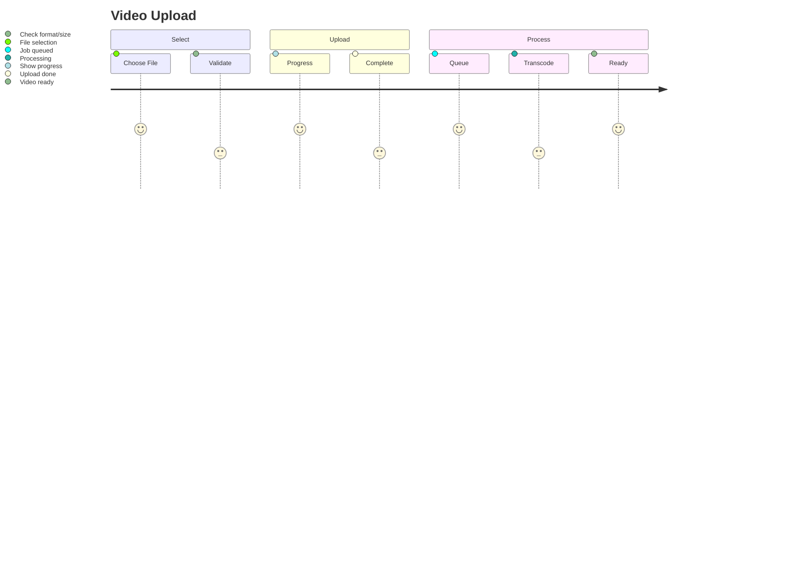
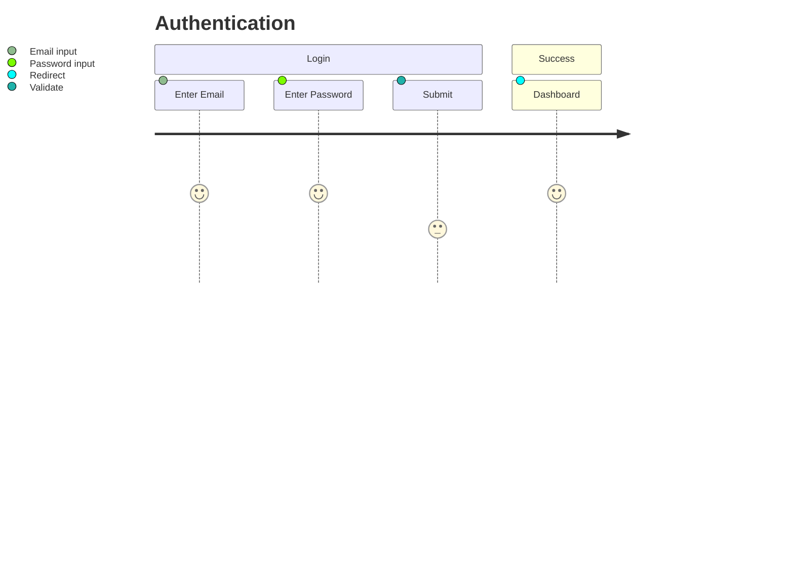

# UI/UX Design

## Purpose

This document defines the user interface and user experience design for the Automated Cloud-Native Video Transcoding and Streaming Platform.

## Scope

Design system, component library, and user workflows.

## Audience

- Frontend Engineers
- UI/UX Designers
- Product Managers

## Dependencies

- [00_Project_Standards.md](./00_Project_Standards.md) - Development standards
- [05_Tech_Stack.md](./05_Tech_Stack.md) - Technology stack
- [03_PRD.md](./03_PRD.md) - Product requirements

## Related Documents

- [23_API_Examples.md](./23_API_Examples.md) - API examples
- [25_Roadmap.md](./25_Roadmap.md) - Roadmap

## Table of Contents

1. [Design System](#design-system)
2. [Component Library](#component-library)
3. [Color Palette](#color-palette)
4. [Typography](#typography)
5. [Layout System](#layout-system)
6. [User Workflows](#user-workflows)
7. [Accessibility](#accessibility)
8. [Responsive Design](#responsive-design)
9. [Design Decisions](#design-decisions)
10. [Notes](#notes)
11. [References](#references)
12. [Future Documents](#future-documents)
13. [Revision History](#revision-history)

## Design System

### Framework

- **Next.js 15** with App Router
- **Tailwind CSS** for styling
- **shadcn/ui** for components
- **Radix UI** for primitives

### Design Tokens

```json
{
  "colors": {
    "primary": { "50": "#f0f9ff", "500": "#0ea5e9", "900": "#0c4a6e" },
    "success": { "500": "#22c55e" },
    "warning": { "500": "#f59e0b" },
    "error": { "500": "#ef4444" }
  },
  "spacing": { "xs": "0.5rem", "sm": "0.75rem", "md": "1rem", "lg": "1.5rem" },
  "borderRadius": { "sm": "0.25rem", "md": "0.5rem", "lg": "1rem" }
}
```

## Component Library

### Core Components

| Component | Description |
|-----------|-------------|
| Button | Primary, secondary, destructive variants |
| Input | Text, email, password, file |
| Card | Video card, user card |
| Modal | Confirmation, form modal |
| Table | Video list, user list |
| Avatar | User avatar with status |

### Video Components

| Component | Description |
|-----------|-------------|
| VideoPlayer | Video.js wrapper |
| VideoCard | Video thumbnail with info |
| VideoUpload | Drag-and-drop upload |
| VideoProgress | Processing progress bar |

### Layout Components

| Component | Description |
|-----------|-------------|
| Header | Navigation header |
| Sidebar | Main navigation |
| Footer | Page footer |
| Grid | Responsive grid |

## Color Palette

### Primary Colors

| Color | Hex | Usage |
|-------|-----|-------|
| Primary | #0ea5e9 | Main actions |
| Secondary | #64748b | Secondary actions |
| Success | #22c55e | Success states |
| Warning | #f59e0b | Warning states |
| Error | #ef4444 | Error states |

### Semantic Colors

| Purpose | Light | Dark |
|---------|-------|------|
| Background | #ffffff | #0f172a |
| Text | #0f172a | #f8fafc |
| Border | #e2e8f0 | #334155 |

## Typography

### Font Stack

```css
font-family: -apple-system, BlinkMacSystemFont, 'Segoe UI', Roboto, sans-serif;
```

### Type Scale

| Element | Size | Weight | Line Height |
|---------|------|--------|-------------|
| h1 | 2.5rem | 700 | 1.2 |
| h2 | 2rem | 600 | 1.3 |
| h3 | 1.5rem | 600 | 1.4 |
| body | 1rem | 400 | 1.5 |
| small | 0.875rem | 400 | 1.4 |

## Layout System

### Grid System

```tsx
<div className="grid grid-cols-1 md:grid-cols-2 lg:grid-cols-3 gap-6">
  {videos.map(video => <VideoCard key={video.id} video={video} />)}
</div>
```

### Breakpoints

| Name | Width | Usage |
|------|-------|-------|
| sm | 640px | Mobile |
| md | 768px | Tablet |
| lg | 1024px | Desktop |
| xl | 1280px | Large desktop |

## User Workflows

### Video Upload Flow



### Authentication Flow



## Accessibility

### WCAG Compliance

- **Level**: AA
- **Contrast**: 4.5:1 minimum
- **Keyboard**: Full keyboard navigation
- **Screen Reader**: ARIA labels

### Focus Management

```tsx
<Button
  ref={buttonRef}
  onKeyDown={(e) => {
    if (e.key === 'Enter' || e.key === ' ') {
      handleClick();
    }
  }}
>
  Click me
</Button>
```

## Responsive Design

### Mobile First

```tsx
<div className="p-4 md:p-6 lg:p-8">
  <h1 className="text-2xl md:text-3xl lg:text-4xl">
    Video Library
  </h1>
</div>
```

### Touch Targets

- Minimum 44x44 pixels
- Adequate spacing
- Visual feedback

## Design Decisions

### Decision: shadcn/ui

**Status**: Accepted

**Context**: Need for accessible, customizable components.

**Decision**: Use shadcn/ui with Tailwind CSS.

**Consequences**:
- Accessible by default
- Easy to customize
- No runtime dependencies

### Decision: Next.js App Router

**Status**: Accepted

**Context**: Need for modern React features.

**Decision**: Use Next.js 15 with App Router.

**Consequences**:
- Server components
- Nested layouts
- Streaming SSR

## Notes

- All components are accessible
- Design is mobile-first
- Dark mode is supported

## References

- [shadcn/ui Documentation](https://ui.shadcn.com)
- [Tailwind CSS Documentation](https://tailwindcss.com/docs)

## Future Documents

- [25_Roadmap.md](./25_Roadmap.md) - Roadmap

## Revision History

| Date | Version | Author | Changes |
|------|---------|--------|---------|
| 2024-01-15 | 1.0.0 | Design Team | Initial version |