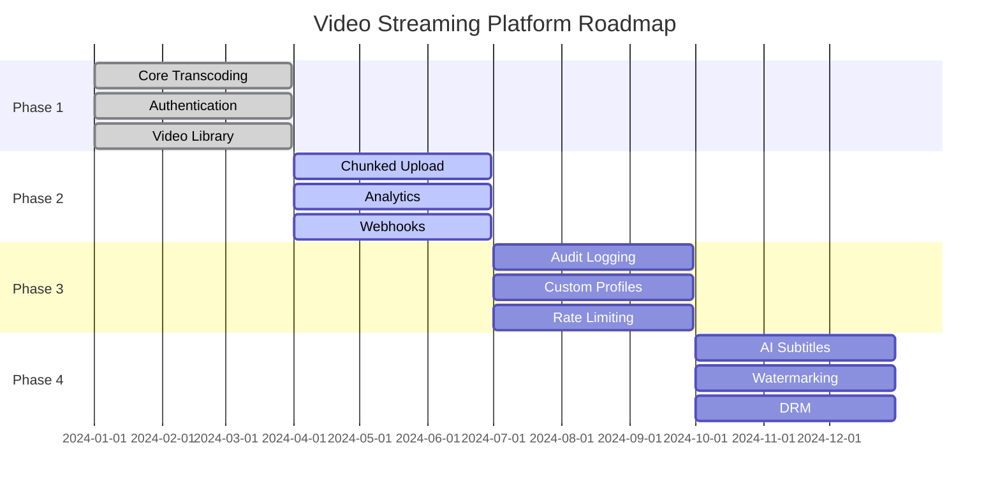

# Roadmap

## Purpose

This document defines the development roadmap and timeline for the Automated Cloud-Native Video Transcoding and Streaming Platform.

## Scope

Feature releases, milestones, and timeline.

## Audience

- Product Managers
- Engineering Teams
- Stakeholders

## Dependencies

- [00_Project_Standards.md](./00_Project_Standards.md) - Development standards
- [01_Project_Vision.md](./01_Project_Vision.md) - Product vision
- [03_PRD.md](./03_PRD.md) - Product requirements

## Related Documents

- [02_Requirements.md](./02_Requirements.md) - Requirements
- [24_UI_UX.md](./24_UI_UX.md) - UI/UX

## Table of Contents

1. [Roadmap Overview](#roadmap-overview)
2. [Phase 1: Foundation (Q1 2024)](#phase-1-foundation-q1-2024)
3. [Phase 2: Scale (Q2 2024)](#phase-2-scale-q2-2024)
4. [Phase 3: Enterprise (Q3 2024)](#phase-3-enterprise-q3-2024)
5. [Phase 4: Innovation (Q4 2024)](#phase-4-innovation-q4-2024)
6. [Future Phases (2025+)](#future-phases-2025)
7. [Success Metrics](#success-metrics)
8. [Design Decisions](#design-decisions)
9. [Notes](#notes)
10. [References](#references)
11. [Future Documents](#future-documents)
12. [Revision History](#revision-history)

## Roadmap Overview

## Phase 1: Foundation (Q1 2024)

### Features

| Feature | Status | Description |
|---------|--------|-------------|
| User Authentication | ✅ | JWT-based auth with refresh tokens |
| Video Upload | ✅ | Single file upload with validation |
| Video Processing | ✅ | Automatic HLS transcoding |
| Video Library | ✅ | List, search, and manage videos |
| Video Streaming | ✅ | HLS adaptive streaming |
| Admin Dashboard | ✅ | System monitoring and user management |

### Milestones

- **Jan 15**: Project kickoff
- **Feb 15**: Authentication complete
- **Mar 15**: Video upload complete
- **Mar 31**: Phase 1 complete

## Phase 2: Scale (Q2 2024)

### Features

| Feature | Status | Description |
|---------|--------|-------------|
| Chunked Upload | ⏳ | Large file support with resume |
| Analytics Dashboard | ⏳ | Usage and performance metrics |
| Webhook Notifications | ⏳ | Event-driven notifications |
| Performance Optimization | ⏳ | Caching and query optimization |

### Milestones

- **Apr 15**: Chunked upload complete
- **May 15**: Analytics dashboard complete
- **Jun 15**: Webhooks complete
- **Jun 30**: Phase 2 complete

## Phase 3: Enterprise (Q3 2024)

### Features

| Feature | Status | Description |
|---------|--------|-------------|
| Audit Logging | ⏳ | Comprehensive audit trail |
| Custom Profiles | ⏳ | User-defined transcoding profiles |
| Rate Limiting | ⏳ | API rate limiting |
| Advanced Security | ⏳ | MFA, IP restrictions |

### Milestones

- **Jul 15**: Audit logging complete
- **Aug 15**: Custom profiles complete
- **Sep 15**: Rate limiting complete
- **Sep 30**: Phase 3 complete

## Phase 4: Innovation (Q4 2024)

### Features

| Feature | Status | Description |
|---------|--------|-------------|
| AI Subtitle Generation | ⏳ | Automatic subtitle generation |
| Watermarking | ⏳ | Video watermarking support |
| DRM Integration | ⏳ | Digital rights management |
| Kubernetes Deployment | ⏳ | Production Kubernetes setup |

### Milestones

- **Oct 15**: AI subtitles complete
- **Nov 15**: Watermarking complete
- **Dec 15**: DRM complete
- **Dec 31**: Phase 4 complete

## Future Phases (2025+)

### Phase 5: Platform (2025)

| Feature | Description |
|---------|-------------|
| CDN Integration | Global content delivery |
| Multi-region | Multi-region deployment |
| Advanced Analytics | ML-powered insights |
| API Marketplace | Third-party integrations |

### Phase 6: Scale (2026)

| Feature | Description |
|---------|-------------|
| Multi-cloud | Multi-cloud support |
| Edge Computing | Edge processing |
| Real-time Streaming | Live streaming support |
| Mobile Apps | Native mobile applications |

## Success Metrics

### User Metrics

| Metric | Q1 Target | Q2 Target | Q3 Target | Q4 Target |
|--------|-----------|-----------|-----------|-----------|
| MAU | 1,000 | 5,000 | 15,000 | 30,000 |
| Videos Processed | 10,000 | 50,000 | 150,000 | 500,000 |
| Uptime | 99.5% | 99.8% | 99.9% | 99.95% |

### Technical Metrics

| Metric | Target |
|--------|--------|
| API Response Time | < 100ms p95 |
| Transcoding Time | < 2x video duration |
| Error Rate | < 0.1% |
| Test Coverage | > 80% |

## Design Decisions

### Decision: Quarterly Releases

**Status**: Accepted

**Context**: Need for predictable delivery schedule.

**Decision**: Release features quarterly.

**Consequences**:
- Regular feature delivery
- Predictable planning
- Quarterly retrospectives

### Decision: Feature Flags

**Status**: Accepted

**Context**: Need for safe feature rollout.

**Decision**: Use feature flags for new features.

**Consequences**:
- Safe rollouts
- A/B testing
- Easy rollback

## Notes

- Roadmap is updated quarterly
- Features may shift between phases
- Priority is based on user feedback

## References

- [Product Vision](./01_Project_Vision.md)
- [Requirements](./02_Requirements.md)

## Future Documents

- None

## Revision History

| Date | Version | Author | Changes |
|------|---------|--------|---------|
| 2024-01-15 | 1.0.0 | Product Team | Initial version |