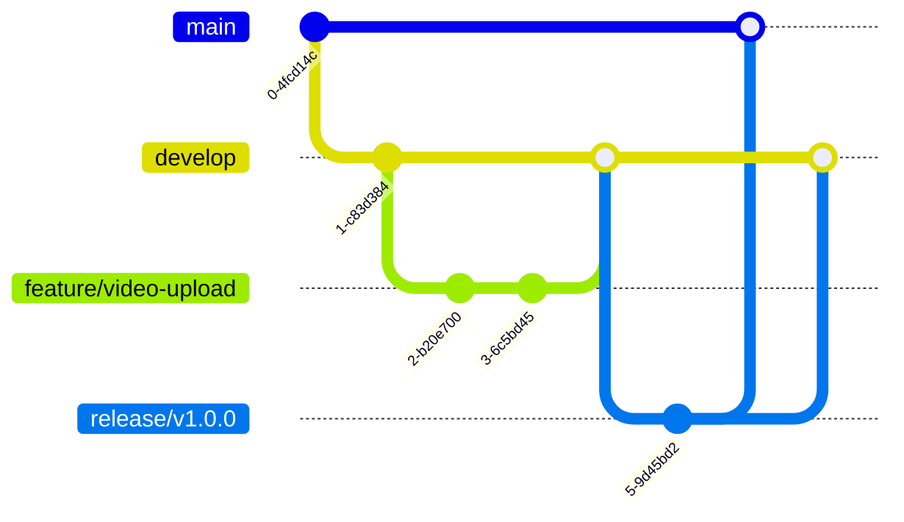
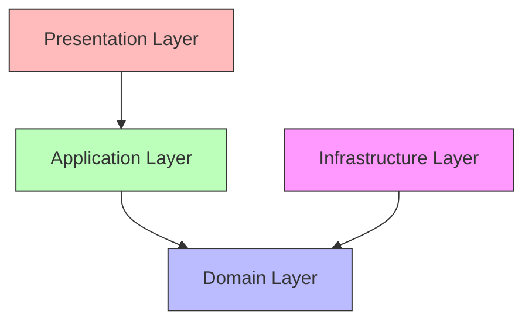

# Coding Guidelines

## Purpose

This document defines the coding standards and conventions for the Automated Cloud-Native Video Transcoding and Streaming Platform.

## Scope

All coding conventions, naming standards, and best practices.

## Audience

- Software Engineers
- Technical Leads
- Code Reviewers

## Dependencies

- [00_Project_Standards.md](./00_Project_Standards.md) - Development standards
- [05_Tech_Stack.md](./05_Tech_Stack.md) - Technology stack
- [06_Folder_Structure.md](./06_Folder_Structure.md) - Folder structure

## Related Documents

- [27_Configuration_Guide.md](./27_Configuration_Guide.md) - Configuration
- [08_API_Design.md](./08_API_Design.md) - API design

## Table of Contents

1. [Naming Conventions](#naming-conventions)
2. [Folder Conventions](#folder-conventions)
3. [File Naming](#file-naming)
4. [API Naming](#api-naming)
5. [DTO Naming](#dto-naming)
6. [Prisma Naming](#prisma-naming)
7. [Redis Key Naming](#redis-key-naming)
8. [BullMQ Naming](#bullmq-naming)
9. [Git Commit Convention](#git-commit-convention)
10. [Branch Strategy](#branch-strategy)
11. [Clean Architecture Rules](#clean-architecture-rules)
12. [SOLID Principles](#solid-principles)
13. [Best Practices](#best-practices)
14. [Design Decisions](#design-decisions)
15. [Notes](#notes)
16. [References](#references)
17. [Future Documents](#future-documents)
18. [Revision History](#revision-history)

## Naming Conventions

### General Naming

| Element | Convention | Example |
|---------|------------|---------|
| Files | kebab-case | `video-transcoder.ts` |
| Directories | kebab-case | `video-processing/` |
| Variables | camelCase | `videoMetadata` |
| Functions | camelCase | `transcodeVideo()` |
| Classes | PascalCase | `VideoTranscoder` |
| Interfaces | PascalCase | `VideoMetadata` |
| Types | PascalCase | `VideoStatus` |
| Constants | UPPER_SNAKE_CASE | `MAX_FILE_SIZE` |
| Enums | PascalCase | `VideoResolution` |
| Private Members | #private or _private | `#internalState` |

### Boolean Naming

| Type | Convention | Example |
|------|------------|---------|
| Boolean variables | is/has/can prefix | `isActive`, `hasPermission` |
| Boolean functions | is/has/can prefix | `isValid()`, `canDelete()` |

## Folder Conventions

### Backend Structure

```
src/
├── modules/
│   ├── {module-name}/
│   │   ├── application/
│   │   │   ├── commands/
│   │   │   ├── queries/
│   │   │   └── services/
│   │   ├── domain/
│   │   │   ├── entities/
│   │   │   ├── value-objects/
│   │   │   └── services/
│   │   ├── infrastructure/
│   │   │   ├── repositories/
│   │   │   └── services/
│   │   └── presentation/
│   │       ├── controllers/
│   │       ├── guards/
│   │       └── dtos/
├── shared/
│   ├── kernel/
│   ├── application/
│   └── infrastructure/
```

### Frontend Structure

```
src/
├── app/
│   ├── api/
│   ├── auth/
│   ├── dashboard/
│   ├── library/
│   ├── player/
│   └── admin/
├── components/
│   ├── ui/
│   ├── video/
│   ├── forms/
│   └── layout/
├── lib/
│   ├── api/
│   ├── utils/
│   └── validations/
├── hooks/
├── stores/
├── types/
└── styles/
```

## File Naming

### Backend Files

| Type | Pattern | Example |
|------|---------|---------|
| Service | `{name}.service.ts` | `video.service.ts` |
| Controller | `{name}.controller.ts` | `video.controller.ts` |
| Module | `{name}.module.ts` | `video.module.ts` |
| Entity | `{name}.entity.ts` | `video.entity.ts` |
| Repository | `{name}.repository.ts` | `video.repository.ts` |
| DTO | `{name}.dto.ts` | `create-video.dto.ts` |
| Guard | `{name}.guard.ts` | `auth.guard.ts` |
| Interceptor | `{name}.interceptor.ts` | `logging.interceptor.ts` |

### Frontend Files

| Type | Pattern | Example |
|------|---------|---------|
| Component | `{name}.tsx` | `video-card.tsx` |
| Hook | `use-{name}.ts` | `use-videos.ts` |
| API | `{name}.api.ts` | `video.api.ts` |
| Type | `{name}.types.ts` | `video.types.ts` |
| Style | `{name}.css` | `video.css` |

## API Naming

### Endpoint Naming

| Resource | Convention | Example |
|----------|------------|---------|
| Collection | Plural noun | `/videos`, `/users` |
| Item | Plural noun + ID | `/videos/{id}` |
| Action | Verb as sub-resource | `/videos/{id}/status` |

### HTTP Methods

| Method | Usage |
|--------|-------|
| GET | Retrieve resource |
| POST | Create resource |
| PUT | Replace resource |
| PATCH | Update resource |
| DELETE | Delete resource |

### Query Parameters

| Parameter | Convention | Example |
|-----------|------------|---------|
| Filter | Singular | `?status=active` |
| Search | `q` or `search` | `?q=title` |
| Pagination | `page`, `limit` | `?page=1&limit=20` |
| Sort | `sort`, `order` | `?sort=createdAt&order=desc` |

## DTO Naming

### DTO Structure

```typescript
// Create DTO
export class CreateVideoDto {
  @IsString()
  @IsNotEmpty()
  title: string;
  
  @IsOptional()
  @IsString()
  description?: string;
  
  @IsNotEmpty()
  file: Express.Multer.File;
}

// Update DTO
export class UpdateVideoDto {
  @IsOptional()
  @IsString()
  title?: string;
  
  @IsOptional()
  @IsString()
  description?: string;
  
  @IsOptional()
  @IsBoolean()
  isPublic?: boolean;
}

// Response DTO
export class VideoResponseDto {
  id: string;
  title: string;
  status: VideoStatus;
  createdAt: Date;
}
```

### DTO Naming Convention

| Type | Pattern | Example |
|------|---------|---------|
| Create | `Create{Resource}Dto` | `CreateVideoDto` |
| Update | `Update{Resource}Dto` | `UpdateVideoDto` |
| Response | `{Resource}ResponseDto` | `VideoResponseDto` |
| Query | `{Resource}QueryDto` | `VideoQueryDto` |

## Prisma Naming

### Model Naming

| Element | Convention | Example |
|---------|------------|---------|
| Models | PascalCase, singular | `User`, `Video` |
| Fields | camelCase | `createdAt`, `updatedAt` |
| Relations | {entity}Id | `userId`, `videoId` |
| Indexes | @@index or @@unique | `@@index([email])` |
| Table names | snake_case | `@@map("video_resolutions")` |

### Field Naming

```prisma
model Video {
  id          String    @id @default(cuid())
  userId      String    // Foreign key
  title       String    // Required field
  description String?   // Optional field
  status      VideoStatus @default(PENDING)
  createdAt   DateTime  @default(now())
  updatedAt   DateTime  @updatedAt
  deletedAt   DateTime? // Soft delete
}
```

## Redis Key Naming

### Key Patterns

| Pattern | Example | Description |
|---------|---------|-------------|
| User | `user:{id}` | User data |
| Video | `video:{id}` | Video data |
| Video list | `user:{id}:videos` | User's videos |
| Processing status | `video:{id}:status` | Processing status |
| Rate limit | `rate:{userId}:{endpoint}` | Rate limit counter |
| Session | `session:{sessionId}` | User session |
| Token blacklist | `blacklist:{tokenId}` | Revoked tokens |

### Key Structure

```typescript
const cacheKeys = {
  user: (id: string) => `user:${id}`,
  video: (id: string) => `video:${id}`,
  videoList: (userId: string, page: number) => `user:${userId}:videos:${page}`,
  processingStatus: (videoId: string) => `video:${videoId}:status`,
  rateLimit: (userId: string, endpoint: string) => `rate:${userId}:${endpoint}`,
  session: (sessionId: string) => `session:${sessionId}`,
  tokenBlacklist: (tokenId: string) => `blacklist:${tokenId}`,
};
```

## BullMQ Naming

### Queue Names

| Queue | Purpose |
|-------|---------|
| `transcode` | Video transcoding jobs |
| `thumbnail` | Thumbnail generation jobs |
| `metadata` | Metadata extraction jobs |
| `cleanup` | Cleanup jobs |

### Job Names

| Job | Pattern |
|-----|---------|
| Transcode | `transcode:{videoId}` |
| Thumbnail | `thumbnail:{videoId}` |
| Metadata | `metadata:{videoId}` |

### Job Data Structure

```typescript
interface TranscodeJob {
  videoId: string;
  userId: string;
  resolutions: Resolution[];
  priority: number;
}

interface ThumbnailJob {
  videoId: string;
  timestamps: number[];
  width: number;
  height: number;
}
```

## Git Commit Convention

### Commit Format

```
type(scope): subject

body (optional)

footer (optional)
```

### Commit Types

| Type | Usage |
|------|-------|
| feat | New feature |
| fix | Bug fix |
| docs | Documentation |
| style | Formatting |
| refactor | Code refactoring |
| test | Adding tests |
| chore | Maintenance |

### Branch Naming

| Type | Format | Example |
|------|--------|---------|
| Feature | `feature/{ticket}-{description}` | `feature/VSP-123-add-video-upload` |
| Bug | `bugfix/{ticket}-{description}` | `bugfix/VSP-456-fix-transcoding-error` |
| Hotfix | `hotfix/{ticket}-{description}` | `hotfix/VSP-789-security-patch` |
| Release | `release/{version}` | `release/v1.2.0` |

## Branch Strategy

### Git Flow



### Branch Protection

| Branch | Protection Rules |
|--------|-----------------|
| main | Require PR, CI pass, code review |
| develop | Require CI pass |
| feature/* | No restrictions |
| hotfix/* | Require PR, CI pass |

## Clean Architecture Rules

### Layer Dependencies



### Dependency Rule

- Inner layers must not depend on outer layers
- Use dependency injection for outer layer implementations
- Interfaces defined in inner layers, implemented in outer layers

### Layer Responsibilities

| Layer | Responsibility |
|-------|--------------|
| Domain | Business logic, entities, value objects |
| Application | Use cases, application services, DTOs |
| Infrastructure | External implementations, database, storage |
| Presentation | Controllers, guards, API handlers |

## SOLID Principles

### Single Responsibility

```typescript
// Good: One responsibility
class VideoTranscoder {
  transcode(video: Video): Promise<void> {
    // Only transcoding logic
  }
}

// Bad: Multiple responsibilities
class VideoService {
  transcode() {}
  sendEmail() {}
  generateReport() {}
}
```

### Open/Closed

```typescript
// Open for extension, closed for modification
interface Transcoder {
  transcode(input: string, output: string): Promise<void>;
}

class H264Transcoder implements Transcoder {
  transcode(input: string, output: string): Promise<void> {
    // H.264 implementation
  }
}

class H265Transcoder implements Transcoder {
  transcode(input: string, output: string): Promise<void> {
    // H.265 implementation
  }
}
```

### Liskov Substitution

```typescript
// All implementations are substitutable
class BaseTranscoder {
  abstract transcode(input: string, output: string): Promise<void>;
}

class FastTranscoder extends BaseTranscoder {
  transcode(input: string, output: string): Promise<void> {
    // Can substitute BaseTranscoder
  }
}
```

### Interface Segregation

```typescript
// Small, focused interfaces
interface VideoReader {
  getVideo(id: string): Promise<Video>;
}

interface VideoWriter {
  createVideo(data: CreateVideoDto): Promise<Video>;
  updateVideo(id: string, data: UpdateVideoDto): Promise<Video>;
}

interface VideoDeleter {
  deleteVideo(id: string): Promise<void>;
}
```

### Dependency Inversion

```typescript
// Depend on abstractions, not concretions
interface StorageService {
  upload(file: File): Promise<string>;
  download(key: string): Promise<File>;
}

class VideoService {
  constructor(private storage: StorageService) {} // Abstraction
  
  async uploadVideo(file: File) {
    const url = await this.storage.upload(file);
  }
}
```

## Best Practices

### Code Quality

| Practice | Description |
|----------|-------------|
| DRY | Don't Repeat Yourself |
| KISS | Keep It Simple, Stupid |
| YAGNI | You Aren't Gonna Need It |
| Single Level of Abstraction | Keep code at same abstraction level |

### Error Handling

```typescript
// Use specific error types
throw new VideoNotFoundError(videoId);
throw new InvalidVideoFormatError(format);
throw new StorageQuotaExceededError(quota);

// Handle errors at appropriate level
try {
  await transcodeVideo(videoId);
} catch (error) {
  if (error instanceof ProcessingError) {
    // Handle processing error
  }
  throw error;
}
```

### Testing

```typescript
// Arrange, Act, Assert pattern
describe('VideoService', () => {
  it('should transcode video to multiple resolutions', async () => {
    // Arrange
    const videoId = 'video_123';
    const mockVideo = { id: videoId, status: 'PENDING' };
    
    // Act
    const result = await service.transcodeVideo(videoId);
    
    // Assert
    expect(result.status).toBe('COMPLETED');
  });
});
```

## Design Decisions

### Decision: kebab-case for Files

**Status**: Accepted

**Context**: Consistent naming across the project.

**Decision**: Use kebab-case for all file and directory names.

**Consequences**:
- Consistent with URL paths
- Easy to read
- No case-sensitivity issues

### Decision: Clean Architecture

**Status**: Accepted

**Context**: Need for maintainable, testable code.

**Decision**: Implement Clean Architecture with clear layer separation.

**Consequences**:
- Clear separation of concerns
- Easy to test business logic
- Framework agnostic core

## Notes

- All code follows the established conventions
- Code reviews check for convention compliance
- Automated linting enforces rules

## References

- [Clean Architecture - Robert Martin](https://www.amazon.com/Clean-Architecture-Robert-C-Martin/dp/0134494164)
- [SOLID Principles](https://en.wikipedia.org/wiki/SOLID)

## Future Documents

- [29_UI_Flow.md](./29_UI_Flow.md) - UI flow

## Revision History

| Date | Version | Author | Changes |
|------|---------|--------|---------|
| 2024-01-15 | 1.0.0 | Architecture Team | Initial version |