# UI Flow

## Purpose

This document defines the user interface flow and navigation for the Automated Cloud-Native Video Transcoding and Streaming Platform.

## Scope

User journeys, navigation patterns, and UI workflows.

## Audience

- Frontend Engineers
- UI/UX Designers
- Product Managers

## Dependencies

- [00_Project_Standards.md](./00_Project_Standards.md) - Development standards
- [03_PRD.md](./03_PRD.md) - Product requirements
- [24_UI_UX.md](./24_UI_UX.md) - UI/UX design

## Related Documents

- [08_API_Design.md](./08_API_Design.md) - API design
- [09_Authentication.md](./09_Authentication.md) - Authentication

## Table of Contents

1. [User Journey](#user-journey)
2. [Navigation Flow](#navigation-flow)
3. [Authentication Flow](#authentication-flow)
4. [Dashboard Flow](#dashboard-flow)
5. [Upload Flow](#upload-flow)
6. [Video Playback Flow](#video-playback-flow)
7. [Admin Flow](#admin-flow)
8. [Responsive Strategy](#responsive-strategy)
9. [Wireframe Navigation](#wireframe-navigation)
10. [Design Decisions](#design-decisions)
11. [Notes](#notes)
12. [References](#references)
13. [Future Documents](#future-documents)
14. [Revision History](#revision-history)

## User Journey

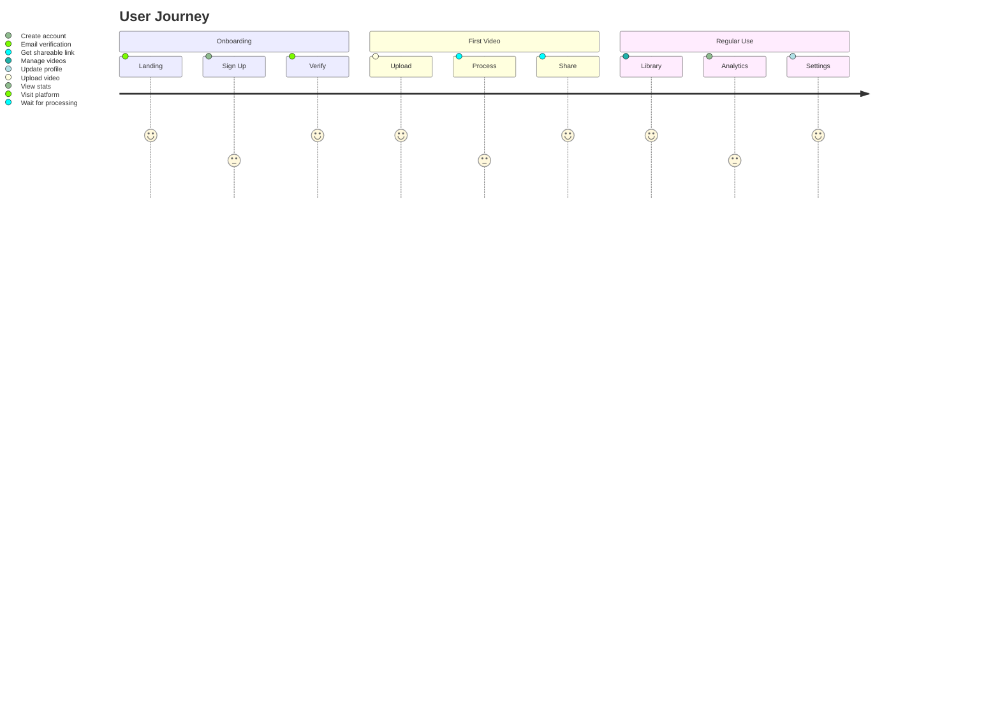

## Navigation Flow

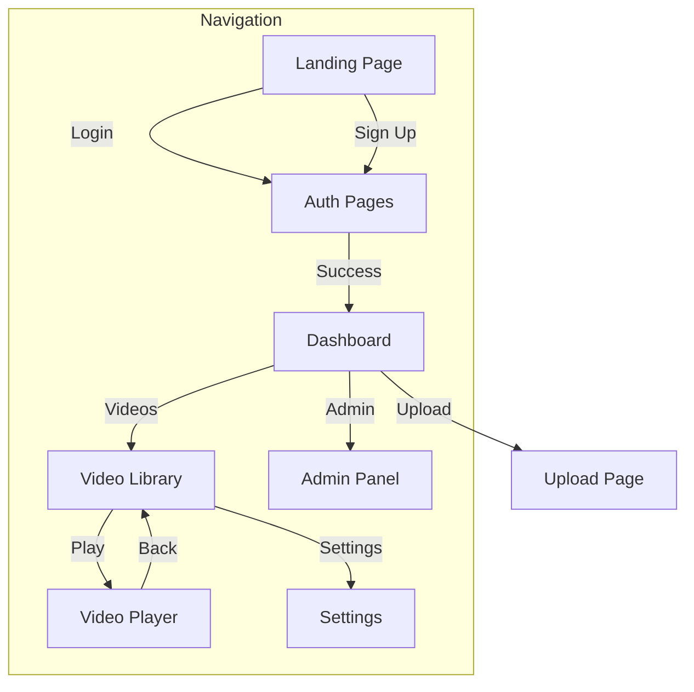

## Authentication Flow

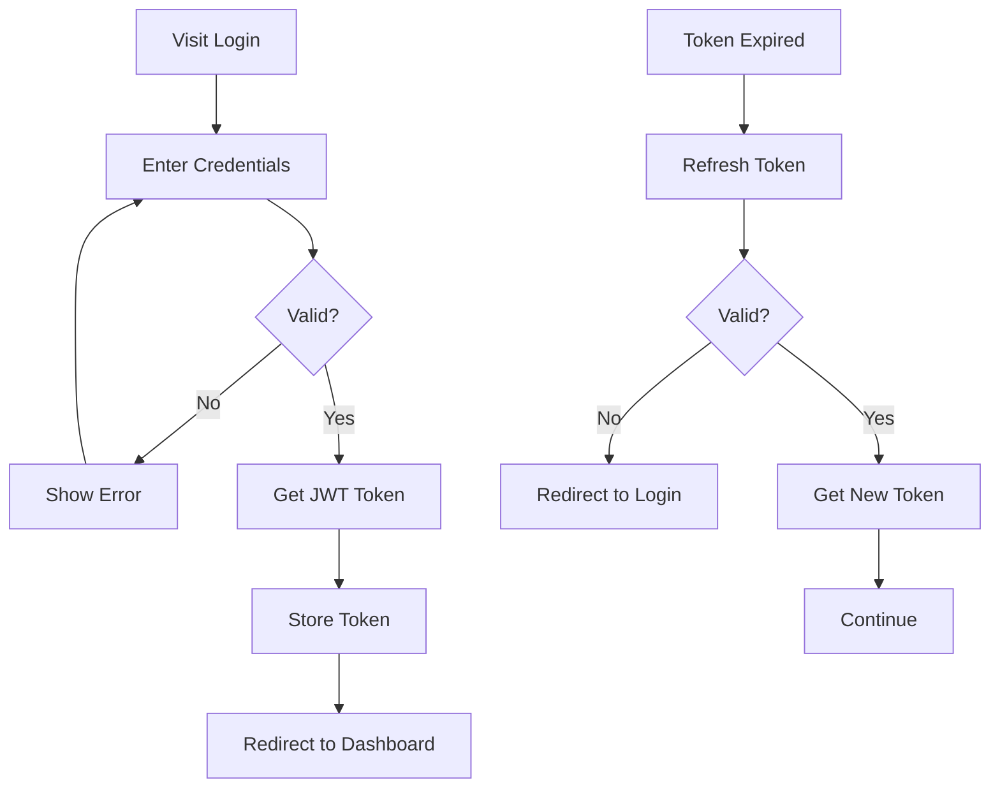

### Authentication State

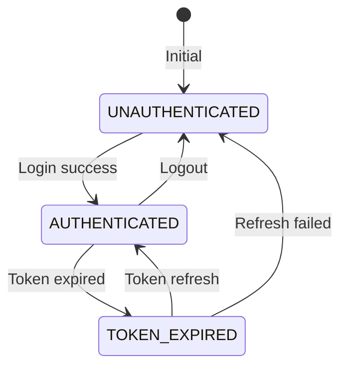

## Dashboard Flow

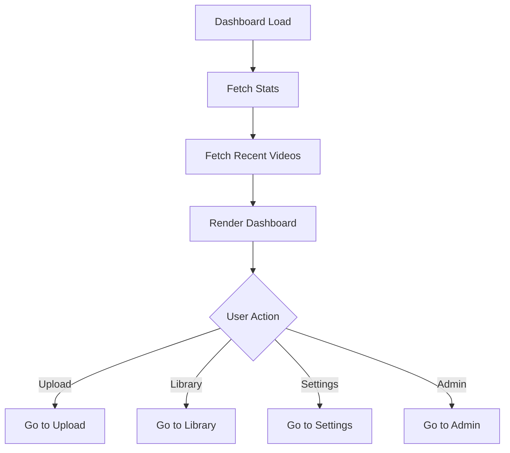

### Dashboard Layout

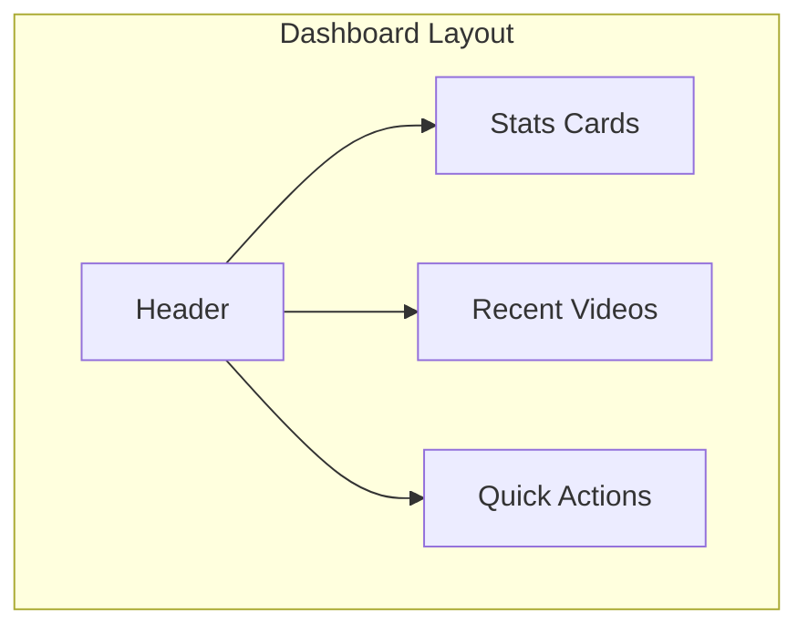

## Upload Flow

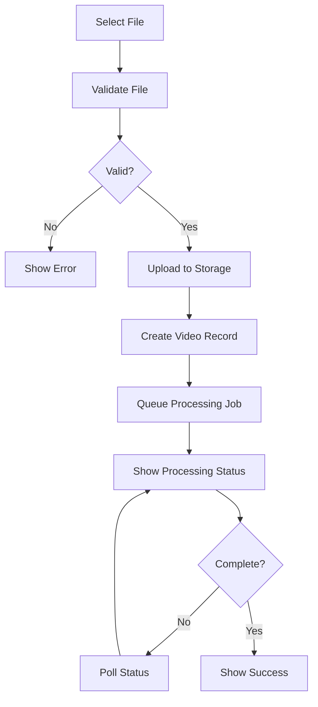

### Chunked Upload Flow

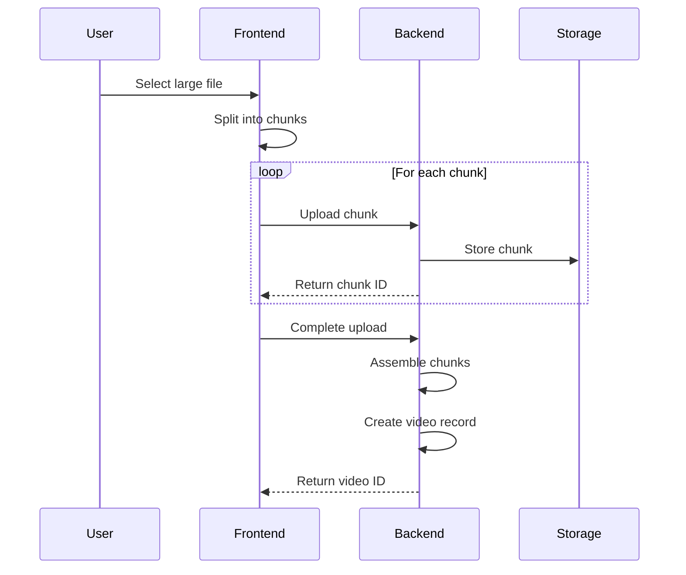

## Video Playback Flow

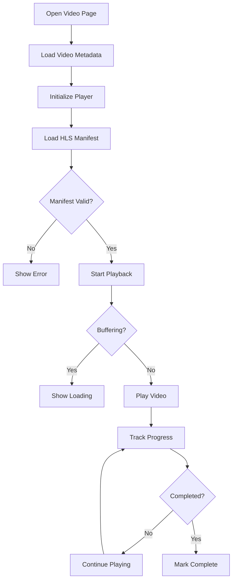

### Player State Machine

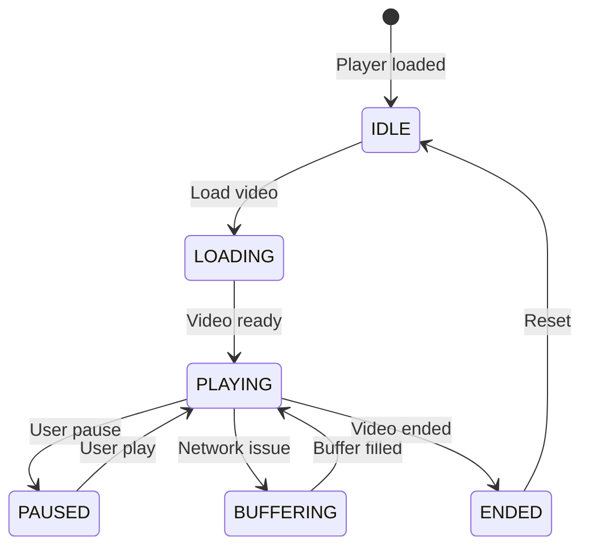

## Admin Flow

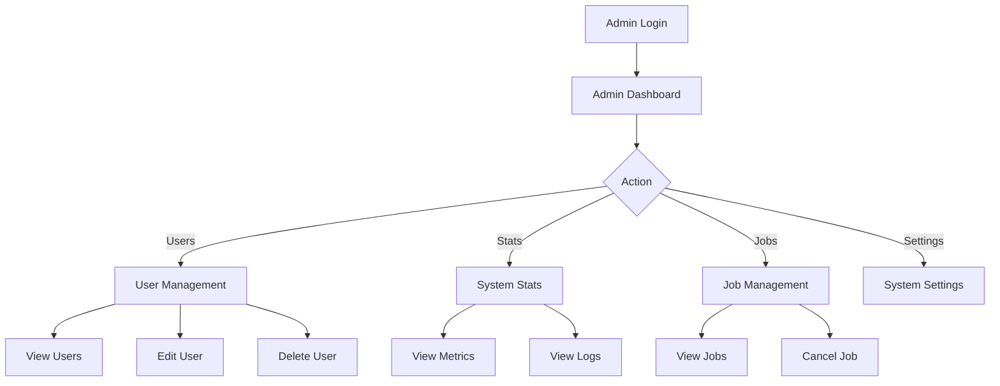

## Responsive Strategy

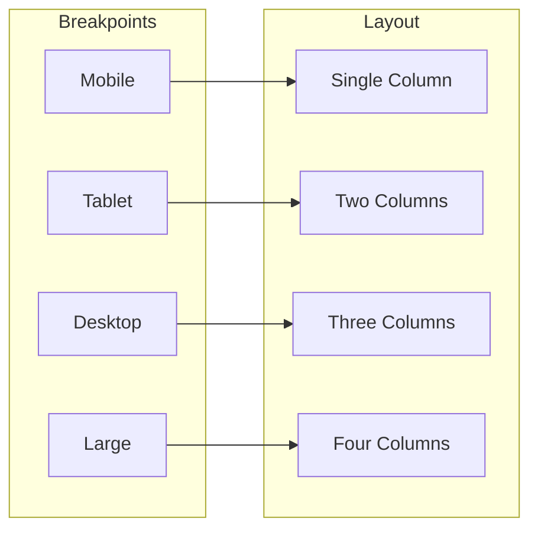

### Responsive Grid

```tsx
// Responsive video grid
<div className="grid grid-cols-1 sm:grid-cols-2 md:grid-cols-3 lg:grid-cols-4 gap-4">
  {videos.map(video => (
    <VideoCard key={video.id} video={video} />
  ))}
</div>
```

## Wireframe Navigation

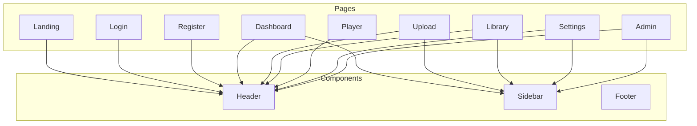

## Design Decisions

### Decision: Protected Routes

**Status**: Accepted

**Context**: Need to secure authenticated pages.

**Decision**: Use middleware to protect routes.

**Consequences**:
- Automatic redirect to login
- Token validation
- Role-based access

### Decision: Responsive First

**Status**: Accepted

**Context**: Users access from multiple devices.

**Decision**: Mobile-first responsive design.

**Consequences**:
- Better mobile experience
- Progressive enhancement
- More CSS complexity

## Notes

- All navigation is client-side
- Authentication state is persisted
- UI is accessible
- Dark mode is supported

## References

- [Next.js App Router](https://nextjs.org/docs/app)
- [Tailwind CSS](https://tailwindcss.com/docs)

## Future Documents

- [30_API_Status_Codes.md](./30_API_Status_Codes.md) - API status codes

## Revision History

| Date | Version | Author | Changes |
|------|---------|--------|---------|
| 2024-01-15 | 1.0.0 | Design Team | Initial version |