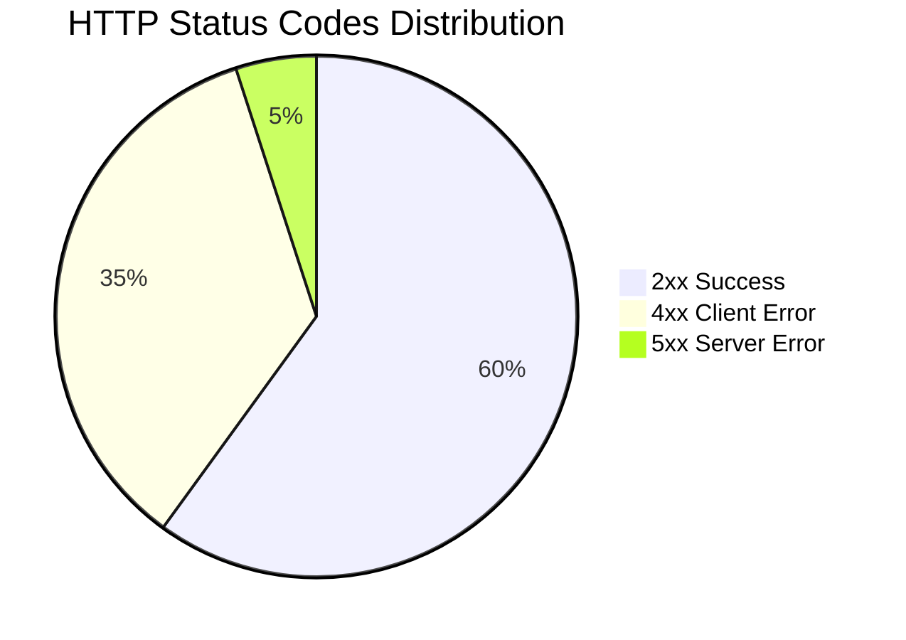

# API Status Codes

## Purpose

This document defines the standard API response status codes and formats for the Automated Cloud-Native Video Transcoding and Streaming Platform.

## Scope

All HTTP status codes, response formats, and error handling.

## Audience

- Backend Engineers
- Frontend Engineers
- API Consumers
- QA Engineers

## Dependencies

- [00_Project_Standards.md](./00_Project_Standards.md) - Development standards
- [08_API_Design.md](./08_API_Design.md) - API design
- [19_Error_Handling.md](./19_Error_Handling.md) - Error handling

## Related Documents

- [23_API_Examples.md](./23_API_Examples.md) - API examples
- [09_Authentication.md](./09_Authentication.md) - Authentication

## Table of Contents

1. [Status Code Overview](#status-code-overview)
2. [Success Responses](#success-responses)
3. [Client Error Responses](#client-error-responses)
4. [Server Error Responses](#server-error-responses)
5. [Response Format Standards](#response-format-standards)
6. [Error Code Reference](#error-code-reference)
7. [Rate Limit Headers](#rate-limit-headers)
8. [Design Decisions](#design-decisions)
9. [Notes](#notes)
10. [References](#references)
11. [Future Documents](#future-documents)
12. [Revision History](#revision-history)

## Status Code Overview



## Success Responses

### 200 OK

**Usage**: Successful GET, PUT, PATCH requests

```json
{
  "data": {
    "id": "video_abc123",
    "title": "My Video",
    "status": "COMPLETED"
  },
  "meta": {
    "timestamp": "2024-01-15T10:30:00Z",
    "requestId": "req_123456"
  }
}
```

### 201 Created

**Usage**: Successful POST requests (resource created)

```json
{
  "data": {
    "id": "video_abc123",
    "title": "My Video",
    "status": "PENDING",
    "createdAt": "2024-01-15T10:30:00Z"
  },
  "meta": {
    "timestamp": "2024-01-15T10:30:00Z",
    "requestId": "req_123456"
  }
}
```

### 202 Accepted

**Usage**: Request accepted for async processing

```json
{
  "data": {
    "jobId": "job_abc123",
    "status": "PENDING",
    "message": "Video processing started"
  },
  "meta": {
    "timestamp": "2024-01-15T10:30:00Z",
    "requestId": "req_123456"
  }
}
```

### 204 No Content

**Usage**: Successful DELETE requests

```http
HTTP/1.1 204 No Content
```

## Client Error Responses

### 400 Bad Request

**Usage**: Validation error, malformed request

```json
{
  "error": {
    "code": "VALIDATION_ERROR",
    "message": "Invalid input data",
    "details": [
      {
        "field": "title",
        "value": "",
        "message": "Title is required"
      },
      {
        "field": "file",
        "message": "File size exceeds 5GB limit"
      }
    ]
  },
  "meta": {
    "timestamp": "2024-01-15T10:30:00Z",
    "requestId": "req_123456"
  }
}
```

### 401 Unauthorized

**Usage**: Missing or invalid authentication token

```json
{
  "error": {
    "code": "AUTHENTICATION_ERROR",
    "message": "Access token is required"
  },
  "meta": {
    "timestamp": "2024-01-15T10:30:00Z",
    "requestId": "req_123456"
  }
}
```

### 403 Forbidden

**Usage**: Insufficient permissions

```json
{
  "error": {
    "code": "AUTHORIZATION_ERROR",
    "message": "You do not have permission to access this resource"
  },
  "meta": {
    "timestamp": "2024-01-15T10:30:00Z",
    "requestId": "req_123456"
  }
}
```

### 404 Not Found

**Usage**: Resource not found

```json
{
  "error": {
    "code": "NOT_FOUND",
    "message": "Video not found"
  },
  "meta": {
    "timestamp": "2024-01-15T10:30:00Z",
    "requestId": "req_123456"
  }
}
```

### 409 Conflict

**Usage**: Duplicate resource, version conflict

```json
{
  "error": {
    "code": "CONFLICT",
    "message": "Email already registered"
  },
  "meta": {
    "timestamp": "2024-01-15T10:30:00Z",
    "requestId": "req_123456"
  }
}
```

### 413 Payload Too Large

**Usage**: File size exceeds limit

```json
{
  "error": {
    "code": "VALIDATION_ERROR",
    "message": "File size exceeds maximum allowed (5GB)"
  },
  "meta": {
    "timestamp": "2024-01-15T10:30:00Z",
    "requestId": "req_123456"
  }
}
```

### 415 Unsupported Media Type

**Usage**: Invalid file format

```json
{
  "error": {
    "code": "VALIDATION_ERROR",
    "message": "Unsupported video format. Supported: mp4, mov, avi, mkv, webm, flv"
  },
  "meta": {
    "timestamp": "2024-01-15T10:30:00Z",
    "requestId": "req_123456"
  }
}
```

### 422 Unprocessable Entity

**Usage**: Semantic validation error

```json
{
  "error": {
    "code": "VALIDATION_ERROR",
    "message": "Video processing failed",
    "details": [
      {
        "field": "video",
        "message": "Corrupted or invalid video file"
      }
    ]
  },
  "meta": {
    "timestamp": "2024-01-15T10:30:00Z",
    "requestId": "req_123456"
  }
}
```

### 429 Too Many Requests

**Usage**: Rate limit exceeded

```json
{
  "error": {
    "code": "RATE_LIMIT",
    "message": "Too many requests. Please try again later."
  },
  "meta": {
    "timestamp": "2024-01-15T10:30:00Z",
    "requestId": "req_123456"
  }
}
```

## Server Error Responses

### 500 Internal Server Error

**Usage**: Unexpected server error

```json
{
  "error": {
    "code": "INTERNAL_ERROR",
    "message": "An unexpected error occurred"
  },
  "meta": {
    "timestamp": "2024-01-15T10:30:00Z",
    "requestId": "req_123456"
  }
}
```

### 502 Bad Gateway

**Usage**: Upstream service error

```json
{
  "error": {
    "code": "EXTERNAL_ERROR",
    "message": "Storage service unavailable"
  },
  "meta": {
    "timestamp": "2024-01-15T10:30:00Z",
    "requestId": "req_123456"
  }
}
```

### 503 Service Unavailable

**Usage**: Service temporarily unavailable

```json
{
  "error": {
    "code": "SERVICE_UNAVAILABLE",
    "message": "Service temporarily unavailable. Please try again later."
  },
  "meta": {
    "timestamp": "2024-01-15T10:30:00Z",
    "requestId": "req_123456"
  }
}
```

## Response Format Standards

### Success Response

```typescript
interface SuccessResponse<T> {
  data: T;
  meta: {
    timestamp: string;
    requestId: string;
  };
}
```

### Paginated Response

```typescript
interface PaginatedResponse<T> {
  data: T[];
  pagination: {
    page: number;
    limit: number;
    total: number;
    totalPages: number;
    hasNext: boolean;
    hasPrev: boolean;
  };
  meta: {
    timestamp: string;
    requestId: string;
  };
}
```

### Error Response

```typescript
interface ErrorResponse {
  error: {
    code: string;
    message: string;
    details?: Array<{
      field?: string;
      value?: unknown;
      message: string;
    }>;
  };
  meta: {
    timestamp: string;
    requestId: string;
  };
}
```

## Error Code Reference

| Code | HTTP Status | Description |
|------|-------------|-------------|
| VALIDATION_ERROR | 400 | Invalid input data |
| AUTHENTICATION_ERROR | 401 | Missing or invalid token |
| AUTHORIZATION_ERROR | 403 | Insufficient permissions |
| NOT_FOUND | 404 | Resource not found |
| CONFLICT | 409 | Duplicate resource |
| RATE_LIMIT | 429 | Too many requests |
| INTERNAL_ERROR | 500 | Server error |
| PROCESSING_ERROR | 500 | Video processing failed |
| EXTERNAL_ERROR | 502 | Third-party service error |
| SERVICE_UNAVAILABLE | 503 | Service unavailable |

## Rate Limit Headers

```http
X-RateLimit-Limit: 100
X-RateLimit-Remaining: 99
X-RateLimit-Reset: 1705312260
```

## Design Decisions

### Decision: Structured Error Responses

**Status**: Accepted

**Context**: Need for consistent, machine-readable errors.

**Decision**: Use structured error response format with error codes.

**Consequences**:
- Consistent API
- Easy error handling
- More verbose responses

### Decision: Request ID

**Status**: Accepted

**Context**: Need for request tracing and debugging.

**Decision**: Include request ID in all responses.

**Consequences**:
- Easy debugging
- Request tracing
- Additional header management

## Notes

- All responses follow the same structure
- Error codes are stable and documented
- Stack traces are never exposed to clients
- All responses include timestamp

## References

- [RFC 7807 - Problem Details](https://tools.ietf.org/html/rfc7807)
- [HTTP Status Codes](https://developer.mozilla.org/en-US/docs/Web/HTTP/Status)

## Future Documents

- [31_File_Upload_Policy.md](./31_File_Upload_Policy.md) - File upload policy

## Revision History

| Date | Version | Author | Changes |
|------|---------|--------|---------|
| 2024-01-15 | 1.0.0 | API Team | Initial version |