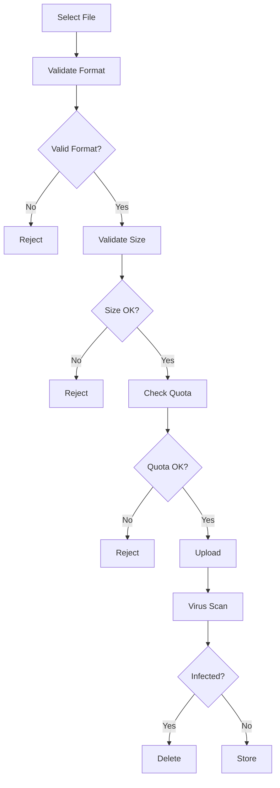
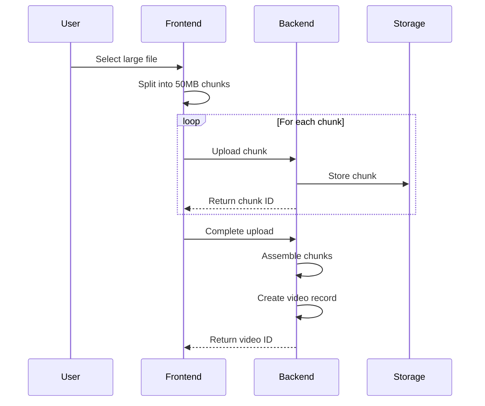
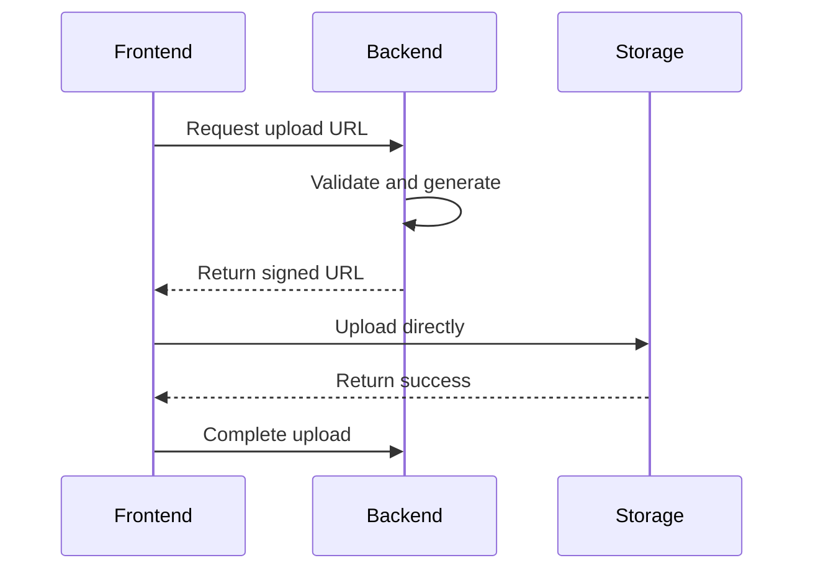

# File Upload Policy

## Purpose

This document defines the file upload policy for the Automated Cloud-Native Video Transcoding and Streaming Platform.

## Scope

Accepted formats, size limits, validation, and security measures.

## Audience

- Backend Engineers
- Frontend Engineers
- Security Engineers
- DevOps Engineers

## Dependencies

- [00_Project_Standards.md](./00_Project_Standards.md) - Development standards
- [02_Requirements.md](./02_Requirements.md) - System requirements
- [17_Security.md](./17_Security.md) - Security architecture

## Related Documents

- [08_API_Design.md](./08_API_Design.md) - API design
- [13_Storage_Architecture.md](./13_Storage_Architecture.md) - Storage

## Table of Contents

1. [Upload Policy Overview](#upload-policy-overview)
2. [Accepted Formats](#accepted-formats)
3. [Maximum Upload Size](#maximum-upload-size)
4. [Chunk Upload](#chunk-upload)
5. [Resume Upload](#resume-upload)
6. [Validation](#validation)
7. [Virus Scanning](#virus-scanning)
8. [Temporary Storage](#temporary-storage)
9. [Cleanup](#cleanup)
10. [Error Handling](#error-handling)
11. [Retry Strategy](#retry-strategy)
12. [Security](#security)
13. [Signed Upload URLs](#signed-upload-urls)
14. [Design Decisions](#design-decisions)
15. [Notes](#notes)
16. [References](#references)
17. [Future Documents](#future-documents)
18. [Revision History](#revision-history)

## Upload Policy Overview



## Accepted Formats

### Video Formats

| Format | Extension | MIME Type | Codec |
|--------|-----------|-----------|-------|
| MP4 | .mp4 | video/mp4 | H.264, H.265 |
| MOV | .mov | video/quicktime | H.264, ProRes |
| AVI | .avi | video/x-msvideo | H.264 |
| MKV | .mkv | video/x-matroska | H.264, H.265 |
| WebM | .webm | video/webm | VP8, VP9 |
| FLV | .flv | video/x-flv | H.264 |

### Format Validation

```typescript
const ALLOWED_FORMATS = [
  'video/mp4',
  'video/quicktime',
  'video/x-msvideo',
  'video/x-matroska',
  'video/webm',
  'video/x-flv',
];

const ALLOWED_EXTENSIONS = ['.mp4', '.mov', '.avi', '.mkv', '.webm', '.flv'];

function validateFormat(file: File): boolean {
  return ALLOWED_FORMATS.includes(file.type) &&
    ALLOWED_EXTENSIONS.some(ext => file.name.endsWith(ext));
}
```

## Maximum Upload Size

### Size Limits

| Type | Limit |
|------|-------|
| Single upload | 5GB |
| Chunk size | 50MB |
| Total user storage | Based on plan (10GB-10TB) |

### Size Validation

```typescript
const MAX_FILE_SIZE = 5368709120; // 5GB
const CHUNK_SIZE = 52428800; // 50MB

function validateSize(file: File): boolean {
  return file.size <= MAX_FILE_SIZE;
}
```

## Chunk Upload

### Chunked Upload Flow



### Chunk Upload API

```typescript
// Initialize upload
POST /videos/upload/init
{
  "filename": "video.mp4",
  "size": 1073741824, // 1GB
  "mimeType": "video/mp4"
}

// Response
{
  "data": {
    "uploadId": "upload_abc123",
    "chunkSize": 52428800,
    "totalChunks": 21
  }
}

// Upload chunk
PUT /videos/upload/{uploadId}/chunk/{index}
// Binary data

// Complete upload
POST /videos/upload/{uploadId}/complete
{
  "title": "My Video"
}
```

## Resume Upload

### Resume Capability

```typescript
// Check for existing upload
GET /videos/upload/{uploadId}

// Response
{
  "data": {
    "uploadId": "upload_abc123",
    "uploadedChunks": [0, 1, 2, 3],
    "totalChunks": 21
  }
}

// Resume from last chunk
// Upload remaining chunks
```

## Validation

### File Validation

```typescript
const videoUploadSchema = z.object({
  file: z.instanceof(File)
    .refine(
      (file) => ALLOWED_FORMATS.includes(file.type),
      'Unsupported file format'
    )
    .refine(
      (file) => file.size <= MAX_FILE_SIZE,
      'File size exceeds 5GB limit'
    ),
  title: z.string().min(1).max(200),
  description: z.string().max(2000).optional(),
});
```

### Magic Byte Validation

```typescript
// Check file signature
const FILE_SIGNATURES: Record<string, number[]> = {
  'mp4': [0x00, 0x00, 0x00, 0x18, 0x66, 0x74, 0x79, 0x70],
  'mov': [0x00, 0x00, 0x00, 0x14, 0x66, 0x74, 0x79, 0x70],
  'avi': [0x52, 0x49, 0x46, 0x46],
  'mkv': [0x1A, 0x45, 0xDF, 0xA3],
  'webm': [0x1A, 0x45, 0xDF, 0xA3],
  'flv': [0x46, 0x4C, 0x56],
};

async function validateMagicBytes(file: File): Promise<boolean> {
  const buffer = await file.slice(0, 8).arrayBuffer();
  const bytes = new Uint8Array(buffer);
  // Check against known signatures
}
```

## Virus Scanning

### ClamAV Integration

```typescript
// Future: Virus scanning
async function scanFile(file: File): Promise<boolean> {
  const stream = file.stream();
  const result = await clamav.scan(stream);
  return result.isClean;
}
```

### Scan Status

| Status | Action |
|--------|--------|
| Clean | Accept file |
| Infected | Reject and delete |
| Error | Quarantine for review |

## Temporary Storage

### Upload Directory

```
temp/
├── uploads/
│   ├── {uploadId}/
│   │   ├── chunk_0
│   │   ├── chunk_1
│   │   └── ...
```

### Cleanup Policy

```typescript
// Clean up incomplete uploads after 24 hours
const CLEANUP_INTERVAL = 24 * 60 * 60 * 1000; // 24 hours

async function cleanupTempUploads() {
  const uploads = await storage.list('temp/uploads/', {
    olderThan: Date.now() - CLEANUP_INTERVAL,
  });
  
  for (const upload of uploads) {
    await storage.delete(upload.key);
  }
}
```

## Cleanup

### Automatic Cleanup

| Resource | TTL |
|----------|-----|
| Incomplete uploads | 24 hours |
| Failed uploads | 1 hour |
| Temp chunks | 1 hour |

### Cleanup Job

```typescript
// Scheduled cleanup job
const cleanupJob = new CronJob('0 */6 * * *', async () => {
  await cleanupTempUploads();
  await cleanupFailedJobs();
});
```

## Error Handling

### Upload Errors

| Error | HTTP Status | Description |
|-------|-------------|-------------|
| Invalid format | 415 | Unsupported file type |
| File too large | 413 | Exceeds size limit |
| Quota exceeded | 403 | Storage quota exceeded |
| Upload failed | 500 | Storage error |
| Virus detected | 400 | Infected file |

### Error Response

```json
{
  "error": {
    "code": "VALIDATION_ERROR",
    "message": "File validation failed",
    "details": [
      {
        "field": "file",
        "message": "Unsupported format: .wmv"
      }
    ]
  },
  "meta": {
    "timestamp": "2024-01-15T10:30:00Z",
    "requestId": "req_123456"
  }
}
```

## Retry Strategy

### Client-Side Retry

```typescript
// Exponential backoff
const retryConfig = {
  maxRetries: 3,
  initialDelay: 1000,
  maxDelay: 30000,
};

async function uploadWithRetry(
  file: File,
  attempt = 1
): Promise<UploadResult> {
  try {
    return await uploadFile(file);
  } catch (error) {
    if (attempt < retryConfig.maxRetries) {
      const delay = Math.min(
        retryConfig.initialDelay * 2 ** (attempt - 1),
        retryConfig.maxDelay
      );
      await sleep(delay);
      return uploadWithRetry(file, attempt + 1);
    }
    throw error;
  }
}
```

## Security

### Security Measures

| Measure | Implementation |
|---------|----------------|
| File type validation | Magic bytes + extension |
| Size limit | Server-side validation |
| Rate limiting | 100 uploads/minute |
| Authentication | JWT required |
| Authorization | User quota check |
| Virus scanning | ClamAV (future) |

### Signed URLs

```typescript
// Generate signed URL for direct upload
const signedUrl = await s3Client.getSignedUrl('putObject', {
  Bucket: process.env.MINIO_BUCKET,
  Key: `temp/${uploadId}/chunk_${index}`,
  Expires: 3600,
  ContentType: 'application/octet-stream',
});
```

## Signed Upload URLs

### Pre-signed URL Flow



### URL Generation

```typescript
// Generate pre-signed URL
async function generateUploadUrl(
  uploadId: string,
  index: number,
  contentType: string
): Promise<string> {
  return s3Client.getSignedUrl('putObject', {
    Bucket: process.env.MINIO_BUCKET,
    Key: `temp/${uploadId}/chunk_${index}`,
    Expires: 3600,
    ContentType: contentType,
  });
}
```

## Design Decisions

### Decision: 50MB Chunk Size

**Status**: Accepted

**Context**: Balance between upload reliability and overhead.

**Decision**: Use 50MB chunks for large file uploads.

**Consequences**:
- Good balance for most connections
- Reasonable number of chunks for 5GB file
- Memory efficient

### Decision: Magic Byte Validation

**Status**: Accepted

**Context**: Need to prevent malicious file uploads.

**Decision**: Validate file signatures in addition to extension.

**Consequences**:
- More secure
- Additional processing time
- Better user experience

## Notes

- All uploads are validated
- Chunked upload is required for files > 100MB
- Virus scanning is planned for future
- Cleanup runs automatically

## References

- [OWASP File Upload](https://cheatsheetseries.owasp.org/cheatsheets/File_Upload_Cheat_Sheet.html)
- [ClamAV](https://www.clamav.net)

## Future Documents

- [32_FFmpeg_Profiles.md](./32_FFmpeg_Profiles.md) - FFmpeg profiles

## Revision History

| Date | Version | Author | Changes |
|------|---------|--------|---------|
| 2024-01-15 | 1.0.0 | Security Team | Initial version |