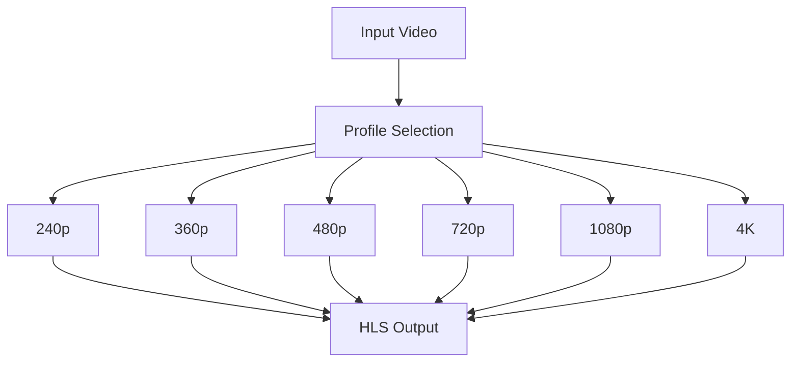

# FFmpeg Profiles

## Purpose

This document defines the FFmpeg transcoding profiles for the Automated Cloud-Native Video Transcoding and Streaming Platform.

## Scope

All transcoding profiles, codecs, and output configurations.

## Audience

- Backend Engineers
- Video Engineers
- DevOps Engineers

## Dependencies

- [00_Project_Standards.md](./00_Project_Standards.md) - Development standards
- [05_Tech_Stack.md](./05_Tech_Stack.md) - Technology stack
- [15_Transcoding_Pipeline.md](./15_Transcoding_Pipeline.md) - Transcoding

## Related Documents

- [13_Storage_Architecture.md](./13_Storage_Architecture.md) - Storage
- [14_Streaming_Architecture.md](./14_Streaming_Architecture.md) - Streaming

## Table of Contents

1. [Transcoding Overview](#transcoding-overview)
2. [240p Profile](#240p-profile)
3. [360p Profile](#360p-profile)
4. [480p Profile](#480p-profile)
5. [720p Profile](#720p-profile)
6. [1080p Profile](#1080p-profile)
7. [4K Profile](#4k-profile)
8. [Codec Configuration](#codec-configuration)
9. [Container Format](#container-format)
10. [Bitrate Settings](#bitrate-settings)
11. [Frame Rate](#frame-rate)
12. [Audio Settings](#audio-settings)
13. [Segment Duration](#segment-duration)
14. [Thumbnail Profile](#thumbnail-profile)
15. [Preview GIF Profile](#preview-gif-profile)
16. [Future AV1 Support](#future-av1-support)
17. [Design Decisions](#design-decisions)
18. [Notes](#notes)
19. [References](#references)
20. [Future Documents](#future-documents)
21. [Revision History](#revision-history)

## Transcoding Overview



## 240p Profile

### Configuration

| Setting | Value |
|---------|-------|
| Resolution | 426x240 |
| Video Codec | H.264 (libx264) |
| Video Bitrate | 400 kbps |
| Audio Codec | AAC |
| Audio Bitrate | 64 kbps |
| Frame Rate | Same as input (max 30 fps) |
| Profile | Baseline |
| Level | 3.0 |

### FFmpeg Command

```bash
ffmpeg -i input.mp4 \
  -vf scale=426:240 \
  -c:v libx264 \
  -preset fast \
  -crf 28 \
  -b:v 400k \
  -maxrate 400k \
  -bufsize 800k \
  -profile:v baseline \
  -level 3.0 \
  -c:a aac \
  -b:a 64k \
  -hls_time 10 \
  -hls_playlist_type event \
  output.m3u8
```

## 360p Profile

### Configuration

| Setting | Value |
|---------|-------|
| Resolution | 640x360 |
| Video Codec | H.264 (libx264) |
| Video Bitrate | 800 kbps |
| Audio Codec | AAC |
| Audio Bitrate | 96 kbps |
| Frame Rate | Same as input (max 30 fps) |
| Profile | Main |
| Level | 3.1 |

### FFmpeg Command

```bash
ffmpeg -i input.mp4 \
  -vf scale=640:360 \
  -c:v libx264 \
  -preset fast \
  -crf 26 \
  -b:v 800k \
  -maxrate 800k \
  -bufsize 1600k \
  -profile:v main \
  -level 3.1 \
  -c:a aac \
  -b:a 96k \
  -hls_time 10 \
  -hls_playlist_type event \
  output.m3u8
```

## 480p Profile

### Configuration

| Setting | Value |
|---------|-------|
| Resolution | 854x480 |
| Video Codec | H.264 (libx264) |
| Video Bitrate | 1200 kbps |
| Audio Codec | AAC |
| Audio Bitrate | 128 kbps |
| Frame Rate | Same as input (max 30 fps) |
| Profile | Main |
| Level | 3.1 |

### FFmpeg Command

```bash
ffmpeg -i input.mp4 \
  -vf scale=854:480 \
  -c:v libx264 \
  -preset fast \
  -crf 24 \
  -b:v 1200k \
  -maxrate 1200k \
  -bufsize 2400k \
  -profile:v main \
  -level 3.1 \
  -c:a aac \
  -b:a 128k \
  -hls_time 10 \
  -hls_playlist_type event \
  output.m3u8
```

## 720p Profile

### Configuration

| Setting | Value |
|---------|-------|
| Resolution | 1280x720 |
| Video Codec | H.264 (libx264) |
| Video Bitrate | 2400 kbps |
| Audio Codec | AAC |
| Audio Bitrate | 192 kbps |
| Frame Rate | Same as input (max 30 fps) |
| Profile | Main |
| Level | 4.0 |

### FFmpeg Command

```bash
ffmpeg -i input.mp4 \
  -vf scale=1280:720 \
  -c:v libx264 \
  -preset fast \
  -crf 23 \
  -b:v 2400k \
  -maxrate 2400k \
  -bufsize 4800k \
  -profile:v main \
  -level 4.0 \
  -c:a aac \
  -b:a 192k \
  -hls_time 10 \
  -hls_playlist_type event \
  output.m3u8
```

## 1080p Profile

### Configuration

| Setting | Value |
|---------|-------|
| Resolution | 1920x1080 |
| Video Codec | H.264 (libx264) |
| Video Bitrate | 4800 kbps |
| Audio Codec | AAC |
| Audio Bitrate | 256 kbps |
| Frame Rate | Same as input (max 30 fps) |
| Profile | High |
| Level | 4.2 |

### FFmpeg Command

```bash
ffmpeg -i input.mp4 \
  -vf scale=1920:1080 \
  -c:v libx264 \
  -preset fast \
  -crf 22 \
  -b:v 4800k \
  -maxrate 4800k \
  -bufsize 9600k \
  -profile:v high \
  -level 4.2 \
  -c:a aac \
  -b:a 256k \
  -hls_time 10 \
  -hls_playlist_type event \
  output.m3u8
```

## 4K Profile

### Configuration

| Setting | Value |
|---------|-------|
| Resolution | 3840x2160 |
| Video Codec | H.264 (libx264) |
| Video Bitrate | 12000 kbps |
| Audio Codec | AAC |
| Audio Bitrate | 384 kbps |
| Frame Rate | Same as input (max 30 fps) |
| Profile | High |
| Level | 5.2 |

### FFmpeg Command

```bash
ffmpeg -i input.mp4 \
  -vf scale=3840:2160 \
  -c:v libx264 \
  -preset fast \
  -crf 20 \
  -b:v 12000k \
  -maxrate 12000k \
  -bufsize 24000k \
  -profile:v high \
  -level 5.2 \
  -c:a aac \
  -b:a 384k \
  -hls_time 10 \
  -hls_playlist_type event \
  output.m3u8
```

## Codec Configuration

### Video Codecs

| Codec | Use Case |
|-------|----------|
| H.264 (libx264) | Primary codec, broad compatibility |
| H.265 (libx265) | Future, better compression |
| VP8 (libvpx) | WebM support |
| VP9 (libvpx-vp9) | WebM support, better quality |

### Audio Codecs

| Codec | Use Case |
|-------|----------|
| AAC | Primary audio codec |
| MP3 | Alternative |
| Vorbis | WebM support |

## Container Format

### HLS Container

```m3u8
#EXTM3U
#EXT-X-VERSION:3
#EXT-X-INDEPENDENT-SEGMENTS

#EXT-X-STREAM-INF:BANDWIDTH=2400000,RESOLUTION=1280x720,CODECS="avc1.4d001f,mp4a.40.2"
720p/master.m3u8

#EXT-X-STREAM-INF:BANDWIDTH=1200000,RESOLUTION=854x480,CODECS="avc1.4d001f,mp4a.40.2"
480p/master.m3u8
```

## Bitrate Settings

### Video Bitrate Ladder

| Resolution | Video Bitrate | Audio Bitrate | Total |
|------------|---------------|---------------|-------|
| 240p | 400 kbps | 64 kbps | 464 kbps |
| 360p | 800 kbps | 96 kbps | 896 kbps |
| 480p | 1200 kbps | 128 kbps | 1328 kbps |
| 720p | 2400 kbps | 192 kbps | 2592 kbps |
| 1080p | 4800 kbps | 256 kbps | 5056 kbps |
| 4K | 12000 kbps | 384 kbps | 12384 kbps |

### CRF Values

| Resolution | CRF |
|------------|-----|
| 240p | 28 |
| 360p | 26 |
| 480p | 24 |
| 720p | 23 |
| 1080p | 22 |
| 4K | 20 |

## Frame Rate

### Frame Rate Handling

```bash
# Preserve original frame rate, max 30 fps
ffmpeg -i input.mp4 \
  -vf "fps=max(30,fps=30)" \
  -r 30 \
  output.mp4
```

## Audio Settings

### Audio Configuration

| Setting | Value |
|---------|-------|
| Sample Rate | 48000 Hz |
| Channels | Stereo (2) |
| Profile | AAC-LC |

### Audio Command

```bash
-c:a aac \
-ar 48000 \
-ac 2 \
-b:a 128k
```

## Segment Duration

### HLS Segments

| Setting | Value |
|---------|-------|
| Target Duration | 10 seconds |
| Max Duration | 10 seconds |
| Playlist Type | Event |

### Segment Command

```bash
-hls_time 10 \
-hls_playlist_type event \
-hls_segment_filename "segment_%03d.ts"
```

## Thumbnail Profile

### Thumbnail Generation

| Setting | Value |
|---------|-------|
| Resolution | 1280x720 |
| Format | JPEG |
| Quality | 85% |
| Timestamps | 10s, 30s, 60s |

### Thumbnail Command

```bash
# Generate at specific timestamps
ffmpeg -ss 10 -i input.mp4 -vframes 1 -q:v 2 thumbnail_10s.jpg
ffmpeg -ss 30 -i input.mp4 -vframes 1 -q:v 2 thumbnail_30s.jpg
ffmpeg -ss 60 -i input.mp4 -vframes 1 -q:v 2 thumbnail_60s.jpg
```

## Preview GIF Profile

### GIF Configuration

| Setting | Value |
|---------|-------|
| Duration | 3 seconds |
| FPS | 10 |
| Resolution | 640x360 |
| Format | GIF |

### GIF Command

```bash
ffmpeg -ss 0 -i input.mp4 \
  -t 3 \
  -vf "fps=10,scale=640:360:flags=lanczos" \
  -loop 0 \
  preview.gif
```

## Future AV1 Support

### AV1 Profile (Future)

| Setting | Value |
|---------|-------|
| Resolution | 1920x1080 |
| Video Codec | AV1 (libaom-av1) |
| Video Bitrate | 3000 kbps |
| Audio Codec | Opus |
| Audio Bitrate | 128 kbps |

### AV1 Command

```bash
# Future AV1 support
ffmpeg -i input.mp4 \
  -c:v libaom-av1 \
  -crf 30 \
  -b:v 3000k \
  -c:a libopus \
  -b:a 128k \
  output.mkv
```

## Design Decisions

### Decision: H.264 for Compatibility

**Status**: Accepted

**Context**: Need for broad device compatibility.

**Decision**: Use H.264 as primary codec.

**Consequences**:
- Apple device support
- Broad compatibility
- Higher file sizes

### Decision: 10s Segments

**Status**: Accepted

**Context**: Balance between latency and overhead.

**Decision**: Use 10-second HLS segments.

**Consequences**:
- Good for live streaming
- Reasonable manifest size
- Quick seeking

## Notes

- All profiles use HLS output
- Hardware acceleration is supported
- Profiles are configurable
- Future support for AV1 planned

## References

- [FFmpeg Documentation](https://ffmpeg.org/documentation.html)
- [HLS Specification](https://tools.ietf.org/html/draft-pantos-http-live-streaming)

## Future Documents

- [33_Bucket_Structure.md](./33_Bucket_Structure.md) - Bucket structure

## Revision History

| Date | Version | Author | Changes |
|------|---------|--------|---------|
| 2024-01-15 | 1.0.0 | Video Team | Initial version |