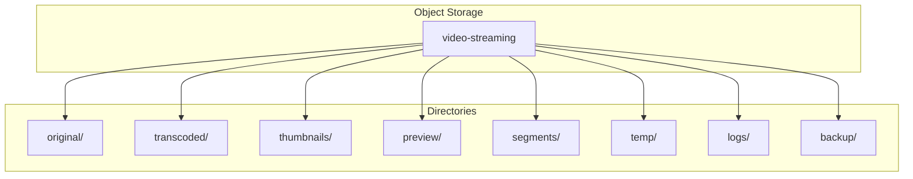

# Bucket Structure

## Purpose

This document defines the object storage hierarchy for the Automated Cloud-Native Video Transcoding and Streaming Platform.

## Scope

Storage organization, lifecycle rules, and permissions.

## Audience

- DevOps Engineers
- Backend Engineers
- System Architects

## Dependencies

- [00_Project_Standards.md](./00_Project_Standards.md) - Development standards
- [13_Storage_Architecture.md](./13_Storage_Architecture.md) - Storage architecture
- [05_Tech_Stack.md](./05_Tech_Stack.md) - Technology stack

## Related Documents

- [15_Transcoding_Pipeline.md](./15_Transcoding_Pipeline.md) - Transcoding
- [14_Streaming_Architecture.md](./14_Streaming_Architecture.md) - Streaming

## Table of Contents

1. [Storage Overview](#storage-overview)
2. [Directory Structure](#directory-structure)
3. [Original Videos](#original-videos)
4. [Transcoded Videos](#transcoded-videos)
5. [Thumbnails](#thumbnails)
6. [Preview GIFs](#preview-gifs)
7. [Segments](#segments)
8. [Temporary Storage](#temporary-storage)
9. [Logs](#logs)
10. [Backup](#backup)
11. [Lifecycle Rules](#lifecycle-rules)
12. [Cleanup Policy](#cleanup-policy)
13. [Permissions](#permissions)
14. [Design Decisions](#design-decisions)
15. [Notes](#notes)
16. [References](#references)
17. [Future Documents](#future-documents)
18. [Revision History](#revision-history)

## Storage Overview



## Directory Structure

### Full Path Structure

```
{video-id}/
├── original.mp4
├── metadata.json
├── thumbnails/
│   ├── 10s.jpg
│   ├── 30s.jpg
│   └── 60s.jpg
├── preview.gif
├── hls/
│   ├── 240p/
│   │   ├── master.m3u8
│   │   ├── segment_0.ts
│   │   └── segment_1.ts
│   ├── 360p/
│   ├── 480p/
│   ├── 720p/
│   ├── 1080p/
│   └── 4k/
└── dash/
    └── (future)
```

### Storage Paths

| Type | Path Pattern |
|------|--------------|
| Original | `{videoId}/original.mp4` |
| Metadata | `{videoId}/metadata.json` |
| Thumbnail | `{videoId}/thumbnails/{timestamp}s.jpg` |
| Preview | `{videoId}/preview.gif` |
| HLS Manifest | `{videoId}/hls/{resolution}/master.m3u8` |
| HLS Segment | `{videoId}/hls/{resolution}/segment_{index}.ts` |

## Original Videos

### Storage Location

```
original/
├── {videoId}/
│   └── original.mp4
```

### Access Policy

| Access | Policy |
|--------|--------|
| Owner | Read/Write |
| Admin | Read |
| Public | None (private) |

### Retention

- Original videos are kept indefinitely
- Soft delete marks videos as deleted
- Hard delete after retention period

## Transcoded Videos

### Storage Location

```
transcoded/
├── {videoId}/
│   ├── hls/
│   │   ├── 240p/
│   │   ├── 360p/
│   │   ├── 480p/
│   │   ├── 720p/
│   │   ├── 1080p/
│   │   └── 4k/
│   └── dash/
```

### HLS Structure

```
hls/
├── master.m3u8
├── 240p/
│   ├── master.m3u8
│   ├── segment_0.ts
│   └── segment_1.ts
├── 360p/
│   ├── master.m3u8
│   └── ...
└── ...
```

## Thumbnails

### Storage Location

```
thumbnails/
├── {videoId}/
│   ├── 10s.jpg
│   ├── 30s.jpg
│   └── 60s.jpg
```

### Thumbnail Settings

| Setting | Value |
|---------|-------|
| Format | JPEG |
| Quality | 85% |
| Resolution | 1280x720 |
| Timestamps | 10s, 30s, 60s |

## Preview GIFs

### Storage Location

```
preview/
├── {videoId}/
│   └── preview.gif
```

### GIF Settings

| Setting | Value |
|---------|-------|
| Duration | 3 seconds |
| FPS | 10 |
| Resolution | 640x360 |
| Format | GIF |

## Segments

### Storage Location

```
segments/
├── {videoId}/
│   ├── 240p/
│   │   ├── segment_0.ts
│   │   └── segment_1.ts
│   ├── 360p/
│   └── ...
```

### Segment Settings

| Setting | Value |
|---------|-------|
| Duration | 10 seconds |
| Format | MPEG-2 TS |
| Naming | `segment_{index}.ts` |

## Temporary Storage

### Storage Location

```
temp/
├── uploads/
│   ├── {uploadId}/
│   │   ├── chunk_0
│   │   └── chunk_1
├── processing/
│   └── {videoId}/
└── failed/
    └── {videoId}/
```

### TTL Configuration

| Resource | TTL |
|----------|-----|
| Upload chunks | 24 hours |
| Processing temp | 1 hour |
| Failed jobs | 1 hour |

## Logs

### Storage Location

```
logs/
├── {date}/
│   ├── processing.log
│   └── error.log
```

### Log Retention

| Log Type | Retention |
|----------|-----------|
| Processing logs | 30 days |
| Error logs | 90 days |
| Audit logs | 365 days |

## Backup

### Storage Location

```
backup/
├── {date}/
│   ├── database.sql
│   └── config.json
```

### Backup Schedule

| Type | Frequency | Retention |
|------|-----------|-----------|
| Database | Daily | 30 days |
| Config | Weekly | 90 days |

## Lifecycle Rules

### MinIO Lifecycle

```json
{
  "Rules": [
    {
      "ID": "temp-cleanup",
      "Status": "Enabled",
      "Prefix": "temp/",
      "Expiration": {
        "Days": 1
      }
    },
    {
      "ID": "log-cleanup",
      "Status": "Enabled",
      "Prefix": "logs/",
      "Expiration": {
        "Days": 30
      }
    }
  ]
}
```

### Cloudflare R2 Lifecycle

```json
{
  "rules": [
    {
      "id": "temp-cleanup",
      "status": "enabled",
      "prefix": "temp/",
      "expiration": {
        "days": 1
      }
    }
  ]
}
```

## Cleanup Policy

### Automatic Cleanup

```typescript
// Cleanup job configuration
const cleanupConfig = {
  temp: {
    path: 'temp/',
    ttl: 24 * 60 * 60 * 1000, // 24 hours
    schedule: '0 */6 * * *', // Every 6 hours
  },
  logs: {
    path: 'logs/',
    ttl: 30 * 24 * 60 * 60 * 1000, // 30 days
    schedule: '0 0 * * *', // Daily
  },
  failed: {
    path: 'failed/',
    ttl: 60 * 60 * 1000, // 1 hour
    schedule: '*/30 * * * *', // Every 30 minutes
  },
};
```

## Permissions

### Bucket Policy

```json
{
  "Version": "2012-10-17",
  "Statement": [
    {
      "Effect": "Allow",
      "Principal": "*",
      "Action": "s3:GetObject",
      "Resource": "arn:aws:s3:::video-streaming/hls/*",
      "Condition": {
        "StringEquals": {
          "s3:ExistingObjectTag/public": "true"
        }
      }
    },
    {
      "Effect": "Allow",
      "Principal": "*",
      "Action": "s3:GetObject",
      "Resource": "arn:aws:s3:::video-streaming/thumbnails/*"
    }
  ]
}
```

### IAM Policy

```json
{
  "Version": "2012-10-17",
  "Statement": [
    {
      "Effect": "Allow",
      "Action": [
        "s3:PutObject",
        "s3:GetObject",
        "s3:DeleteObject"
      ],
      "Resource": "arn:aws:s3:::video-streaming/*"
    }
  ]
}
```

## Design Decisions

### Decision: UUID-based Paths

**Status**: Accepted

**Context**: Need for unique, non-guessable paths.

**Decision**: Use UUID for video IDs in storage paths.

**Consequences**:
- No naming conflicts
- Secure URLs
- Easy to manage

### Decision: Separate Directories

**Status**: Accepted

**Context**: Need for organized storage.

**Decision**: Use separate directories for each content type.

**Consequences**:
- Easy to manage
- CDN-friendly
- Clear organization

## Notes

- All paths use UUID-based video IDs
- Storage is isolated per environment
- Lifecycle rules are automated
- Permissions are restrictive by default

## References

- [MinIO Documentation](https://min.io/docs)
- [Cloudflare R2 Documentation](https://developers.cloudflare.com/r2)

## Future Documents

- [34_AI_Generation_Guidelines.md](./34_AI_Generation_Guidelines.md) - AI guidelines

## Revision History

| Date | Version | Author | Changes |
|------|---------|--------|---------|
| 2024-01-15 | 1.0.0 | Infrastructure Team | Initial version |