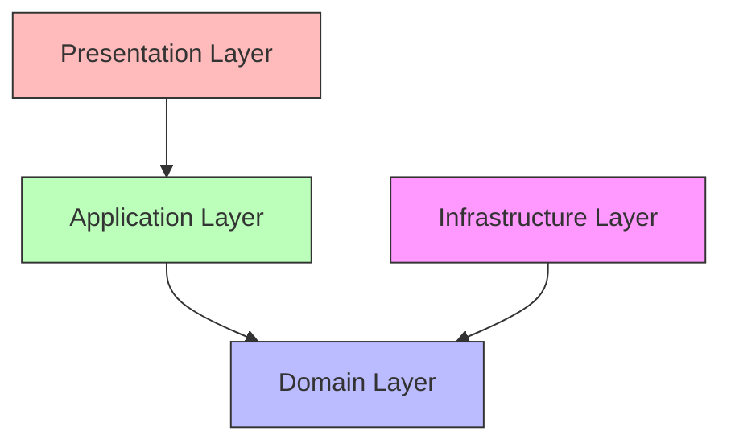

# AI Generation Guidelines

## Purpose

This document defines the guidelines for AI-assisted development of the Automated Cloud-Native Video Transcoding and Streaming Platform.

## Scope

Instructions for AI tools including Claude Code, Lovable, Antigravity, Cursor, and ChatGPT.

## Audience

- AI Development Tools
- Software Engineers
- Technical Leads

## Dependencies

- [00_Project_Standards.md](./00_Project_Standards.md) - Development standards
- [04_System_Architecture.md](./04_System_Architecture.md) - System architecture
- [05_Tech_Stack.md](./05_Tech_Stack.md) - Technology stack

## Related Documents

- [28_Coding_Guidelines.md](./28_Coding_Guidelines.md) - Coding guidelines
- [06_Folder_Structure.md](./06_Folder_Structure.md) - Folder structure

## Table of Contents

1. [AI Development Rules](#ai-development-rules)
2. [Claude Code Instructions](#claude-code-instructions)
3. [Lovable Instructions](#lovable-instructions)
4. [Antigravity Instructions](#antigravity-instructions)
5. [Cursor Instructions](#cursor-instructions)
6. [ChatGPT Instructions](#chatgpt-instructions)
7. [Architecture Rules](#architecture-rules)
8. [Code Standards](#code-standards)
9. [API Conventions](#api-conventions)
10. [Naming Conventions](#naming-conventions)
11. [Module Independence](#module-independence)
12. [Scalability Requirements](#scalability-requirements)
13. [Component Guidelines](#component-guidelines)
14. [Documentation Requirements](#documentation-requirements)
15. [Design Decisions](#design-decisions)
16. [Notes](#notes)
17. [References](#references)
18. [Future Documents](#future-documents)
19. [Revision History](#revision-history)

## AI Development Rules

### Core Principles

1. **Never change technology stack** - The stack is defined in [05_Tech_Stack.md](./05_Tech_Stack.md)
2. **Never change architecture** - The architecture is defined in [04_System_Architecture.md](./04_System_Architecture.md)
3. **Never introduce new libraries without approval** - Use only approved dependencies
4. **Always update documentation when architecture changes** - Keep docs in sync
5. **Follow Clean Architecture** - See [00_Project_Standards.md](./00_Project_Standards.md)
6. **Follow coding standards** - See [28_Coding_Guidelines.md](./28_Coding_Guidelines.md)
7. **Follow API conventions** - See [08_API_Design.md](./08_API_Design.md)
8. **Follow naming conventions** - See [28_Coding_Guidelines.md](./28_Coding_Guidelines.md)
9. **Never duplicate logic** - Use shared services
10. **Keep modules independent** - Clear boundaries
11. **Write scalable code** - Consider performance
12. **Prefer reusable components** - Component-driven design
13. **Keep backend modular** - Module-per-feature
14. **Keep frontend component-driven** - Reusable UI components
15. **Always reference documentation before implementation** - Check existing docs

## Claude Code Instructions

### Before Implementation

```
1. Read all relevant documentation in docs/
2. Check existing code patterns in the codebase
3. Verify technology stack compatibility
4. Ensure no architecture changes are needed
```

### Code Generation

```
1. Use TypeScript strict mode
2. Follow kebab-case for files
3. Use PascalCase for classes
4. Use camelCase for functions/variables
5. Include JSDoc comments
6. Write tests alongside code
7. Use dependency injection
8. Follow Clean Architecture layers
```

### Example Prompt

```
"Implement a video service following the patterns in:
- docs/00_Project_Standards.md
- docs/08_API_Design.md
- docs/28_Coding_Guidelines.md

Use the existing VideoRepository pattern and ensure:
- Proper error handling
- Type safety
- Clean Architecture compliance
- Test coverage
"
```

## Lovable Instructions

### Component Generation

```
1. Use shadcn/ui components
2. Follow Tailwind CSS conventions
3. Implement responsive design
4. Ensure accessibility (WCAG 2.1 AA)
5. Use React Hook Form for forms
6. Use Zod for validation
7. Follow the design system in docs/24_UI_UX.md
```

### State Management

```
1. Use Zustand for global state
2. Use TanStack Query for server state
3. Implement proper loading states
4. Handle errors gracefully
5. Use optimistic updates where appropriate
```

## Antigravity Instructions

### Full-Stack Development

```
1. Generate API endpoints first
2. Create database schema with Prisma
3. Implement backend services
4. Generate frontend components
5. Ensure type safety across stack
6. Follow the API design in docs/08_API_Design.md
```

### Database Operations

```
1. Use Prisma for all database operations
2. Follow naming conventions in docs/07_Database_Schema.md
3. Include proper indexes
4. Use transactions for multi-step operations
5. Implement soft delete where appropriate
```

## Cursor Instructions

### Code Understanding

```
1. Analyze existing patterns before generating
2. Follow the established folder structure
3. Use existing shared utilities
4. Maintain consistency with codebase
5. Check for existing similar implementations
```

### Refactoring

```
1. Maintain backward compatibility
2. Update all references
3. Run tests after changes
4. Update documentation
5. Follow SOLID principles
```

## ChatGPT Instructions

### Code Review

```
1. Check for security vulnerabilities
2. Verify error handling
3. Ensure proper logging
4. Validate input sanitization
5. Check for performance issues
```

### Documentation

```
1. Use clear, concise language
2. Include code examples
3. Add Mermaid diagrams where helpful
4. Cross-reference related documents
5. Follow the documentation template
```

## Architecture Rules

### Clean Architecture



### Layer Responsibilities

| Layer | Responsibility |
|-------|---------------|
| Domain | Business logic, entities |
| Application | Use cases, DTOs |
| Infrastructure | Database, storage, external APIs |
| Presentation | Controllers, API handlers |

## Code Standards

### TypeScript Configuration

```json
{
  "compilerOptions": {
    "target": "ES2022",
    "module": "ESNext",
    "strict": true,
    "noUncheckedIndexedAccess": true,
    "noImplicitAny": true,
    "strictNullChecks": true
  }
}
```

### Code Quality

| Rule | Description |
|------|-------------|
| DRY | Don't Repeat Yourself |
| KISS | Keep It Simple, Stupid |
| YAGNI | You Aren't Gonna Need It |
| Single Responsibility | One reason to change |

## API Conventions

### RESTful Design

| Convention | Example |
|------------|---------|
| Plural resources | `/videos`, `/users` |
| HTTP methods | GET, POST, PATCH, DELETE |
| Status codes | 200, 201, 400, 401, 404, 500 |
| Versioning | `/api/v1/` |

### Response Format

```typescript
interface ApiResponse<T> {
  data: T;
  meta: {
    timestamp: string;
    requestId: string;
  };
}
```

## Naming Conventions

### File and Directory Names

| Type | Convention | Example |
|------|------------|---------|
| Files | kebab-case | `video-transcoder.ts` |
| Directories | kebab-case | `video-processing/` |
| Components | kebab-case | `video-card.tsx` |

### Code Names

| Type | Convention | Example |
|------|------------|---------|
| Variables | camelCase | `videoMetadata` |
| Functions | camelCase | `transcodeVideo()` |
| Classes | PascalCase | `VideoTranscoder` |
| Interfaces | PascalCase | `VideoMetadata` |
| Constants | UPPER_SNAKE_CASE | `MAX_FILE_SIZE` |

## Module Independence

### Module Structure

```
modules/
├── video/
│   ├── application/
│   ├── domain/
│   ├── infrastructure/
│   └── presentation/
├── user/
│   └── ...
└── auth/
    └── ...
```

### Module Boundaries

- Each module is self-contained
- Shared code goes in `shared/`
- Modules communicate through interfaces
- No direct module-to-module dependencies

## Scalability Requirements

### Performance Targets

| Metric | Target |
|--------|--------|
| API response time | < 100ms p95 |
| Video processing | < 2x video duration |
| Concurrent uploads | 1000+ |
| Cache hit ratio | > 80% |

### Scaling Patterns

```typescript
// Horizontal scaling
const worker = new Worker('transcode', async (job) => {
  // Stateless processing
}, { concurrency: 4 });
```

## Component Guidelines

### Frontend Components

```tsx
// Use shadcn/ui
import { Button } from '@/components/ui/button';
import { Card } from '@/components/ui/card';

// Follow responsive design
<div className="grid grid-cols-1 md:grid-cols-2 lg:grid-cols-3">
  {items.map(item => <Card key={item.id}>{item.name}</Card>)}
</div>
```

### Backend Services

```typescript
// Use dependency injection
@Injectable()
export class VideoService {
  constructor(
    private readonly videoRepository: VideoRepository,
    private readonly storageService: StorageService,
  ) {}
}
```

## Documentation Requirements

### Before Implementation

1. Read all relevant documentation
2. Check for existing patterns
3. Verify no architecture changes needed

### After Implementation

1. Update affected documentation
2. Add code examples
3. Include Mermaid diagrams
4. Cross-reference related docs

## Design Decisions

### Decision: AI-Assisted Development

**Status**: Accepted

**Context**: Need for efficient, consistent development.

**Decision**: Use AI tools with strict guidelines.

**Consequences**:
- Faster development
- Consistent code quality
- Reduced human error

## Notes

- All AI-generated code must be reviewed
- Documentation is the source of truth
- Tests are required for all features
- Security is built into every layer

## References

- [Clean Architecture - Robert Martin](https://www.amazon.com/Clean-Architecture-Robert-C-Martin/dp/0134494164)
- [SOLID Principles](https://en.wikipedia.org/wiki/SOLID)

## Future Documents

- None

## Revision History

| Date | Version | Author | Changes |
|------|---------|--------|---------|
| 2024-01-15 | 1.0.0 | Architecture Team | Initial version |