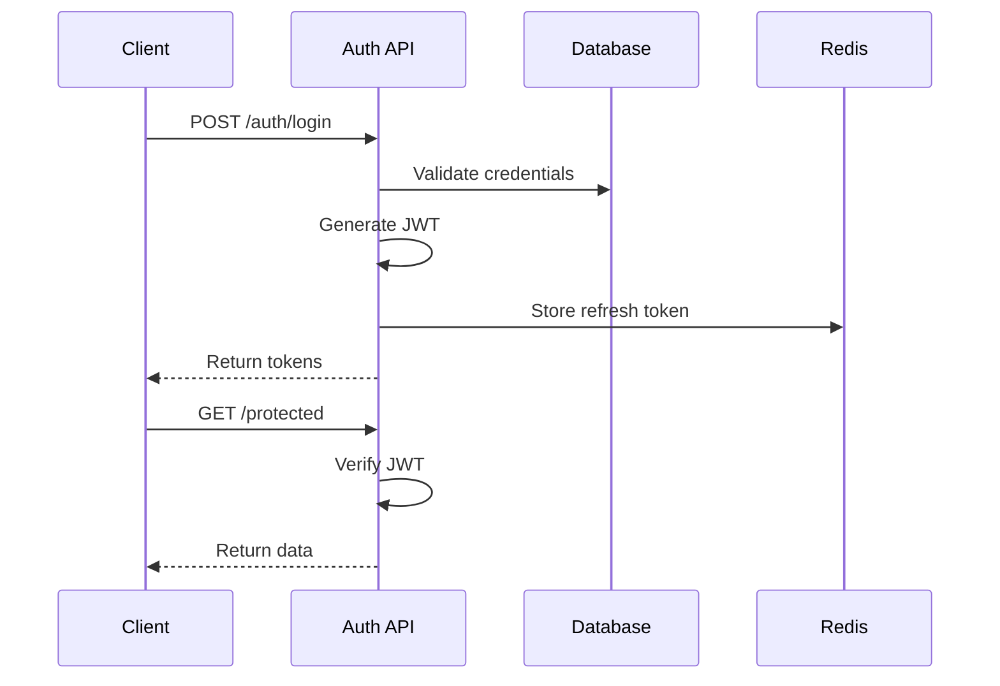
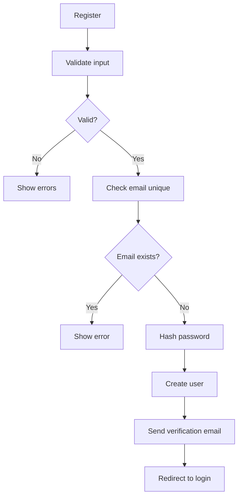
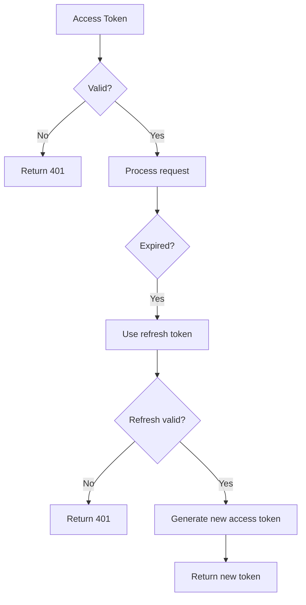
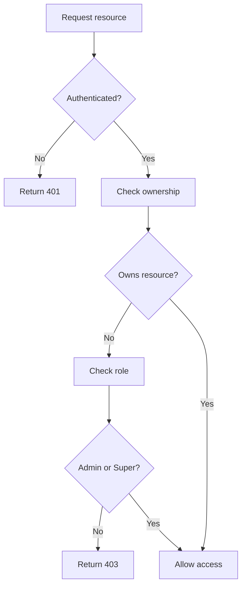
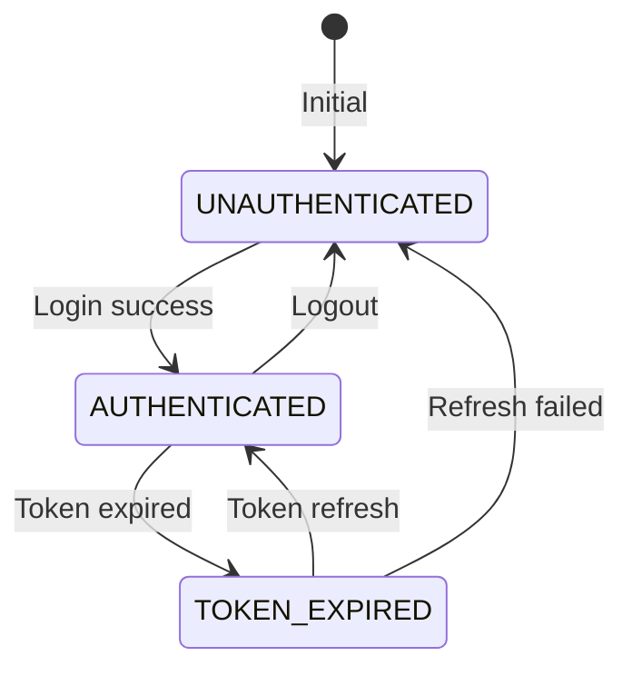
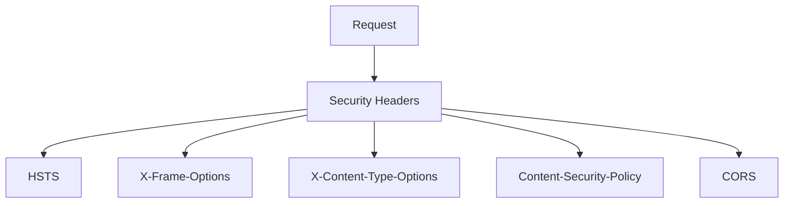

# Authentication Flow

## Purpose

This document defines the authentication flow for the Automated Cloud-Native Video Transcoding and Streaming Platform.

## Scope

Login, registration, token management, and authorization.

## Audience

- Backend Engineers
- Frontend Engineers
- Security Engineers

## Dependencies

- [00_Project_Standards.md](../00_Project_Standards.md) - Development standards
- [09_Authentication.md](../09_Authentication.md) - Authentication
- [10_User_Roles.md](../10_User_Roles.md) - User roles

## Related Documents

- [Upload_Flow.md](./Upload_Flow.md) - Upload
- [Streaming_Flow.md](./Streaming_Flow.md) - Streaming

## Authentication Flow Diagram

## Registration Flow

## Token Flow

## Authorization Flow

## Token State Machine

## Security Headers

## Design Decisions

### Decision: JWT with Refresh Tokens

**Status**: Accepted

**Context**: Need for stateless, scalable authentication.

**Decision**: Use JWT with short-lived access tokens and refresh tokens.

**Consequences**:
- Stateless authentication
- Token rotation
- Secure logout

## Notes

- All tokens are signed with strong secret
- Refresh tokens are stored in database
- Access tokens are short-lived (15 min)
- Rate limiting is applied to auth endpoints

## References

- [JWT.io](https://jwt.io)
- [OWASP Authentication](https://cheatsheetseries.owasp.org/cheatsheets/Authentication_Cheat_Sheet.html)

## Revision History

| Date | Version | Author | Changes |
|------|---------|--------|---------|
| 2024-01-15 | 1.0.0 | Security Team | Initial version |