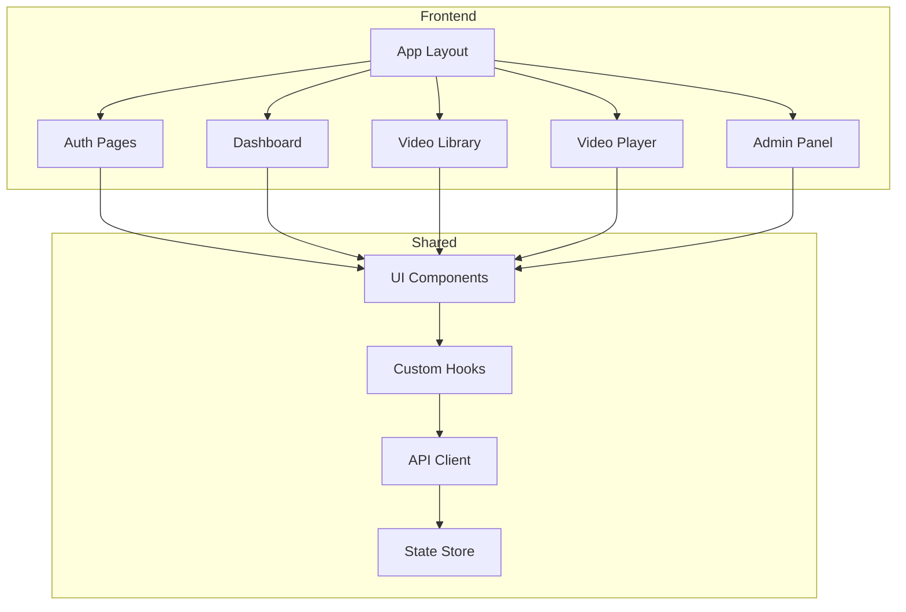
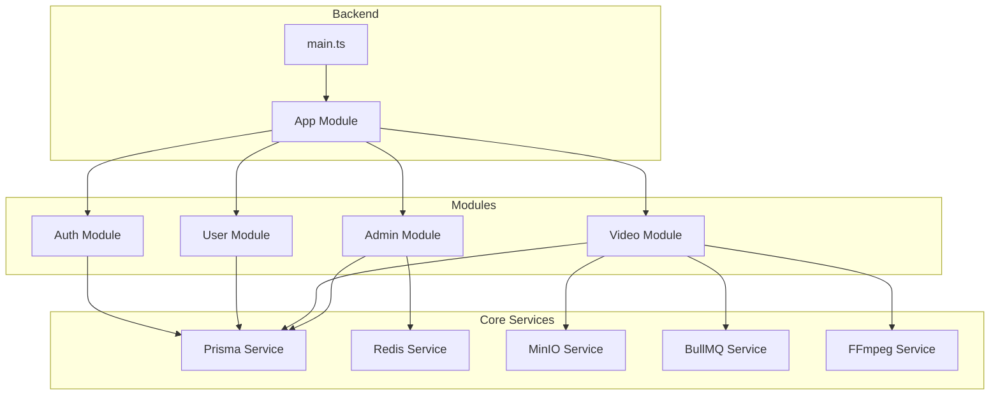
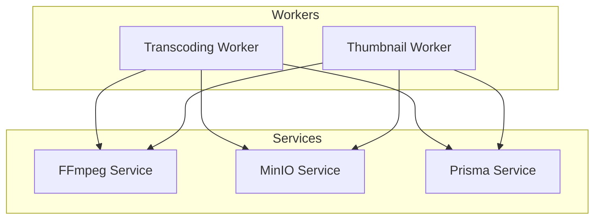
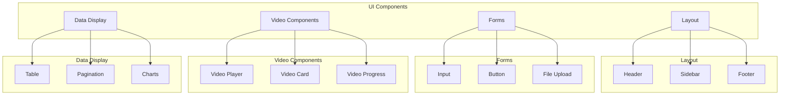
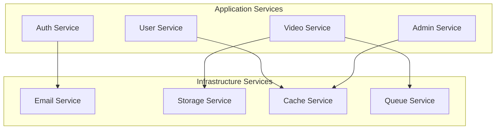

# Component Diagram

## Purpose

This document provides component diagrams for the Automated Cloud-Native Video Transcoding and Streaming Platform.

## Scope

Frontend components, backend modules, and their interactions.

## Audience

- Frontend Engineers
- Backend Engineers
- System Architects

## Dependencies

- [00_Project_Standards.md](../00_Project_Standards.md) - Development standards
- [06_Folder_Structure.md](../06_Folder_Structure.md) - Folder structure
- [24_UI_UX.md](../24_UI_UX.md) - UI/UX

## Related Documents

- [Low_Level_Architecture.md](./Low_Level_Architecture.md) - Architecture
- [ER_Diagram.md](./ER_Diagram.md) - Database

## Frontend Component Diagram

## Backend Component Diagram

## Worker Component Diagram

## UI Component Hierarchy

## Service Layer

## Design Decisions

### Decision: Component-Based Architecture

**Status**: Accepted

**Context**: Need for maintainable, reusable code.

**Decision**: Use component-based architecture for both frontend and backend.

**Consequences**:
- Reusable components
- Clear boundaries
- Easy to test

## Notes

- All components are documented
- Components follow naming conventions
- Shared components are in shared directory
- UI components use shadcn/ui

## References

- [React Documentation](https://react.dev)
- [NestJS Documentation](https://docs.nestjs.com)

## Revision History

| Date | Version | Author | Changes |
|------|---------|--------|---------|
| 2024-01-15 | 1.0.0 | Architecture Team | Initial version |