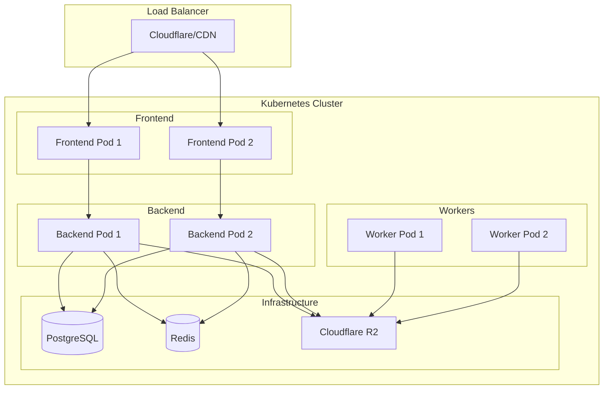
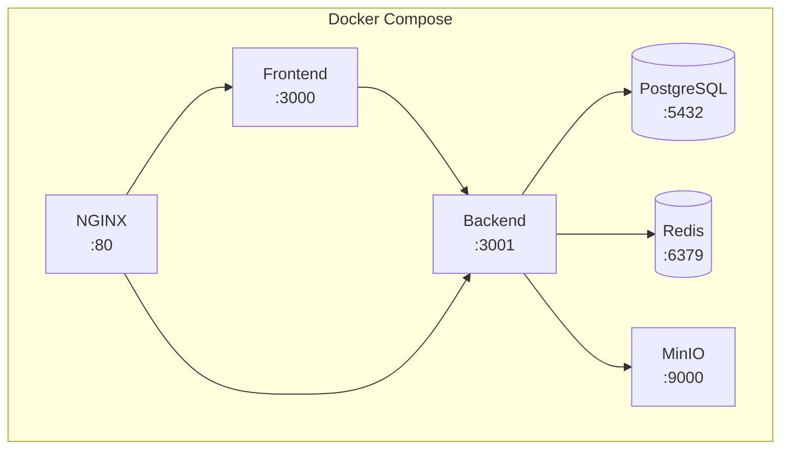
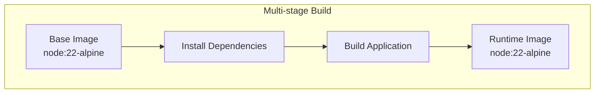
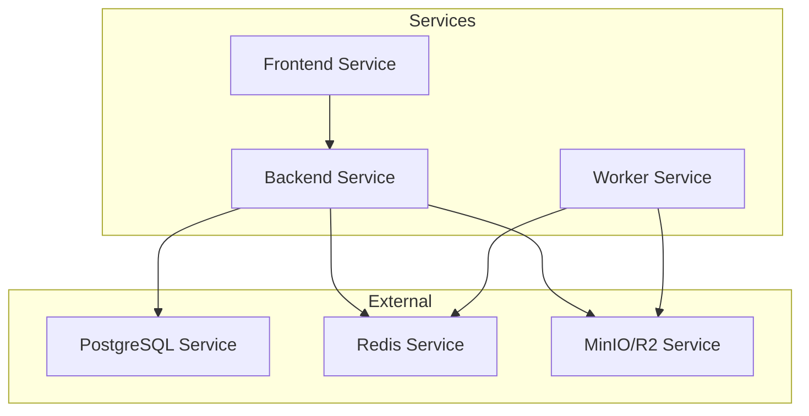
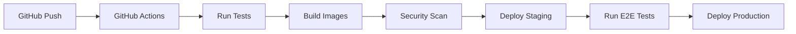

# Deployment Diagram

## Purpose

This document defines the deployment architecture for the Automated Cloud-Native Video Transcoding and Streaming Platform.

## Scope

Infrastructure, containers, and deployment configurations.

## Audience

- DevOps Engineers
- System Administrators
- Engineering Teams

## Dependencies

- [00_Project_Standards.md](../00_Project_Standards.md) - Development standards
- [16_Deployment.md](../16_Deployment.md) - Deployment
- [05_Tech_Stack.md](../05_Tech_Stack.md) - Technology stack

## Related Documents

- [High_Level_Architecture.md](./High_Level_Architecture.md) - Architecture
- [Storage_Flow.md](./Storage_Flow.md) - Storage

## Deployment Diagram



## Development Environment



## Container Architecture



## Kubernetes Deployment

```yaml
apiVersion: apps/v1
kind: Deployment
metadata:
  name: backend
spec:
  replicas: 3
  selector:
    matchLabels:
      app: backend
  template:
    spec:
      containers:
      - name: backend
        image: video-streaming/backend:latest
        ports:
        - containerPort: 3001
        envFrom:
        - secretRef:
            name: video-streaming-secrets
        resources:
          limits:
            cpu: '2'
            memory: '4G'
```

## Service Configuration



## CI/CD Pipeline



## Design Decisions

### Decision: Docker-based Deployment

**Status**: Accepted

**Context**: Need for consistent, reproducible deployments.

**Decision**: Use Docker containers for all services.

**Consequences**:
- Consistent environments
- Easy scaling
- Container overhead

### Decision: Kubernetes for Production

**Status**: Accepted

**Context**: Need for production orchestration.

**Decision**: Use Kubernetes for production deployment.

**Consequences**:
- Auto-scaling
- Self-healing
- Complex setup

## Notes

- All deployments are automated
- Health checks are required
- Rollback procedures are documented
- Monitoring is integrated

## References

- [Docker Documentation](https://docs.docker.com)
- [Kubernetes Documentation](https://kubernetes.io/docs)

## Revision History

| Date | Version | Author | Changes |
|------|---------|--------|---------|
| 2024-01-15 | 1.0.0 | DevOps Team | Initial version |