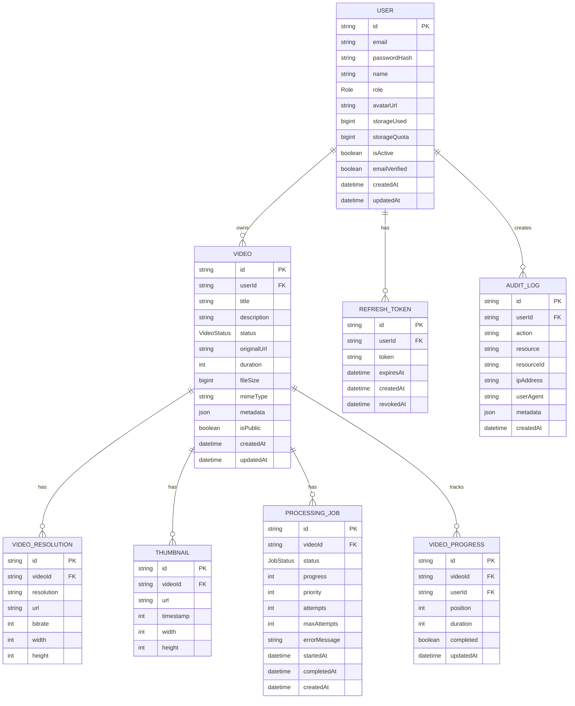
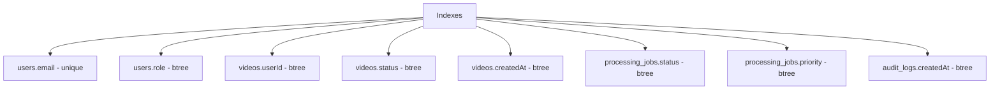

# ER Diagram

## Purpose

This document provides the Entity Relationship diagram for the Automated Cloud-Native Video Transcoding and Streaming Platform.

## Scope

Database schema, relationships, and constraints.

## Audience

- Database Architects
- Backend Engineers
- System Architects

## Dependencies

- [00_Project_Standards.md](../00_Project_Standards.md) - Development standards
- [07_Database_Schema.md](../07_Database_Schema.md) - Database schema
- [05_Tech_Stack.md](../05_Tech_Stack.md) - Technology stack

## Related Documents

- [Storage_Flow.md](./Storage_Flow.md) - Storage
- [Queue_Flow.md](./Queue_Flow.md) - Queue

## ER Diagram

## Entity Descriptions

### User

| Field | Type | Description |
|-------|------|-------------|
| id | String (PK) | Unique identifier |
| email | String (unique) | User email |
| passwordHash | String | Bcrypt hashed password |
| name | String | User display name |
| role | Role (enum) | USER, ADMIN, SUPER_ADMIN |
| storageUsed | BigInt | Bytes used |
| storageQuota | BigInt | Bytes allowed |
| isActive | Boolean | Account status |
| emailVerified | Boolean | Email verification |

### Video

| Field | Type | Description |
|-------|------|-------------|
| id | String (PK) | Unique identifier |
| userId | String (FK) | Owner reference |
| title | String | Video title |
| status | VideoStatus | PENDING, PROCESSING, COMPLETED, FAILED |
| originalUrl | String | Original video URL |
| duration | Int | Duration in seconds |
| fileSize | BigInt | File size in bytes |
| isPublic | Boolean | Public visibility |

### VideoResolution

| Field | Type | Description |
|-------|------|-------------|
| id | String (PK) | Unique identifier |
| videoId | String (FK) | Video reference |
| resolution | String | 240p, 360p, etc. |
| url | String | HLS manifest URL |
| bitrate | Int | Video bitrate |
| width | Int | Video width |
| height | Int | Video height |

### Thumbnail

| Field | Type | Description |
|-------|------|-------------|
| id | String (PK) | Unique identifier |
| videoId | String (FK) | Video reference |
| url | String | Thumbnail URL |
| timestamp | Int | Seconds from start |

## Relationship Cardinality

| Relationship | Cardinality |
|--------------|-------------|
| User to Video | One-to-Many |
| User to RefreshToken | One-to-Many |
| Video to VideoResolution | One-to-Many |
| Video to Thumbnail | One-to-Many |
| Video to ProcessingJob | One-to-Many |
| User to AuditLog | One-to-Many |

## Indexes

## Design Decisions

### Decision: Soft Delete

**Status**: Accepted

**Context**: Need to maintain data for audit and recovery.

**Decision**: Use soft delete with deletedAt timestamp.

**Consequences**:
- Data recovery possible
- Audit trail maintained
- Queries must filter deleted records

## Notes

- All tables use cuid() for primary keys
- Timestamps are in UTC
- Soft delete is implemented for all entities
- Foreign keys use CASCADE delete

## References

- [PostgreSQL Documentation](https://www.postgresql.org/docs/)
- [Prisma Documentation](https://www.prisma.io/docs)

## Revision History

| Date | Version | Author | Changes |
|------|---------|--------|---------|
| 2024-01-15 | 1.0.0 | Database Team | Initial version |