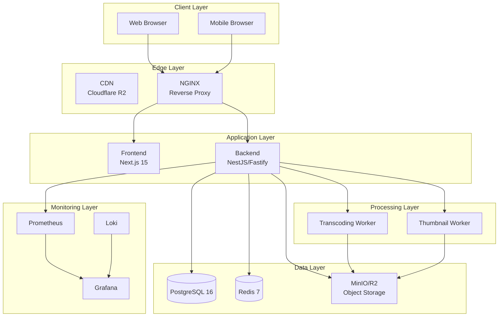
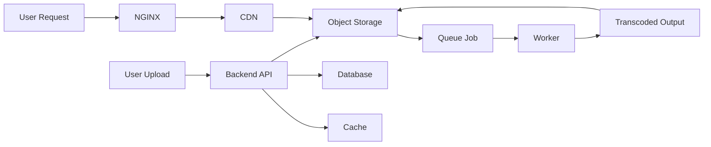
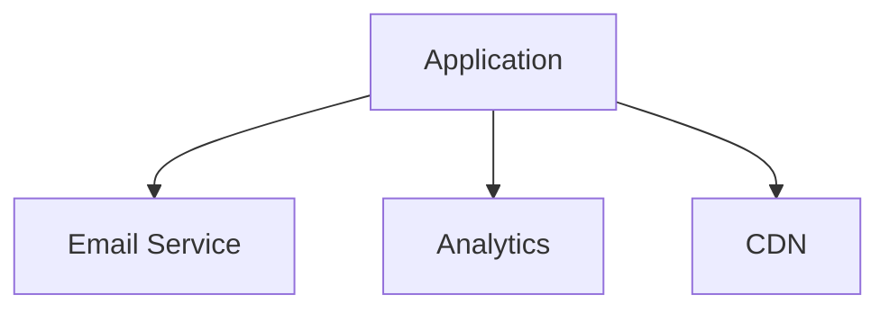

# High Level Architecture

## Purpose

This document provides a high-level architectural overview of the Automated Cloud-Native Video Transcoding and Streaming Platform.

## Scope

System components, data flow, and external integrations.

## Audience

- Solution Architects
- Engineering Teams
- DevOps Engineers
- Stakeholders

## Dependencies

- [00_Project_Standards.md](../00_Project_Standards.md) - Development standards
- [04_System_Architecture.md](../04_System_Architecture.md) - System architecture
- [05_Tech_Stack.md](../05_Tech_Stack.md) - Technology stack

## Related Documents

- [Low_Level_Architecture.md](./Low_Level_Architecture.md) - Low-level details
- [Deployment_Diagram.md](./Deployment_Diagram.md) - Deployment

## High Level Architecture Diagram

## Component Descriptions

### Client Layer

| Component | Description |
|-----------|-------------|
| Web Browser | Primary user interface for desktop users |
| Mobile Browser | Responsive interface for mobile users |

### Edge Layer

| Component | Description |
|-----------|-------------|
| CDN | Content delivery network for video streaming |
| NGINX | Reverse proxy, load balancing, caching |

### Application Layer

| Component | Description |
|-----------|-------------|
| Frontend | Next.js 15 application with React 19 |
| Backend | NestJS API with Fastify server |

### Processing Layer

| Component | Description |
|-----------|-------------|
| Transcoding Worker | FFmpeg-based video processing |
| Thumbnail Worker | Thumbnail and preview generation |

### Data Layer

| Component | Description |
|-----------|-------------|
| PostgreSQL | Primary database for metadata |
| Redis | Cache and job queue |
| Object Storage | Video files and assets |

### Monitoring Layer

| Component | Description |
|-----------|-------------|
| Prometheus | Metrics collection |
| Grafana | Visualization dashboards |
| Loki | Log aggregation |

## Data Flow

## External Integrations

## Design Decisions

### Decision: Cloud-Native Architecture

**Status**: Accepted

**Context**: Need for scalability and deployment flexibility.

**Decision**: Build as cloud-native, container-first platform.

**Consequences**:
- Docker-based deployment
- Stateless services
- Horizontal scaling

### Decision: Modular Monolith

**Status**: Accepted

**Context**: Need for fast initial development.

**Decision**: Start with modular monolith, migrate to microservices.

**Consequences**:
- Faster initial development
- Clear service boundaries
- Future migration path

## Notes

- All components are containerized
- Services are stateless where possible
- Monitoring is comprehensive
- Security is built into every layer

## References

- [Clean Architecture - Robert Martin](https://www.amazon.com/Clean-Architecture-Robert-C-Martin/dp/0134494164)
- [Twelve-Factor App](https://12factor.net)

## Revision History

| Date | Version | Author | Changes |
|------|---------|--------|---------|
| 2024-01-15 | 1.0.0 | Architecture Team | Initial version |