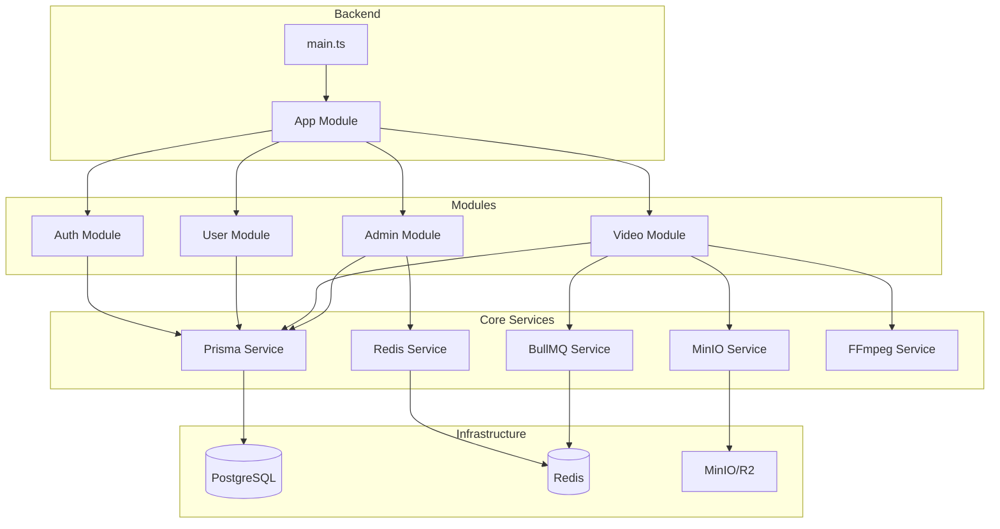
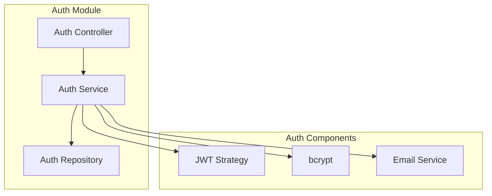
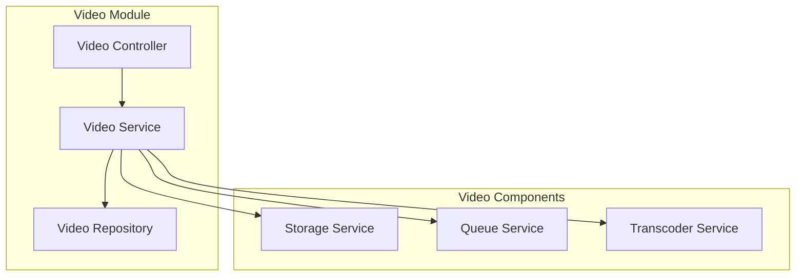
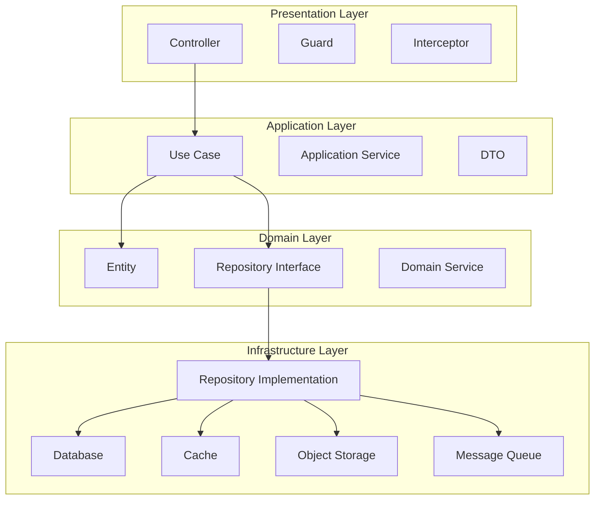
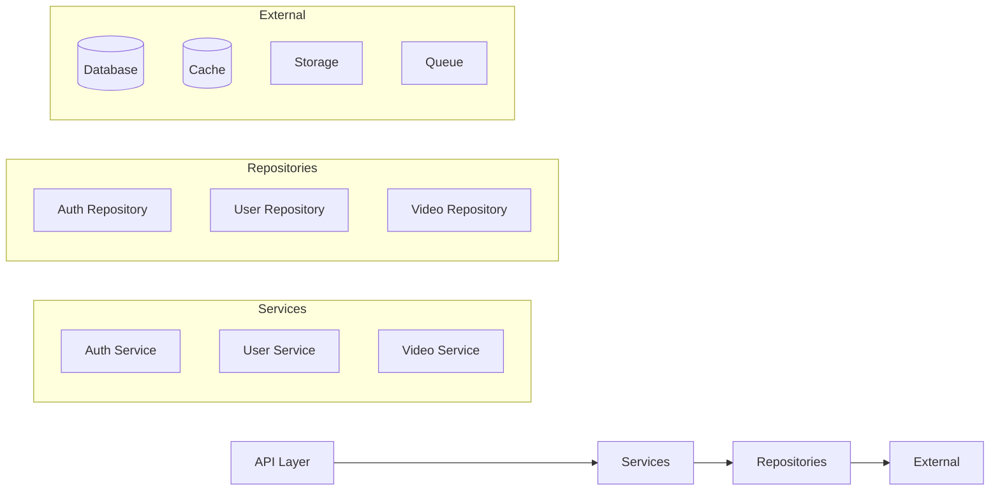
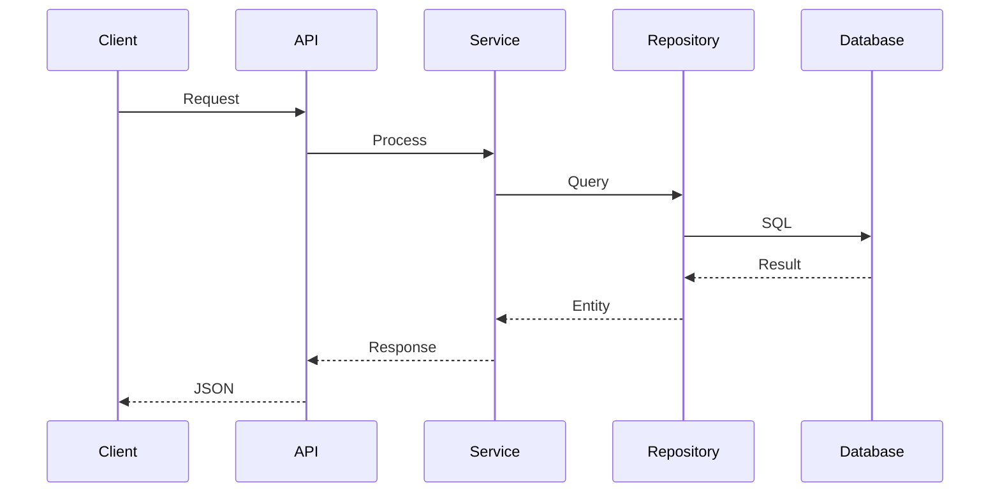

# Low Level Architecture

## Purpose

This document provides low-level architectural details of the Automated Cloud-Native Video Transcoding and Streaming Platform.

## Scope

Internal component structure, module interactions, and data flow.

## Audience

- Backend Engineers
- System Architects
- DevOps Engineers

## Dependencies

- [00_Project_Standards.md](../00_Project_Standards.md) - Development standards
- [04_System_Architecture.md](../04_System_Architecture.md) - System architecture
- [06_Folder_Structure.md](../06_Folder_Structure.md) - Folder structure

## Related Documents

- [High_Level_Architecture.md](./High_Level_Architecture.md) - High-level overview
- [Component_Diagram.md](./Component_Diagram.md) - Component details

## Low Level Architecture Diagram

## Module Architecture

### Auth Module

### Video Module

## Clean Architecture Layers

## Service Dependencies

## Data Flow

## Design Decisions

### Decision: Dependency Injection

**Status**: Accepted

**Context**: Need for testable, flexible code.

**Decision**: Use NestJS dependency injection.

**Consequences**:
- Easy to test
- Flexible configuration
- Clear dependencies

## Notes

- All modules follow Clean Architecture
- Services are stateless
- Repositories abstract data access
- External services are injected

## References

- [NestJS Documentation](https://docs.nestjs.com)
- [Clean Architecture](https://www.amazon.com/Clean-Architecture-Robert-C-Martin/dp/0134494164)

## Revision History

| Date | Version | Author | Changes |
|------|---------|--------|---------|
| 2024-01-15 | 1.0.0 | Architecture Team | Initial version |