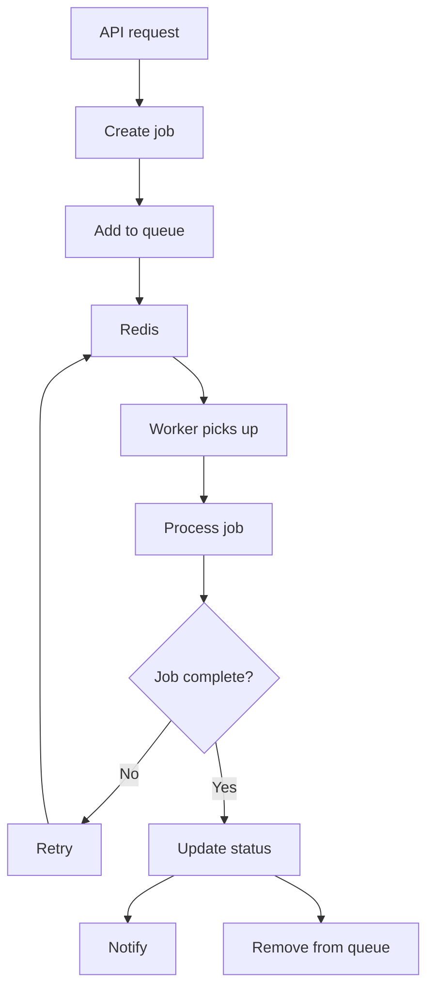
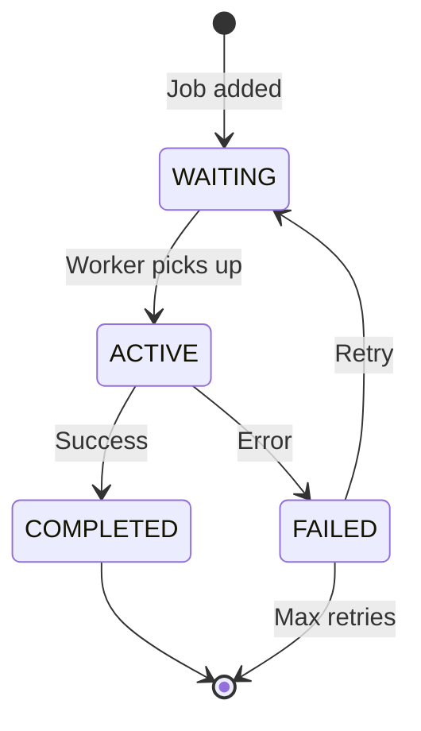
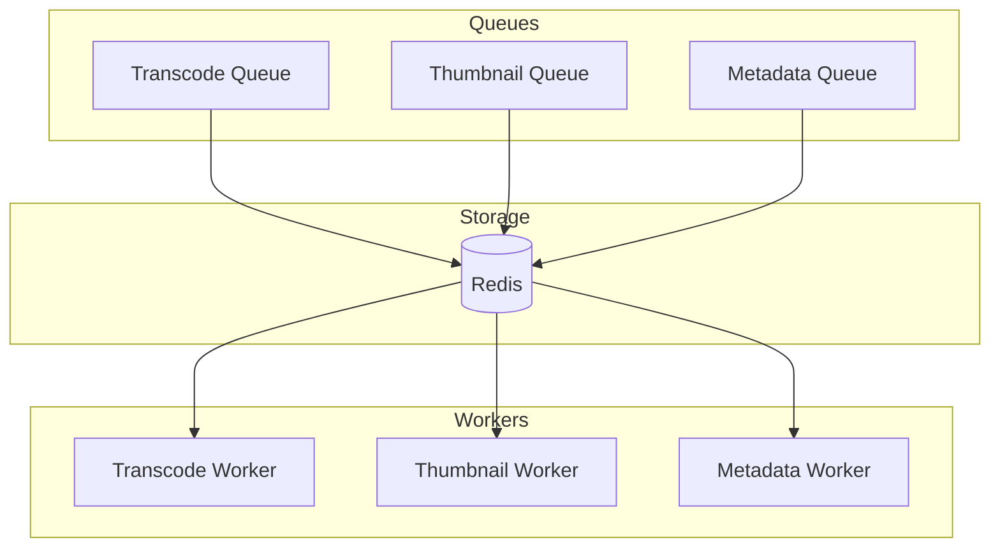
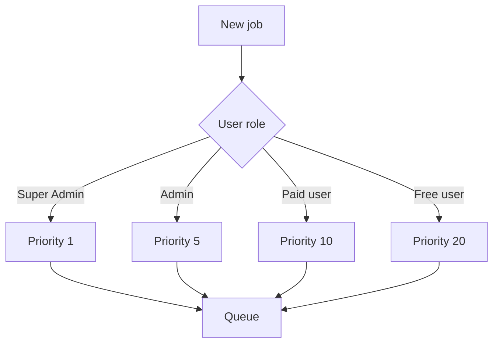
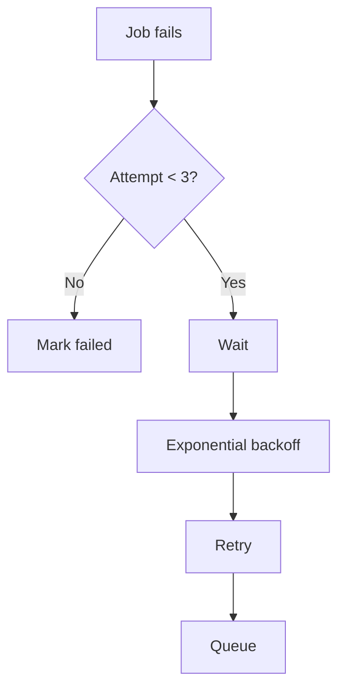
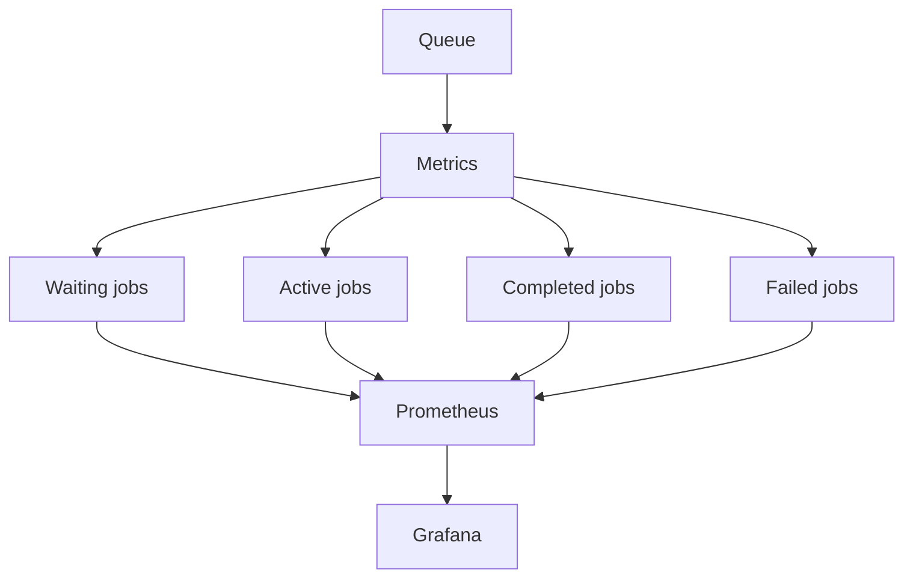

# Queue Flow

## Purpose

This document defines the job queue flow for the Automated Cloud-Native Video Transcoding and Streaming Platform.

## Scope

BullMQ queue management, worker processing, and job lifecycle.

## Audience

- Backend Engineers
- DevOps Engineers
- System Architects

## Dependencies

- [00_Project_Standards.md](../00_Project_Standards.md) - Development standards
- [12_Queue_System.md](../12_Queue_System.md) - Queue system
- [21_Background_Jobs.md](../21_Background_Jobs.md) - Background jobs

## Related Documents

- [Transcoding_Flow.md](./Transcoding_Flow.md) - Transcoding
- [Storage_Flow.md](./Storage_Flow.md) - Storage

## Queue Flow Diagram

## Job Lifecycle

## Queue Architecture

## Priority System

## Retry Strategy

## Monitoring

## Design Decisions

### Decision: BullMQ

**Status**: Accepted

**Context**: Need for Redis-based job queue with good Node.js support.

**Decision**: Use BullMQ for job queue management.

**Consequences**:
- Redis dependency
- Good Node.js integration
- Built-in retry and scheduling

## Notes

- Workers are stateless
- Jobs are idempotent
- Queue metrics are exposed
- Dead letter queue for failed jobs

## References

- [BullMQ Documentation](https://docs.bullmq.io)

## Revision History

| Date | Version | Author | Changes |
|------|---------|--------|---------|
| 2024-01-15 | 1.0.0 | Backend Team | Initial version |