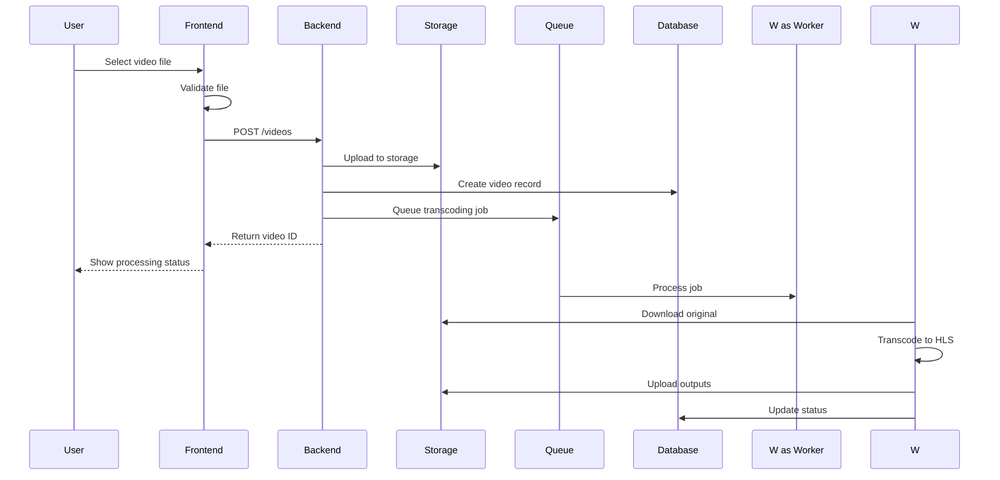
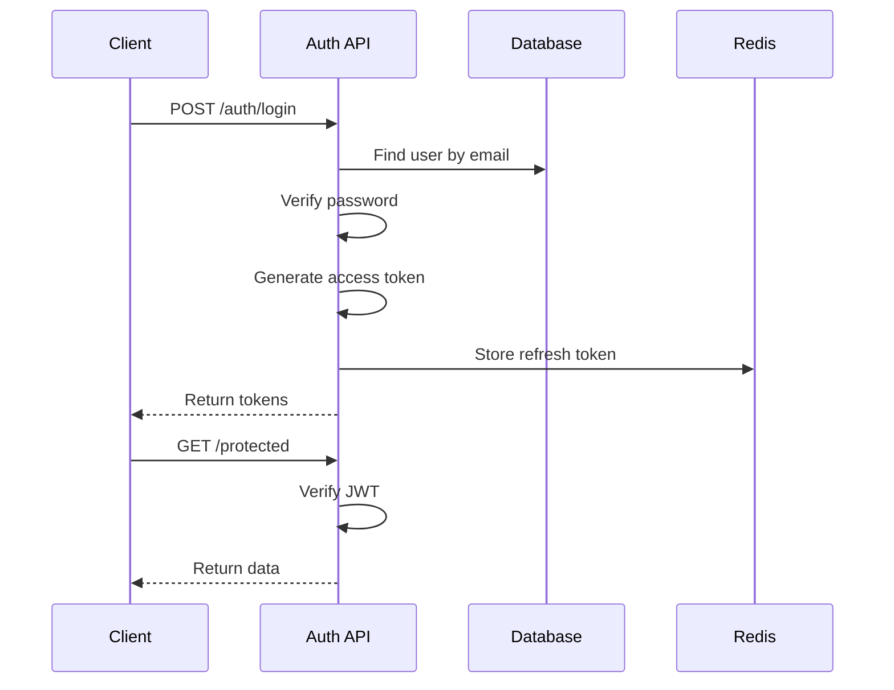
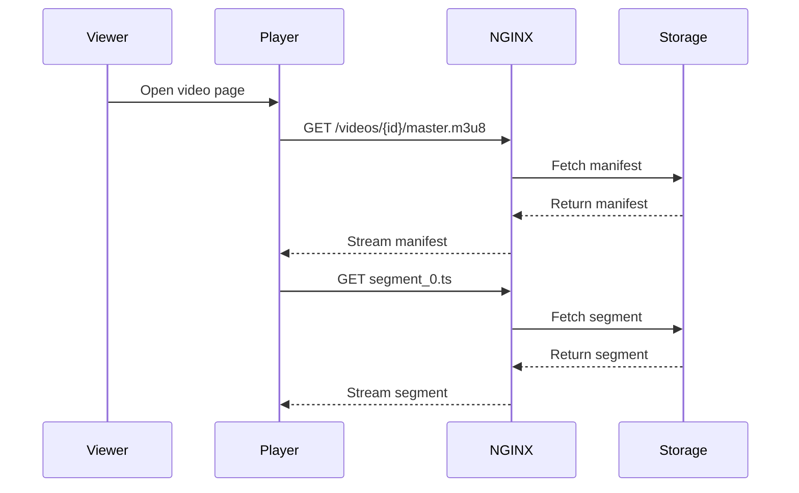
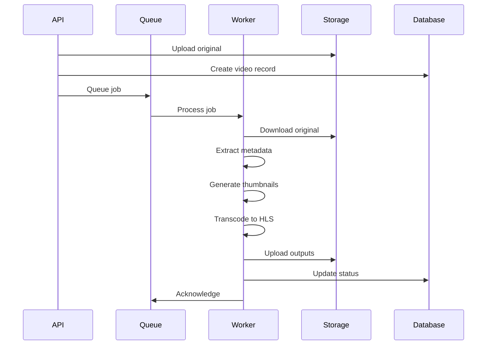
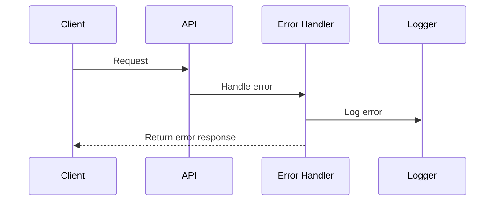
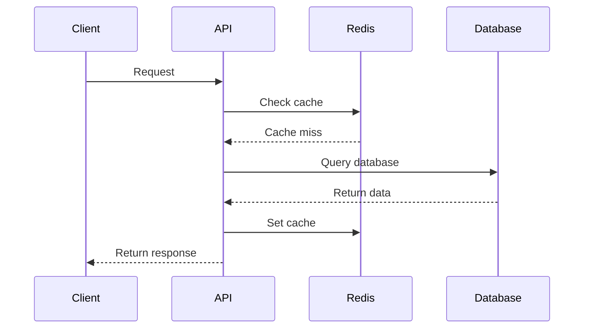

# Sequence Diagrams

## Purpose

This document provides sequence diagrams for the Automated Cloud-Native Video Transcoding and Streaming Platform.

## Scope

API interactions, data flow, and system workflows.

## Audience

- Backend Engineers
- System Architects
- QA Engineers

## Dependencies

- [00_Project_Standards.md](../00_Project_Standards.md) - Development standards
- [08_API_Design.md](../08_API_Design.md) - API design
- [11_Workflow.md](../11_Workflow.md) - Workflow

## Related Documents

- [Authentication_Flow.md](./Authentication_Flow.md) - Authentication
- [Transcoding_Flow.md](./Transcoding_Flow.md) - Transcoding

## Video Upload Sequence

## Authentication Sequence

## Video Streaming Sequence

## Transcoding Sequence

## Error Handling Sequence

## Cache Sequence

## Design Decisions

### Decision: Sequence Diagrams

**Status**: Accepted

**Context**: Need for clear API interaction documentation.

**Decision**: Use Mermaid sequence diagrams for all workflows.

**Consequences**:
- Clear documentation
- Easy to understand
- Version control friendly

## Notes

- All sequences follow REST conventions
- Error handling is consistent
- Caching is implemented
- Security is built in

## References

- [Mermaid Documentation](https://mermaid.js.org)

## Revision History

| Date | Version | Author | Changes |
|------|---------|--------|---------|
| 2024-01-15 | 1.0.0 | Architecture Team | Initial version |