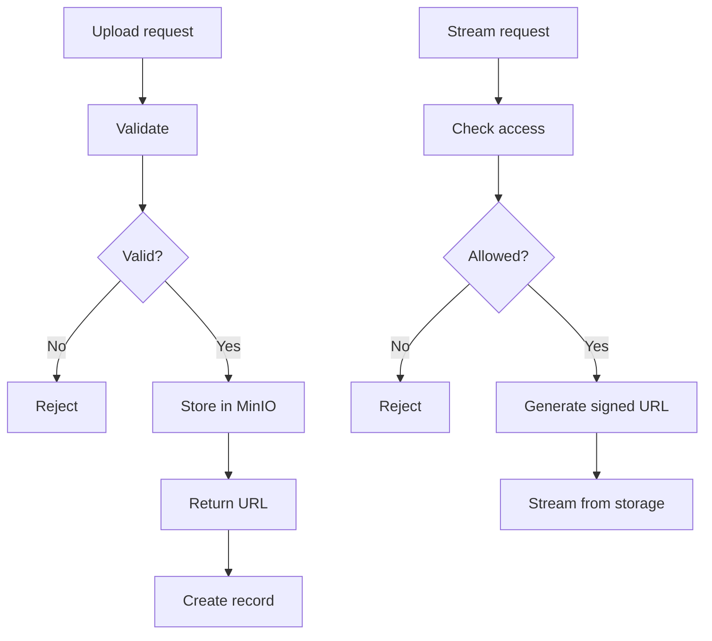
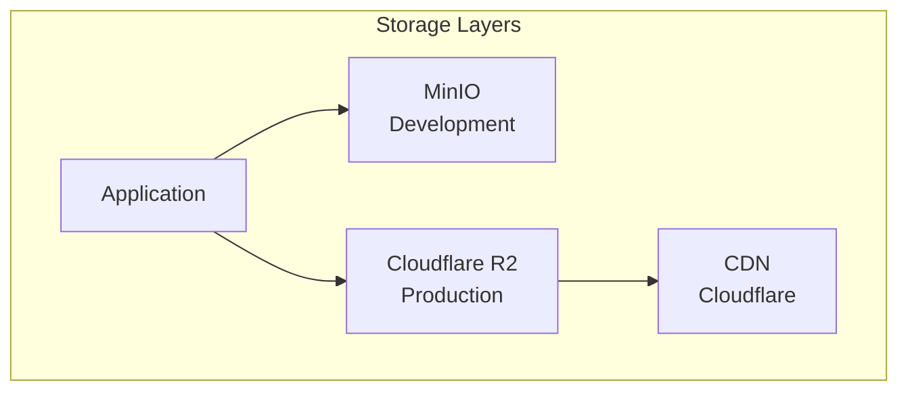
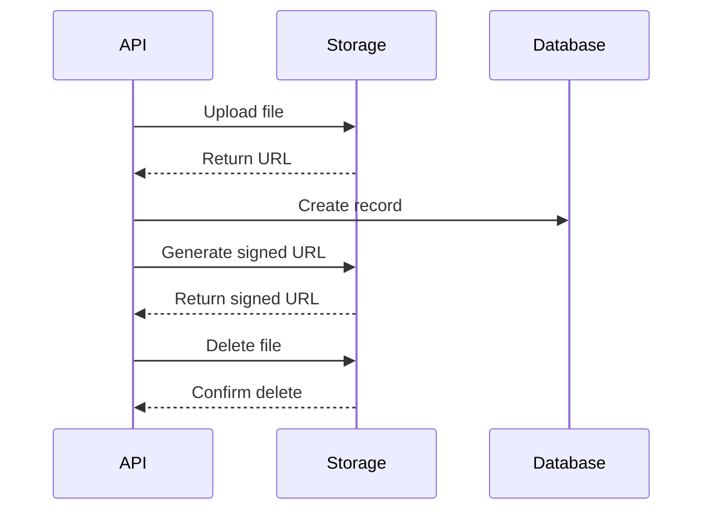
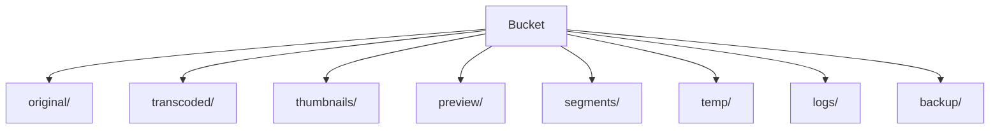
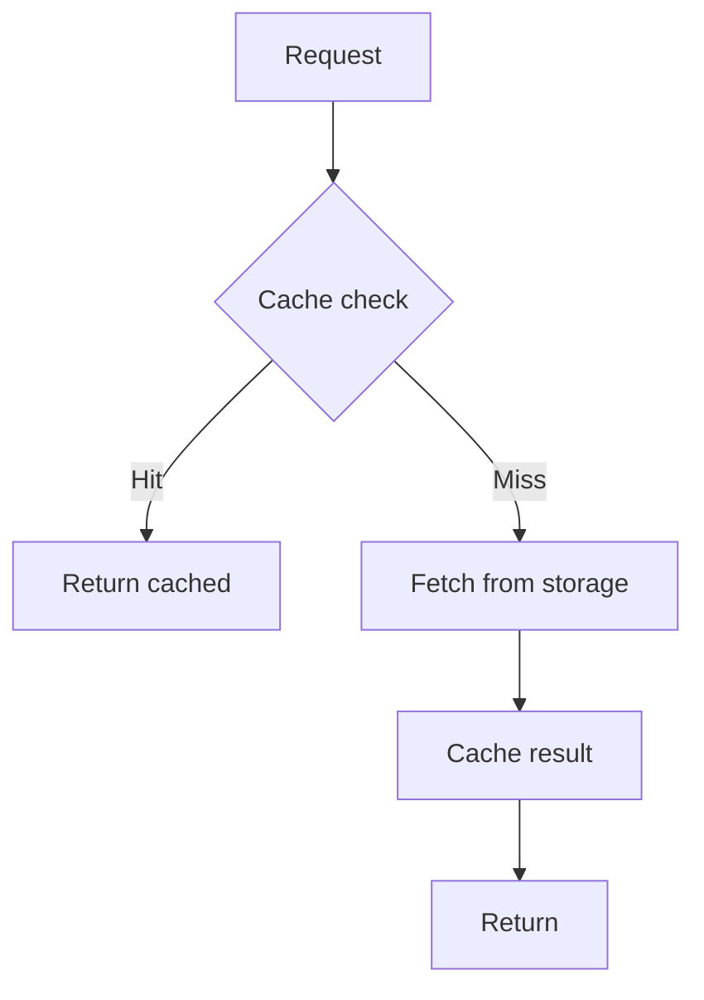
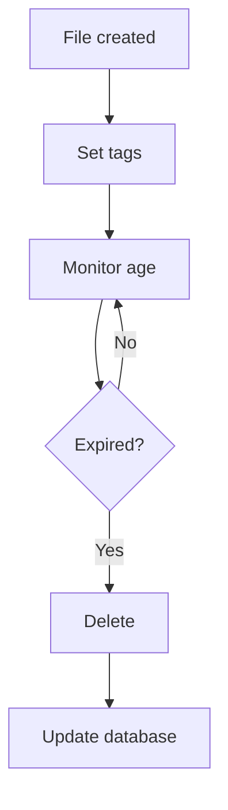
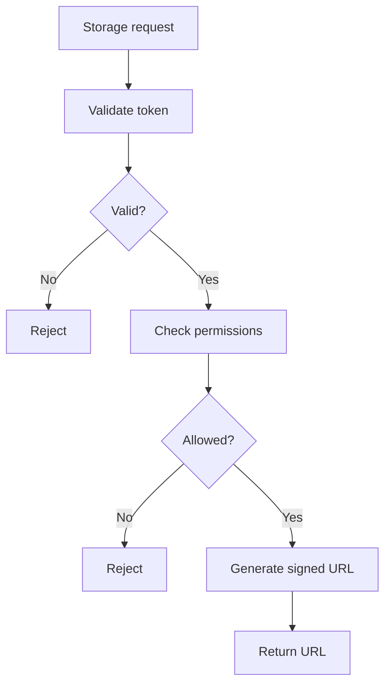

# Storage Flow

## Purpose

This document defines the storage flow for the Automated Cloud-Native Video Transcoding and Streaming Platform.

## Scope

Object storage operations, file management, and CDN integration.

## Audience

- Backend Engineers
- DevOps Engineers
- System Architects

## Dependencies

- [00_Project_Standards.md](../00_Project_Standards.md) - Development standards
- [13_Storage_Architecture.md](../13_Storage_Architecture.md) - Storage
- [33_Bucket_Structure.md](../33_Bucket_Structure.md) - Bucket structure

## Related Documents

- [Upload_Flow.md](./Upload_Flow.md) - Upload
- [Transcoding_Flow.md](./Transcoding_Flow.md) - Transcoding

## Storage Flow Diagram

## Storage Architecture

## File Operations

## Directory Structure

## Cache Strategy

## Lifecycle Management

## Security Flow

## Design Decisions

### Decision: MinIO for Development

**Status**: Accepted

**Context**: Need for S3-compatible storage in development.

**Decision**: Use MinIO locally, Cloudflare R2 in production.

**Consequences**:
- Same API for both environments
- No vendor lock-in
- Easy local development

## Notes

- All files are stored with UUID-based names
- Storage is isolated per environment
- CDN is optional for production
- Lifecycle rules are automated

## References

- [MinIO Documentation](https://min.io/docs)
- [Cloudflare R2 Documentation](https://developers.cloudflare.com/r2)

## Revision History

| Date | Version | Author | Changes |
|------|---------|--------|---------|
| 2024-01-15 | 1.0.0 | Infrastructure Team | Initial version |