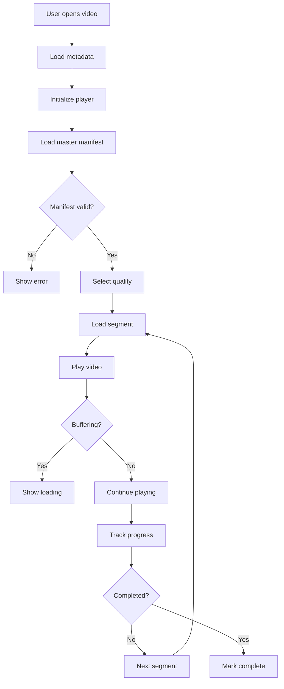
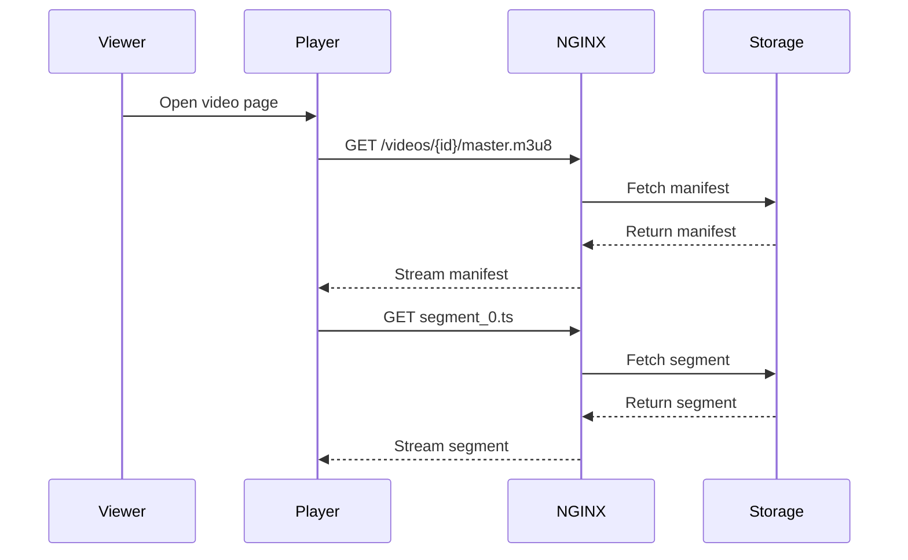
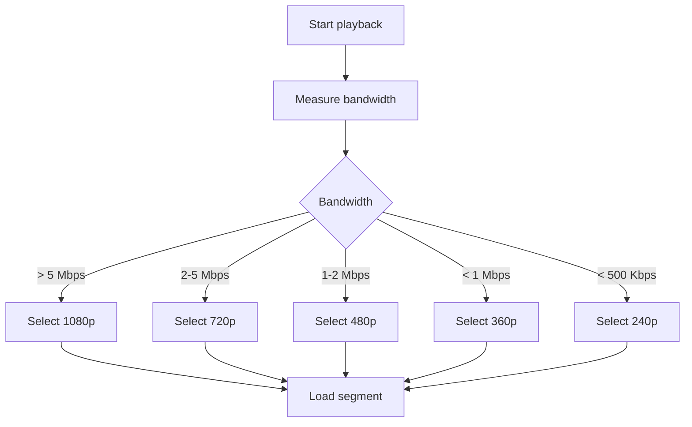
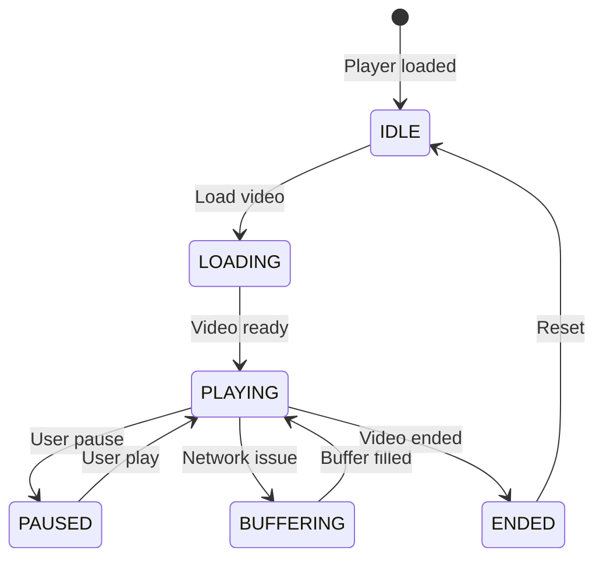
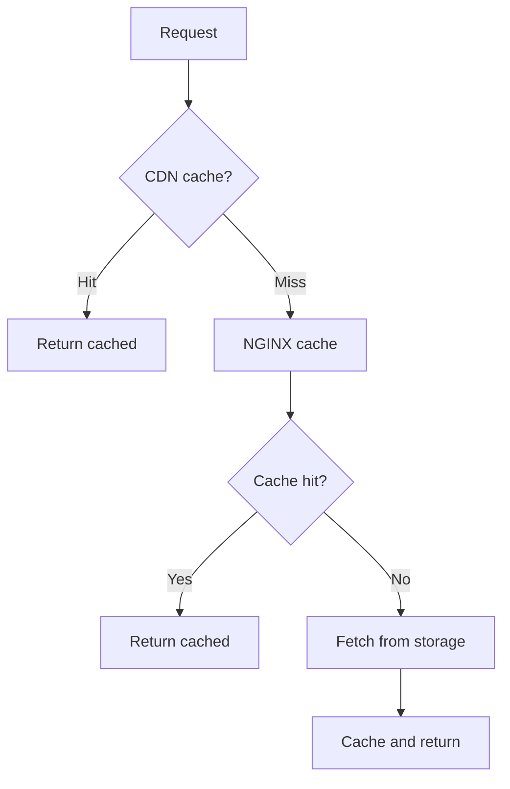
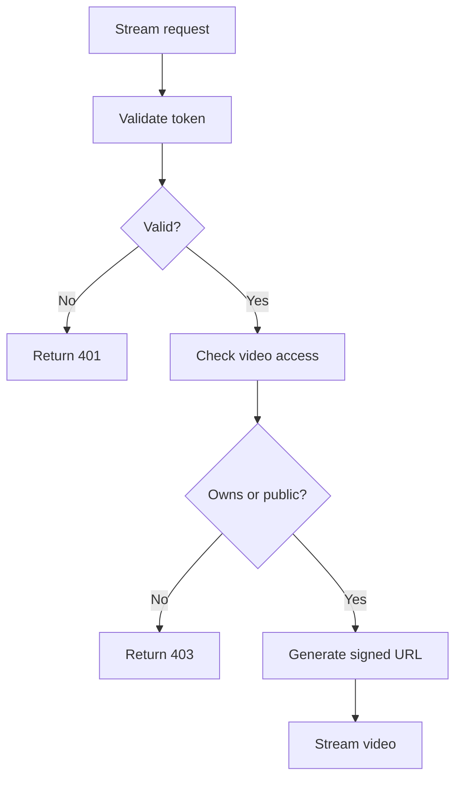

# Streaming Flow

## Purpose

This document defines the video streaming flow for the Automated Cloud-Native Video Transcoding and Streaming Platform.

## Scope

HLS streaming, player integration, and adaptive quality.

## Audience

- Backend Engineers
- Frontend Engineers
- DevOps Engineers

## Dependencies

- [00_Project_Standards.md](../00_Project_Standards.md) - Development standards
- [14_Streaming_Architecture.md](../14_Streaming_Architecture.md) - Streaming
- [13_Storage_Architecture.md](../13_Storage_Architecture.md) - Storage

## Related Documents

- [Authentication_Flow.md](./Authentication_Flow.md) - Authentication
- [Storage_Flow.md](./Storage_Flow.md) - Storage

## Streaming Flow Diagram

## HLS Flow

## Adaptive Quality Flow

## Player State Machine

## Cache Flow

## Security Flow

## Design Decisions

### Decision: HLS Protocol

**Status**: Accepted

**Context**: Need for adaptive streaming with broad compatibility.

**Decision**: Use HLS as the primary streaming protocol.

**Consequences**:
- Apple device support
- Industry standard
- Requires segment generation

## Notes

- HLS is the only supported format
- Player is responsive
- Quality selection is automatic
- Cache headers are set appropriately

## References

- [HLS Specification](https://tools.ietf.org/html/draft-pantos-http-live-streaming)
- [Video.js Documentation](https://videojs.com/docs)

## Revision History

| Date | Version | Author | Changes |
|------|---------|--------|---------|
| 2024-01-15 | 1.0.0 | Streaming Team | Initial version |