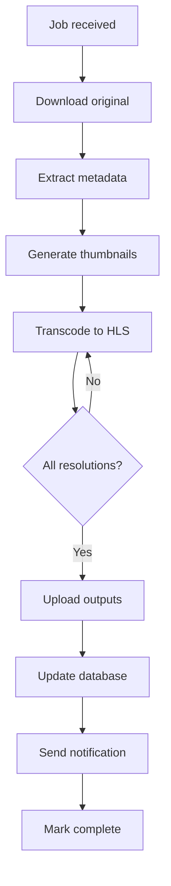
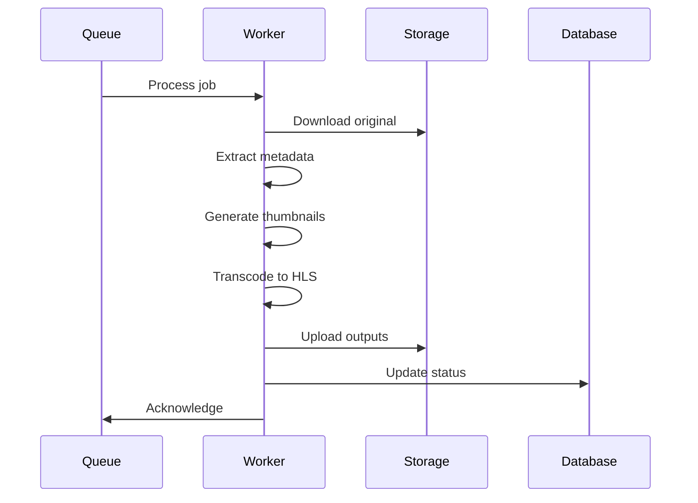
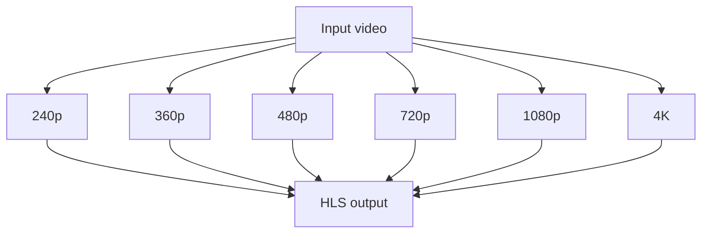
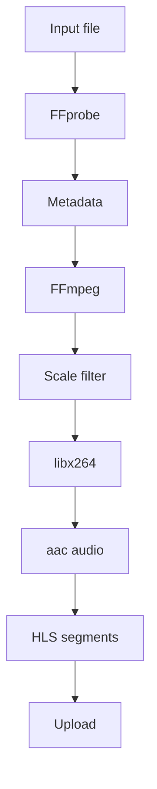
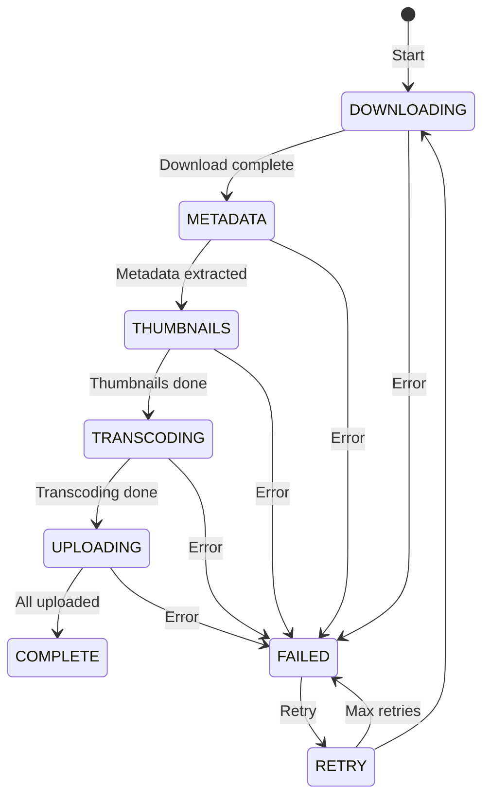
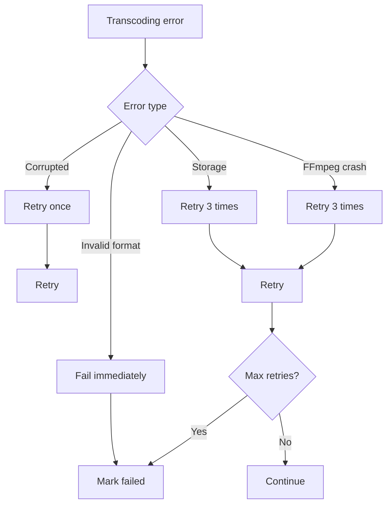

# Transcoding Flow

## Purpose

This document defines the video transcoding flow for the Automated Cloud-Native Video Transcoding and Streaming Platform.

## Scope

FFmpeg processing, output generation, and quality control.

## Audience

- Backend Engineers
- Video Engineers
- DevOps Engineers

## Dependencies

- [00_Project_Standards.md](../00_Project_Standards.md) - Development standards
- [15_Transcoding_Pipeline.md](../15_Transcoding_Pipeline.md) - Transcoding
- [32_FFmpeg_Profiles.md](../32_FFmpeg_Profiles.md) - FFmpeg profiles

## Related Documents

- [Queue_Flow.md](./Queue_Flow.md) - Queue
- [Storage_Flow.md](./Storage_Flow.md) - Storage

## Transcoding Flow Diagram

## Processing Steps

## Resolution Processing

## FFmpeg Processing

## Progress Tracking

## Error Handling

## Design Decisions

### Decision: Parallel Processing

**Status**: Accepted

**Context**: Need for faster video processing.

**Decision**: Process all resolutions in parallel.

**Consequences**:
- Faster processing
- More CPU usage
- Better user experience

## Notes

- FFmpeg runs in Docker container
- Processing is CPU-intensive
- Output is stored in object storage
- Progress is tracked in real-time

## References

- [FFmpeg Documentation](https://ffmpeg.org/documentation.html)
- [HLS Specification](https://tools.ietf.org/html/draft-pantos-http-live-streaming)

## Revision History

| Date | Version | Author | Changes |
|------|---------|--------|---------|
| 2024-01-15 | 1.0.0 | Video Team | Initial version |