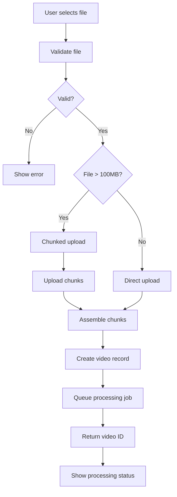
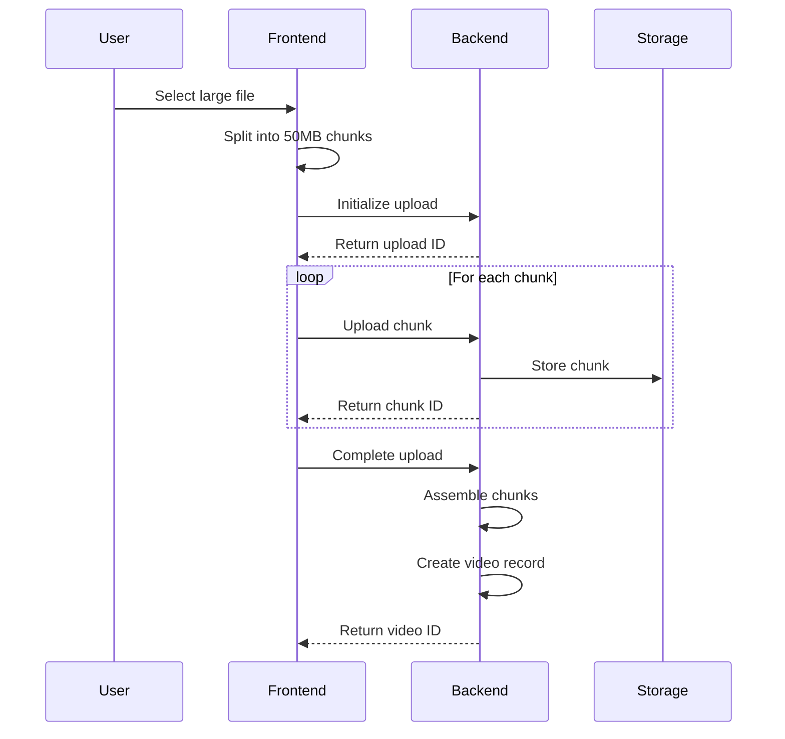
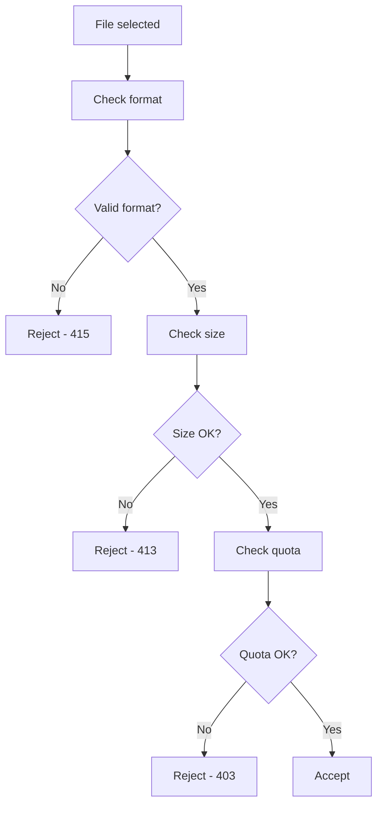
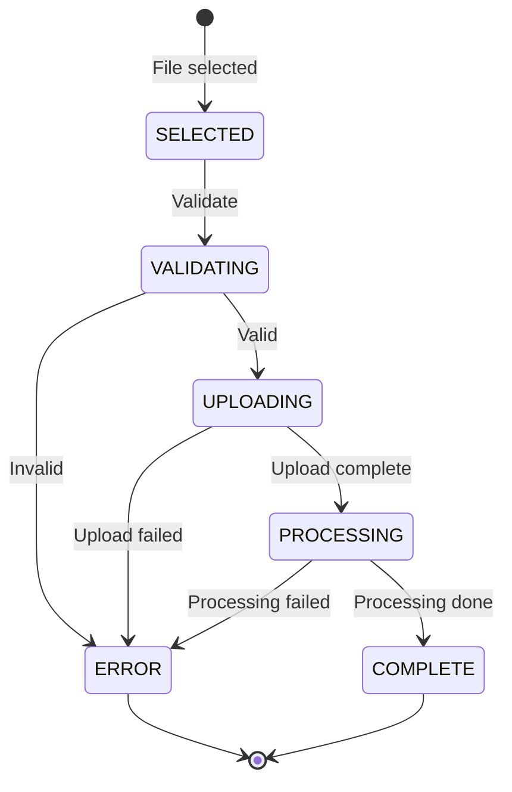
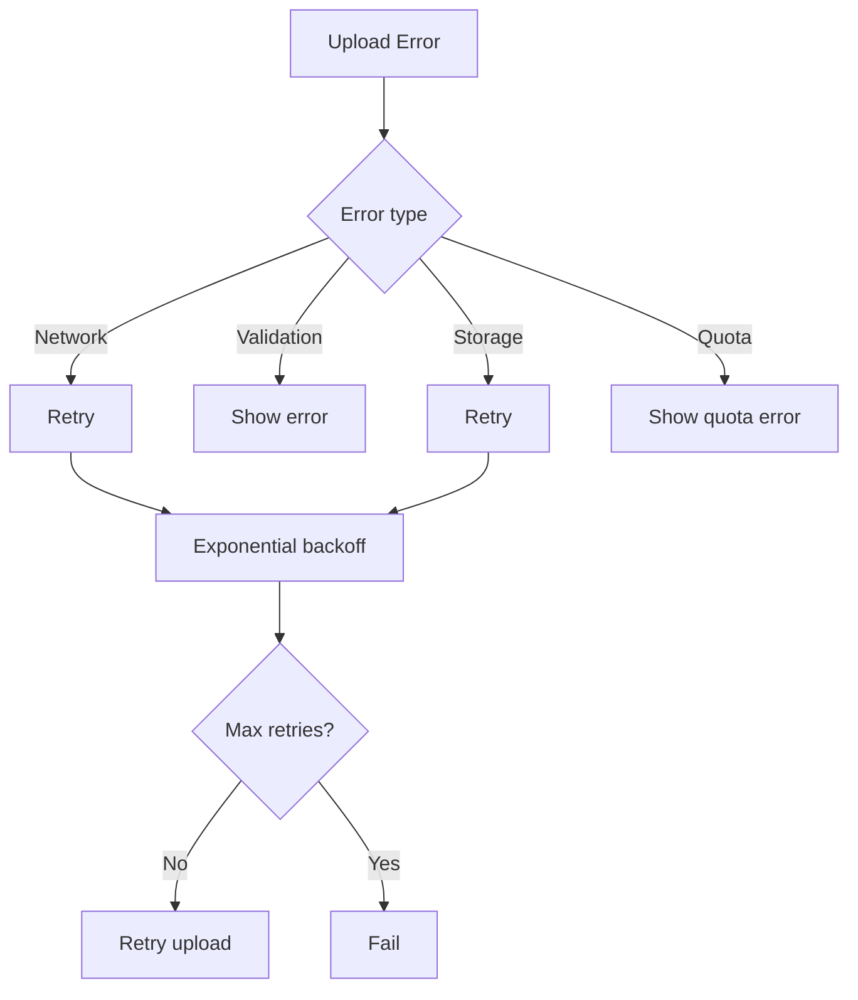

# Upload Flow

## Purpose

This document defines the video upload flow for the Automated Cloud-Native Video Transcoding and Streaming Platform.

## Scope

Upload process, validation, and processing initiation.

## Audience

- Backend Engineers
- Frontend Engineers
- DevOps Engineers

## Dependencies

- [00_Project_Standards.md](../00_Project_Standards.md) - Development standards
- [11_Workflow.md](../11_Workflow.md) - Workflow
- [31_File_Upload_Policy.md](../31_File_Upload_Policy.md) - Upload policy

## Related Documents

- [Storage_Flow.md](./Storage_Flow.md) - Storage
- [Transcoding_Flow.md](./Transcoding_Flow.md) - Transcoding

## Upload Flow Diagram

## Chunked Upload Flow

## Validation Flow

## Upload States

## Error Handling

## Design Decisions

### Decision: 50MB Chunk Size

**Status**: Accepted

**Context**: Balance between reliability and overhead.

**Decision**: Use 50MB chunks for large file uploads.

**Consequences**:
- Good for most connections
- Reasonable number of chunks
- Memory efficient

## Notes

- All uploads are validated
- Chunked upload for files > 100MB
- Progress is tracked
- Errors are handled gracefully

## References

- [OWASP File Upload](https://cheatsheetseries.owasp.org/cheatsheets/File_Upload_Cheat_Sheet.html)

## Revision History

| Date | Version | Author | Changes |
|------|---------|--------|---------|
| 2024-01-15 | 1.0.0 | Backend Team | Initial version |